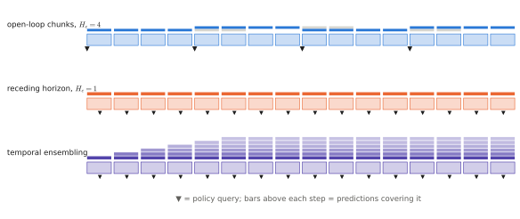

# 8.6 Action Chunking and Temporal Ensembling

Every VLA in Chapter 10 predicts **chunks** of future actions rather than one action per observation. The reasons have already appeared in pieces. Chunks amortise expensive inference over many control steps ([6.6](../06-generative/sampling-cost.md)), reduce the number of decisions over which errors compound ([7.3](../07-decision-making/covariate-shift.md)), and let a stochastic policy commit to one mode over time instead of dithering ([6.1](../06-generative/multimodality.md)). This section gathers them into a design: how long the chunks are, how much of each to execute, and how to blend overlapping predictions.

## What is it?

!!! definition "Chunked execution"
    At query times $t_j$ the policy samples $\mathbf{A}_{t_j}=(\hat{\mathbf{a}}_{t_j},\dots,\hat{\mathbf{a}}_{t_j+H_a-1})\sim\pi_\theta(\cdot\mid\mathbf{o}_{t_j},\ell)$. Three execution schemes:

    1. **Open-loop chunks**: execute the first $H_e\le H_a$ actions, then query again: $t_{j+1}=t_j+H_e$.
    2. **Receding horizon**: $H_e=1$: query every step, execute only the first action (model-predictive-control style).
    3. **Temporal ensembling** (ACT): query every step; the executed action at time $t$ averages all predictions made for $t$ by recent chunks,

    $$
    \mathbf{a}_t=\frac{\sum_{i}w_i\,\hat{\mathbf{a}}_t^{(i)}}{\sum_iw_i},\qquad w_i=\exp(-m\,i),
    $$

    where $\hat{\mathbf{a}}_t^{(i)}$ is the prediction for step $t$ from the $i$-th oldest chunk that covers $t$, and $m\ge0$ sets how strongly older predictions are favoured.

| Symbol | Meaning |
|---|---|
| $H_a$ | predicted horizon (ACT: 100 at 50 Hz; Diffusion Policy: 16; π0: 50) |
| $H_e$ | executed horizon before replanning (Diffusion Policy: 8) |
| $m$ | ensembling decay; larger $m$ trusts older predictions more (with ACT's convention $i=0$ is the oldest) |

## Why does it exist?

Each scheme sits differently on a three-way trade-off:

| | Open-loop chunks ($H_e$ large) | Receding horizon ($H_e=1$) | Temporal ensembling |
|---|---|---|---|
| inference calls per step | $1/H_e$ | 1 | 1 |
| **reactivity** to new observations | low | high | medium (new predictions are averaged with old) |
| **consistency** across steps | high within a chunk; a jump at each boundary | low: each step may sample a new mode | high: averaging smooths |
| handling of **multimodality** | commits to one mode per chunk | may switch mode every step → dithering | averaging two modes gives their mean |

The last row hides a real danger. Ensembling *averages*: if consecutive chunks chose different modes, the executed action is their mean, exactly the regression-to-the-mean failure that a generative head was meant to avoid. ACT is deterministic at test time ($\mathbf{z}=\mathbf{0}$), so its consecutive chunks are consistent and averaging them only smooths. With a stochastic flow or diffusion head, ensembling is safe only if consecutive samples stay in the same mode.

<figure markdown="span">
  
  <figcaption markdown="span">Three ways to execute action chunks, shown on a timeline of control steps. Open-loop chunks execute part of each prediction and then re-query. Receding horizon re-queries every step and keeps only the first action. Temporal ensembling re-queries every step and averages every prediction that covers the current step (shading = weight).</figcaption>
</figure>

## How does it work?

### Choosing $H_a$ and $H_e$

- **Longer $H_a$** captures longer-range structure and makes training targets smoother. But predictions far in the future are uncertain, and the policy must model a higher-dimensional distribution.
- **$H_e$** should be long enough that inference fits in the time it covers ($t_\text{chunk}\le H_e\Delta t$) for synchronous execution, and short enough that the environment does not change much in $H_e\Delta t$: an object moved by a person, a gust hitting a drone.
- Rule of thumb from the literature and from Lab 11: predict more than you execute, $H_e\approx H_a/2$. This is exactly Diffusion Policy's 16/8 split.

### Mode consistency

A flow or diffusion policy re-queried every step draws fresh noise each time, so with an ambiguous instruction it can alternate between goals. Remedies:

1. **execute longer** ($H_e>1$): commit to a mode for the duration of the chunk;
2. **warm start**: initialise the next chunk's noise, or the next chunk itself, from the remainder of the previous one;
3. **inpainting / real-time chunking**: condition the sampler on the actions already committed, so that the new chunk continues them ([6.6](../06-generative/sampling-cost.md#why-does-it-matter-the-control-loop));
4. **ensemble only consistent predictions**: average only when chunks agree, otherwise keep the old one.

### Chunk boundaries

A new chunk starts from a newer observation, so its first action may jump relative to the last executed action of the previous chunk. Jumps excite the robot's dynamics and look jerky. Blending over a few steps, or the inpainting approach, removes them. Smooth low-level controllers ([7.3](../07-decision-making/covariate-shift.md#how-does-it-work-mitigations)) also absorb small jumps.

## Implementation

`vlacourse.depot_env.evaluate` supports all three schemes, stepping many environments in lockstep with batched inference:

```python
# open-loop chunks: re-query every `execute` steps
r = evaluate(policy, n_episodes=200, execute=4)

# receding horizon: re-query every step, execute the first action
r = evaluate(policy, n_episodes=200, execute=1)

# temporal ensembling: re-query every step, average all predictions for the current step
r = evaluate(policy, n_episodes=200, ensemble_m=0.1)

# inside evaluate(), ensembling keeps, per episode, a dict step -> list of predictions:
for h, a in enumerate(chunk):
    preds[i].setdefault(steps[i] + h, []).append(a)
p = preds[i].pop(steps[i])                     # oldest first
w = np.exp(-m * np.arange(len(p)))
a = (w[:, None] * np.array(p)).sum(0) / w.sum()
```

!!! lab "Lab 11, §7"
    Evaluate the flow VLA with $H_e=1,4,8$ and with temporal ensembling, separating ambiguous from specific instructions.

## Limitations

- **Open loop is blind**: within an executed chunk the robot ignores new observations; a moved target or a disturbance is noticed late.
- **Ensembling averages modes** when consecutive chunks disagree.
- **Chunk length is a hyperparameter of the robot and the task**, not only of the model: the right $H_e$ for a slow arm is wrong for a fast drone.

## Why it matters for VLAs and robots

Chunking turns a slow, stochastic generative model into a usable controller. It is also where the learned policy meets real-time constraints most directly. The executed horizon is a latency budget, a reactivity limit and a consistency mechanism at once. For multi-robot teams it adds a coordination question: robots executing open-loop chunks cannot react to each other inside a chunk, which bounds how tightly they can cooperate ([Chapter 14](../14-multi-robot/index.md)).
