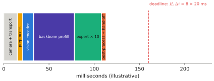

# 8.7 Closed-Loop Execution and Control Rates

A VLA evaluated on held-out demonstrations reports a loss. A VLA on a robot closes a loop: its actions change its next observation, the clock keeps running while it thinks, and a dozen software components sit between its output and the motors. This section assembles the loop and gives the timing model that decides whether it can run. It also catalogues the failure modes that show up only in closed loop. It closes Chapter 8 and prepares the systems engineering of [Chapter 11](../11-deployment/index.md).

## What is it?

!!! definition "The VLA control loop"
    At every query time: (1) **acquire** the latest camera frames and proprioception; (2) **preprocess** them (resize, normalise, tokenise); (3) run the **backbone** and the **action head** to obtain a chunk; (4) **post-process** it (un-normalise, convert frames, clip); (5) **hand off** actions to a lower-level controller at the control rate $1/\Delta t$, which (6) tracks them with feedback until (7) the next chunk arrives. The **end-to-end latency** $t_\text{e2e}$ is the time from the camera exposure behind $\mathbf{o}_t$ to the first execution of an action computed from it.

## Why does it matter?

Three rates coexist and must be consistent:

| Rate | Typical value | Set by |
|---|---|---|
| sensing | camera 30–60 Hz; joint encoders 1 kHz; IMU 200 Hz–1 kHz | hardware |
| **policy** (chunk queries) | 1–10 Hz for large VLAs | $t_\text{e2e}$ and $H_e$ |
| **action** (commands to the controller) | 10–50 Hz for arms; setpoints at 10–50 Hz for drones | dataset recording rate |
| low-level control | 500 Hz–1 kHz (arm torque loops; PX4 attitude loop) | the controller, never the VLA |

The policy must output actions at the **rate it was trained on**. A chunk recorded at 50 Hz executed at 10 Hz moves five times slower than in the demonstrations, and with velocity actions it also travels five times less per action. And the policy must deliver chunks fast enough that the controller never starves: $t_\text{e2e}\le H_e\Delta t$ for synchronous execution, or asynchronous execution with its staleness ([6.6](../06-generative/sampling-cost.md)).

## How does it work?

### A latency budget

<figure markdown="span">
  
  <figcaption markdown="span">Where the time goes in one control step of a chunked VLA (illustrative proportions for a flow-matching VLA on an embedded GPU). Camera transport and preprocessing are often comparable to the model itself. The backbone prefill dominates the model time, and $N$ expert steps add the rest. The chunk must be ready before the previously executed actions run out.</figcaption>
</figure>

The model's share comes from Chapters 2 and 6:

$$
t_\text{model}\approx t_\text{vision}(C\text{ cameras})+t_\text{prefill}(N_\text{tokens})+\begin{cases}H_ad_a\cdot t_\text{decode}&\text{token head}\\N\cdot t_\text{expert}&\text{flow head}\end{cases}
$$

The *non-model* share is easy to forget and often comparable: camera driver and USB/network transport (5–30 ms), image resizing and normalisation in Python (several ms), host↔GPU copies, middleware serialisation (ROS 2 messages; [Chapter 11](../11-deployment/index.md)), and the controller's own interpolation. Measure end to end with timestamps, not only `model(x)`.

### Closed-loop failure modes

| Failure | What you see | Usual cause |
|---|---|---|
| **dithering** | the robot hesitates between two targets or grasps | stochastic head re-queried every step; ambiguous instruction ([8.6](chunking.md)) |
| **freezing / stalling** | the robot stops before finishing | demonstrations with pauses; copycat use of proprioception ([8.2](inputs.md)); near-zero actions near goals |
| **drift** | slow divergence from the intended path | compounding error ([7.3](../07-decision-making/covariate-shift.md)), delta actions without feedback |
| **jerk at chunk boundaries** | visible jumps every $H_e$ steps | new chunk inconsistent with the executed tail |
| **late reaction** | collision with something that moved | long $H_e$, high latency |
| **out-of-distribution panic** | erratic motions after a disturbance | states absent from the data |
| **timing mismatch** | motions too fast/slow, overshoot | executing at a different rate than recorded; latency not modelled |

Most of these are invisible in offline metrics. All are visible in closed-loop rollouts, which is why VLA papers report success rates over real or simulated episodes, and why [Chapter 9](../09-training/index.md) treats evaluation as a first-class part of training.

### Where the safety layer sits

Between step (4) and step (6) every deployed system needs a **safety filter**. It checks each action against workspace and joint limits, velocity and acceleration bounds, and collision constraints. A **watchdog** commands a safe stop if no new chunk arrives in time. The VLA proposes; the filter and the controller dispose. [Chapter 12](../12-embodied/index.md) builds this layer for arms, [Chapter 13](../13-uavs/index.md) for PX4 drones.

## Implementation: a control loop skeleton

```python
import time
import numpy as np

def control_loop(robot, policy, normalizer, H_e=4, dt=0.05, max_age=0.5):
    """Synchronous chunked control: query, execute H_e actions at the recorded rate, repeat."""
    while not robot.task_done():
        t0 = time.monotonic()
        obs = robot.observe()                                   # images + proprioception, timestamped
        if time.monotonic() - obs.stamp > max_age:              # stale observation: do not act on it
            robot.hold(); continue
        chunk = policy(obs.images, obs.instruction, obs.state)  # (H_a, d_a), normalised
        actions = normalizer.unnormalize(chunk[:H_e])
        for a in actions:
            a = robot.safety_filter(a)                          # limits, workspace, collision checks
            robot.command(a)                                    # consumed by a stable low-level controller
            time.sleep(max(0.0, dt - (time.monotonic() - t0) % dt))
        robot.log(obs, chunk, latency=time.monotonic() - t0)
```

!!! lab "Lab 11, §8"
    Time the backbone and each of the three heads, and compute from those numbers the highest synchronous control rate each supports with $H_e=1,4,8$.

## Limitations

- **Simulation hides most timing problems**: rendering and physics wait for the policy. Real robots do not.
- **Latency varies** with load, temperature and the OS; design for the tail, not the mean.
- **Closed-loop evaluation is expensive and noisy**: dozens to hundreds of episodes per configuration for meaningful success rates.

## Why it matters for VLAs and robots

A VLA is a component in a real-time system, and its usefulness is decided by the loop around it as much as by its weights. Can the loop deliver actions at the trained rate? Does it react fast enough to the task's dynamics? Does a safety layer bound what it can command? For the depot arm the answers are positive with a chunked flow-matching VLA and a stable impedance controller. For the drones, the rates in this section show why the VLA belongs above PX4's controllers, never inside them ([Chapter 13](../13-uavs/index.md)).
