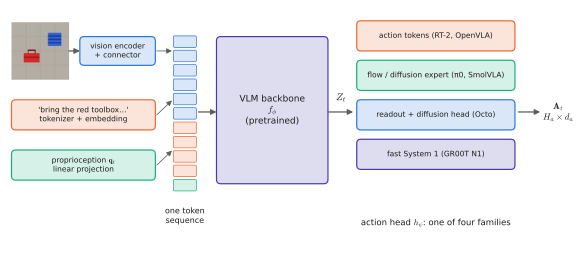

# 8.1 The VLA Paradigm, Formally

Every previous chapter supplied one piece. [Chapter 5](../05-vlms/index.md) built a vision-language model, [Chapter 6](../06-generative/index.md) the models of action distributions, and [Chapter 7](../07-decision-making/index.md) the theory of learning policies from demonstrations. A **Vision-Language-Action model** is what you get when you assemble them: a policy whose backbone is a pretrained vision-language model and whose output is robot actions. This section gives the definition, its parts, and the four architecture families that every system in [Chapter 10](../10-case-studies/index.md) belongs to.

## What is it?

!!! definition "Vision-Language-Action model (VLA)"
    A **VLA** is a conditional generative model of robot action chunks,

    $$
    \mathbf{A}_t\sim\pi_\theta\big(\,\cdot\mid\mathbf{o}_t,\ \ell\,\big),\qquad \mathbf{A}_t=(\mathbf{a}_t,\dots,\mathbf{a}_{t+H_a-1})\in\mathbb{R}^{H_a\times d_a},
    $$

    computed as $\pi_\theta=h_\psi\circ f_\phi$, where

    - $f_\phi$ is a **backbone** initialised from a pretrained vision-language model, which maps the observation tokens (images, instruction, optionally proprioception and history) to contextual features $Z_t=f_\phi(\mathbf{o}_t,\ell)\in\mathbb{R}^{N\times d}$;
    - $h_\psi$ is an **action head** that turns $Z_t$ into a sample of $\mathbf{A}_t$ — by decoding action tokens ([6.2](../06-generative/mdn-ar.md)), by denoising ([6.4](../06-generative/diffusion.md)), by integrating a flow ([6.5](../06-generative/flow-matching.md)), or by regression;

    and the whole model is trained mainly by behavioural cloning ([7.2](../07-decision-making/behavior-cloning.md)) on robot demonstrations, usually together with or after vision-language pretraining.

| Symbol | Shape | Meaning |
|---|---|---|
| $\mathbf{o}_t$ | — | observation: $C$ camera images $I_t^{(1..C)}$, proprioception $\mathbf{q}_t\in\mathbb{R}^{d_q}$, optionally a few past frames |
| $\ell$ | $T_\ell$ ids | the instruction ("bring the red toolbox to the inspection station") |
| $Z_t$ | $N\times d$ | backbone features: $N=C\cdot N_v+T_\ell+(\text{state tokens})$ positions of width $d$ |
| $H_a$, $d_a$ | — | chunk horizon and action dimension ([notation](../../appendix/notation.md#tensor-dimension-symbols)) |
| $\phi$, $\psi$ | — | backbone and head parameters; $\psi$ may be part of the backbone (token heads) or a separate *action expert* |

The term was introduced with RT-2 (Brohan et al., 2023), which showed that a VLM fine-tuned to emit actions as text tokens transfers web knowledge — objects, symbols, simple reasoning — to robot control.

<figure markdown="span">
  
  <figcaption markdown="span">The anatomy of a VLA. Observation tokens — images through a vision encoder and connector, the instruction through the tokenizer, proprioception through a small projection — form one sequence for a pretrained VLM backbone. An action head turns the backbone's features into an action chunk. The four head families differ in what they cost per chunk and in how they represent multimodality.</figcaption>
</figure>

## Why does it exist?

Classical robot learning trained a policy per task from scratch: a ResNet and an MLP on a few hundred demonstrations of one skill. It learned that skill and nothing else — no new objects, no new instructions, no common sense. A VLA bets that the knowledge in web-pretrained VLMs transfers to control:

1. **Semantic generalisation.** "Pick up the extinct animal" can be grounded to a toy dinosaur never seen in robot data, because the VLM knows what an extinct animal is (one of RT-2's showcase examples).
2. **Language as a task interface.** One policy, many tasks, selected by an instruction ([7.1](../07-decision-making/mdp.md#policies-a-vla-can-represent)).
3. **Shared representation across robots and datasets.** With a common backbone, data from many robots and labs can be pooled (Open X-Embodiment; [Chapter 9](../09-training/index.md)).
4. **Scaling.** The same transformer recipe that scaled language and vision might scale control.

The bet has partly paid off. VLAs generalise across objects, scenes and instructions far better than per-task policies. Generalisation to genuinely new *motions*, and the reliability needed for deployment, remain open ([Chapter 15](../15-research/index.md)).

## How does it work? Four architecture families

| Family | Action head | Head cost per chunk | Multimodality | Representative systems |
|---|---|---|---|---|
| **token-based** | the backbone itself decodes discretised action tokens | $H_ad_a$ backbone decode passes (fewer with FAST) | categorical, any shape | RT-2, OpenVLA, π0-FAST |
| **action expert** (flow or diffusion) | a smaller transformer that denoises the chunk, attending to the backbone's features | backbone once + $K$ expert passes | any shape | π0, π0.5, SmolVLA |
| **generalist with a diffusion head** | a small diffusion head on *readout tokens* of a transformer trained largely from scratch on robot data | backbone once + $K$ small passes | any shape | Octo |
| **dual system** | a slow VLM ("System 2") produces latent plans or features; a fast action model ("System 1") runs at the control rate | VLM at a few Hz; action model at 100+ Hz | any shape | GR00T N1 |

The **token-based** family keeps the VLM unchanged and changes only the vocabulary. It is the simplest to build, inherits all the language-model tooling (including RL fine-tuning by token log-probabilities, [7.6](../07-decision-making/rl-finetuning.md)), and is the slowest per action. The **action-expert** family adds a separate network with its own weights for the continuous action stream, so the expensive backbone runs once per chunk. How the expert reads the backbone — a block-wise attention mask over one joint sequence (π0) or cross-attention (GR00T; this book's toy VLA) — is a design choice examined in [8.5](action-experts.md). The **dual-system** family pushes the separation further, into two loops at different rates. That matters for robots whose control rate is far above what any VLM can deliver.

## Implementation: the toy VLA

`vlacourse.vla.TinyVLA` is a VLA with every part of the definition, small enough to train on a laptop GPU in minutes. Lab 11 trains it in the 2-D depot of `vlacourse.depot_env`:

```python
from vlacourse.vla import TinyVLA

vla = TinyVLA(vocab_size, head="flow",        # or "tokens" (RT-2 style) or "mse" (regression baseline)
              vision=tiny_clip.image_encoder, # Lab 07's ViT: 64 patch tokens of a 64x64 image
              horizon=8, d_action=2)          # chunks of 8 velocity commands

loss = vla.loss(images, instr_ids, state, chunks)   # behavioural cloning: flow matching / CE / MSE
A = vla.act(images, instr_ids, state, steps=10)      # (B, 8, 2) action chunk
```

| Part | Toy VLA | π0 (for scale) |
|---|---|---|
| vision | ViT, 64 px, 64 patch tokens, from the Lab 07 tiny CLIP | SigLIP So400m, 224 px, 256 tokens per camera, up to 3 cameras |
| backbone | 4-layer bidirectional transformer, $d=128$ | Gemma 2B (PaliGemma), prefix attention |
| state | 1 token: $(x,y)$ | 1 token: joint state |
| head | 2-layer flow expert with cross-attention, $H_a=8$, 10 Euler steps | 300 M action expert sharing attention, $H_a=50$, 10 steps |
| parameters | ≈3 M | ≈3.3 B |

!!! lab "Lab 11 — A toy VLA in the depot"
    Train the toy VLA with all three heads on the same demonstrations, evaluate them in closed loop on ambiguous and unambiguous instructions, measure their cost per action, and compare chunk execution, replanning and temporal ensembling.

## Limitations

- **Behavioural cloning inherits its limits**: compounding error, no improvement beyond the data ([Chapter 7](../07-decision-making/index.md)).
- **The backbone was trained for text answers**, not for metric geometry or contact; robot data must supply both.
- **Cost.** Billions of parameters per control step. Latency, memory and power become first-class design constraints ([Chapter 11](../11-deployment/index.md)).
- **Evaluation** requires closed-loop rollouts on robots or in simulation, which is expensive and noisy.

## Why it matters for VLAs and robots

The definition makes the design space explicit. Every VLA chooses a backbone, an observation tokenisation, an action representation and a head, a training recipe, and an execution scheme. Sections [8.2](inputs.md)–[8.7](closed-loop.md) take these choices one at a time. Chapter 10 then reads the published systems as points in this space. For your own robots — an arm, a rover, a team of PX4 drones — the same choices decide what is feasible on the hardware you have.
