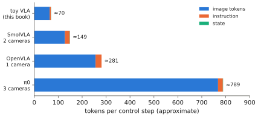

# 8.2 Inputs: Images, Proprioception, Language, History

A VLA sees the world through a token sequence. What goes into that sequence, how many tokens each input costs, and how it is normalised decide what the policy can perceive and how fast it runs. This section goes through the four input streams. For each it gives the representation, its cost, and the robot-specific traps that turn a working policy into a failing one.

## What is it?

!!! definition "Observation tokenisation"
    The backbone input at control step $t$ is the concatenation

    $$
    X_t=\big[\ \underbrace{V^{(1)}_t;\dots;V^{(C)}_t}_{\text{image tokens, }C\cdot N_v}\ ;\ \underbrace{E_\ell}_{T_\ell\text{ instruction tokens}}\ ;\ \underbrace{\mathbf{q}_tW_q}_{\text{state token(s)}}\ ;\ \underbrace{\dots}_{\text{history (optional)}}\ \big]\ +\ \text{segment / camera / position embeddings},
    $$

    where $V^{(c)}_t=\operatorname{conn}(g(I^{(c)}_t))\in\mathbb{R}^{N_v\times d}$ are the image tokens of camera $c$ ([3.4](../03-vision/encoders-for-vlas.md)), $E_\ell$ the instruction's token embeddings, and $W_q\in\mathbb{R}^{d_q\times d}$ a linear projection of the normalised proprioceptive state.

## Why does it matter?

Each input answers a different question for the policy:

| Input | Answers | Typical cost | Trap |
|---|---|---|---|
| wrist camera | *where exactly is the object relative to the gripper?* | $N_v$ (64–256) tokens | moves with the arm; occluded by the object at grasp time |
| head / third-person camera | *where is everything in the scene?* | $N_v$ tokens | fixed viewpoint: policies break when it moves |
| instruction | *which task?* | 10–30 tokens | paraphrases the training data never contained |
| proprioception | *where is my body?* | 1–few tokens | the policy may copy the state instead of reading the images ("copycat" shortcut) |
| history | *what happened before?* | $\times$ frames | expensive; can encourage shortcuts |

## How does it work?

### Images: cameras, resolution and identity

Two or three cameras is the norm for manipulation: a wrist camera for precision and a fixed camera for context. ALOHA/ACT uses four. Each costs its full token budget, so π0's three cameras at 256 tokens each are 768 tokens before the instruction. Because the backbone sees all tokens as one set ordered by position, the camera identity must be explicit, through a learned per-camera embedding or a fixed camera order with separator tokens. A policy trained with the wrist camera first and evaluated with it second fails silently.

Camera **extrinsics** are almost never given to the VLA. The policy learns the camera–robot geometry implicitly from data, which is why moving a camera a few centimetres can break it. Some recent work adds camera parameters or depth as inputs; most VLAs do not ([1.2](../01-multimodal-intro/vision.md#robot-images-are-not-internet-images)).

### Proprioception: normalise, and beware shortcuts

The proprioceptive vector $\mathbf{q}_t$ (joint angles, gripper opening, end-effector pose; for a drone: attitude, velocity, altitude) is normalised per dimension with dataset statistics, mean–standard deviation or quantiles, then projected to one token. It makes control easier: the policy knows its configuration without inferring it from pixels. It also creates the **copycat** problem. In smooth demonstrations, $\mathbf{a}_t\approx\mathbf{a}_{t-1}$, and the current state largely determines the next action, so a policy can achieve low loss by extrapolating its own motion while ignoring the images. It then fails exactly when the images matter (a moved object). Remedies include dropping the state input during training, adding noise to it, or using action chunks, which predict further ahead than one step. Some VLAs (RT-2, OpenVLA) omit proprioception altogether.

### Language: templates and grounding

Instructions enter as ordinary text tokens, usually inside a fixed **prompt template** inherited from the VLM. OpenVLA's is *"In: What action should the robot take to {instruction}?\nOut:"*. The template matters because the backbone was instruction-tuned with templates, and deviating from the training template at test time costs accuracy. Robot datasets are poor in language: many episodes share a handful of instruction templates, and some datasets were annotated after the fact. A VLA therefore generalises to *paraphrases* only as far as the frozen language knowledge carries it. A model that has seen "pick up the red block" 10 000 times may treat "grab the crimson cube" as a different task. Co-training on web data ([Chapter 9](../09-training/index.md)) and instruction augmentation (paraphrasing with an LLM) mitigate this.

### History

Most VLAs condition on the current frame only, or the last 1–2 frames (Octo uses a window of two observations). Longer history multiplies image tokens. It also invites a subtle failure: with history, a BC policy can learn to *repeat what it did*, because past actions are visible in past frames, and so becomes less responsive to new evidence. Memory for long-horizon tasks is usually handled outside the VLA, by a planner, a task tracker or a summary, rather than by raw frames ([Chapter 15](../15-research/index.md)).

<figure markdown="span">
  
  <figcaption markdown="span">Where a VLA's tokens go, for three configurations. Images dominate: a single 224-px camera through SigLIP costs more than ten instructions. Adding cameras or history frames multiplies that share, while proprioception and language are nearly free. The prefill cost and latency of the backbone follow the total ([2.6](../02-transformers/inference.md)).</figcaption>
</figure>

## Implementation

The toy VLA's observation tokenisation (`vlacourse.vla.TinyVLA._prefix`):

```python
def _prefix(self, images, instr, state):
    img = self.img_proj(self.vision(images)[:, 1:])          # (B, 64, d): patch tokens, [CLS] dropped
    txt = self.word(instr)                                     # (B, L, d): instruction words (0 = padding)
    st = self.state_proj(state)[:, None, :]                    # (B, 1, d): proprioception token
    seg = torch.cat([torch.zeros(64), torch.ones(L), torch.full((1,), 2)]).long()
    x = torch.cat([img, txt, st], 1) + self.segment(seg)       # segment embedding: image / text / state
    mask = torch.cat([ones(B, 64), instr != 0, ones(B, 1)], 1) # padding is never attended to
    return x, mask
```

!!! robot "The depot inputs"
    For the depot arm, a sensible configuration is a wrist camera and a head camera at 224 px, each reduced to 64 tokens by pixel shuffle ([3.4](../03-vision/encoders-for-vlas.md#reducing-tokens)). Add the instruction, and one state token with the 7 joint angles and the gripper opening, normalised by quantiles over the dataset. That is about 150 tokens per step, a small fraction of OpenVLA's ≈ 280 or π0's ≈ 800, and fast enough for a 10 Hz chunked policy on a Jetson-class computer ([Chapter 11](../11-deployment/index.md)). For the drones, the same arithmetic forces one downward camera and a coarse resolution — or no VLA in the loop at all ([Chapter 13](../13-uavs/index.md)).

!!! lab "Lab 11, §2"
    Inspect the toy VLA's observation tokens: shapes, segment embeddings, the padding mask, and the token budget per input.

## Limitations

- **No geometry by default**: camera models, depth and the robot's kinematics are left for the network to learn from data.
- **Fragile to input changes** that humans consider irrelevant: camera placement, image resolution, prompt wording, state normalisation statistics.
- **Shortcuts** through proprioception and history can lower training loss while raising closed-loop failure.

## Why it matters for VLAs and robots

Choosing the inputs is choosing what the policy can know and how much each step costs. Most failures of VLAs transferred to a new robot or lab trace back to this section. A camera moved, a normalisation was recomputed, a prompt changed, a state dimension was reordered. Keep the input pipeline under version control with the weights, and test it like code ([Chapter 11](../11-deployment/index.md)).
