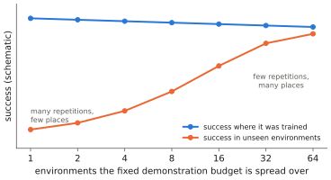

# 9.6 Data Quality, Scaling and Distribution Shift

Language models taught the field to expect smooth improvement with more data ([2.7](../02-transformers/scaling.md)). Robot data behaves differently: it is expensive, heterogeneous, and what matters is less *how much* than *which*. This section collects what is known about data quality, data diversity and scaling for VLAs, and the forms of distribution shift that a deployed policy meets — including the shortcut learning that Lab 11 runs into.

## What is it?

!!! definition "Three kinds of distribution shift for a deployed VLA"
    1. **Covariate shift from the policy's own errors** — the learner visits states the demonstrator did not ([7.3](../07-decision-making/covariate-shift.md)).
    2. **Environment shift** — the deployment world differs from the training worlds: new objects, scenes, lighting, camera placement, robot wear, other agents.
    3. **Task shift** — instructions or task compositions that the training data never paired with these scenes.

    A dataset's job is to make all three small *for the deployments that matter*.

## Why does it matter? Quantity is not the lever you think

Empirical studies of imitation learning repeatedly find that generalisation to new objects and environments improves with the **number of distinct environments and objects** in the data, often roughly as a power law, while adding more demonstrations of the *same* environment saturates quickly. Lab 10 showed the dynamic version — ten times more demonstrations from the same start distribution did not fix compounding error ([7.3](../07-decision-making/covariate-shift.md)) — and Lab 11 shows a semantic version: more demonstrations of the same scene–instruction pairings do not teach the policy to read the instruction.

## How does it work?

### Shortcuts: when the data lets the policy ignore what matters

A behavioural-cloning policy learns *whatever predicts the action in the training data*. If something easier than the intended cue predicts it, the policy learns that instead:

| Shortcut | How it arises | Symptom at test time |
|---|---|---|
| **scene → action** (ignoring the instruction) | every scene appears with only one task | follows the "usual" task in a familiar scene, whatever the instruction |
| **proprioception copycat** | smooth trajectories: state predicts next action | replays motions; ignores moved objects ([8.2](../08-vla/inputs.md)) |
| **background / viewpoint cues** | task correlates with location or camera | fails when the scene is rearranged |
| **operator style** | one operator per task | "task" decoded from motion style, not from the goal |

The fix is in the data distribution: pair each scene with several tasks, vary what should not matter, and make the intended cue the *only* reliable predictor. Lab 11 measures the instruction-ignoring shortcut directly: a VLA trained with one instruction per scene succeeds far more often on ambiguous instructions (any matching object will do) than on specific ones, because it heads for *some* object instead of the named one.

### Data quality

- **Successful, consistent demonstrations**: filter failures out of BC data (keep them for success detectors); remove idle segments; check that commanded actions and observations are aligned ([9.2](demonstrations.md)).
- **Label correctness**: wrong action conventions, frame-rate mismatches and mis-normalised dimensions in pooled datasets are common and silent.
- **Curation over volume**: dropping low-quality or redundant data can improve a generalist; data-attribution methods that estimate which episodes help or hurt are an active research area.

### Scaling — what is and is not known

- More diverse pretraining data (more robots, scenes, tasks) has consistently improved generalists' transfer to new setups (OXE, DROID, π0's large mixture).
- Larger backbones help semantic generalisation (RT-2's larger variants generalised better to novel objects and instructions) but cost latency ([Chapter 11](../11-deployment/index.md)).
- Clean, predictive scaling laws of the kind known for language — loss as a power law in parameters and data — have not been established for closed-loop robot success; loss itself is a poor proxy ([2.7](../02-transformers/scaling.md#scaling-laws)). This is an open research question ([Chapter 15](../15-research/index.md)).

<figure markdown="span">
  
  <figcaption markdown="span">Diversity versus volume (schematic of a common empirical finding). Holding the total number of demonstrations fixed, spreading them over more distinct environments and objects improves success on *unseen* environments far more than adding repetitions in the same few environments, which mostly improves performance where the robot already works.</figcaption>
</figure>

## Implementation: auditing a dataset for shortcuts

```python
import collections

def audit(episodes):
    """episodes: list of dicts with 'scene_id', 'instruction', 'operator', 'success'.
    Flags data distributions that permit shortcuts."""
    by_scene = collections.defaultdict(set)
    by_operator = collections.defaultdict(set)
    for e in episodes:
        by_scene[e["scene_id"]].add(e["instruction"])
        by_operator[e["operator"]].add(e["instruction"])
    single = sum(len(v) == 1 for v in by_scene.values()) / len(by_scene)
    print(f"scenes with a single instruction: {single:.0%}  (high -> the policy can ignore language)")
    print(f"instructions per operator: { {k: len(v) for k, v in by_operator.items()} }")
    print(f"success rate in data: {sum(e['success'] for e in episodes) / len(episodes):.0%} (filter failures for BC)")
```

!!! lab "Lab 11, §4–5"
    Train the toy VLA with one and with several instructions per scene and compare its success on specific vs ambiguous instructions — the instruction-ignoring shortcut, measured.

## Limitations

- **"Diversity" is hard to define and measure**; it depends on which variations matter for the target deployment.
- **Shortcuts are found by testing**, usually after deployment fails; audits catch only the ones you think of.
- **Scaling results are tied to their evaluation suites** and may not transfer to your robots.

## Why it matters for VLAs and robots

With a fixed data budget, diversity and the absence of shortcuts are worth more than volume. For multi-robot systems there is a specific twist: a team of $N$ robots collects $N$ times the data per hour, but from correlated scenes and tasks — volume without diversity — unless the team is deliberately spread over different environments and roles ([Chapter 14](../14-multi-robot/index.md)).
