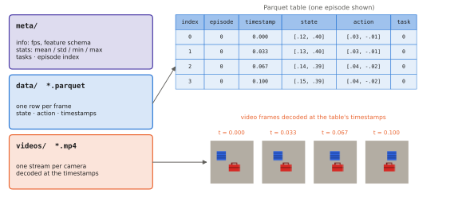

# 9.3 Datasets: Open X-Embodiment, DROID, LIBERO and the LeRobot Format

Generalist VLAs exist because robot datasets from many labs were pooled into common formats. This section describes the datasets that matter for this course — what they contain, how they differ, what they are used for — and the storage format you will actually read and write in Lab 13: the **LeRobot dataset**.

## What is it?

| Dataset | Kind | Scale | Robots | Typical use |
|---|---|---|---|---|
| **Open X-Embodiment (OXE)** | union of ~60 real-robot datasets, converted to one format | 1 M+ trajectories | 22 embodiments | pretraining generalists (Octo, OpenVLA, RT-X) |
| **BridgeData V2** | real, single robot, many scenes | ~60 k trajectories | WidowX 250 | pretraining, generalisation studies |
| **DROID** | real, one standardised platform carried to many sites | ~76 k trajectories, 564 scenes | Franka | scene-diverse pretraining; evaluation |
| **LIBERO** | simulated benchmark suites (spatial, object, goal, long-horizon) | 130 tasks, 50 demos each | simulated Franka | standard evaluation of VLAs and fine-tuning recipes |
| **LeRobot Hub datasets** | community-contributed, mostly low-cost arms (SO-100/101, Koch, ALOHA) | thousands of small datasets | many | SmolVLA pretraining; your own data |

!!! definition "LeRobot dataset format"
    A LeRobot dataset is a directory (usually hosted on the Hugging Face Hub) with

    - **tabular data** in Parquet files: one row per time step with `observation.state`, `action`, `timestamp`, `frame_index`, `episode_index`, `index`, `task_index`, and any other low-dimensional features;
    - **videos**: one MP4 per camera, holding the image observations (`observation.images.<camera>`), decoded on the fly at the stored timestamps;
    - **metadata** (`meta/`): `info.json` (frame rate `fps`, feature names, shapes and dtypes, robot type, codebase version), per-episode information, the task strings, and **normalisation statistics** (mean, std, min, max, quantiles per feature).

## Why does it matter?

Pooling data is the reason generalists generalise — the OXE paper found that RT-X models trained on the mixture outperformed models trained on each lab's data alone, on several of those labs' own robots (positive transfer). But pooling only works with a common representation: aligned action spaces and normalisation ([8.3](../08-vla/action-spaces.md)), consistent camera naming, explicit frame rates, task strings. The formats in this section are what make that possible, and their metadata — `fps`, statistics, camera names — must travel with every checkpoint trained on them.

## How does it work?

### Heterogeneity and mixture weights

OXE's datasets differ in nearly every respect: robot, gripper, camera placement and count, control frequency (3–50 Hz), action convention (absolute vs delta, joint vs end-effector), instruction quality (from rich language to a single template). Generalist training therefore uses a **curated subset with mixture weights** (Octo and OpenVLA publish theirs), standardises actions to end-effector deltas plus gripper where possible, drops datasets with incompatible or noisy labels, and re-weights the rest so that a few huge but repetitive datasets do not dominate ([9.1](stages.md#mixture-weights)).

### Simulation benchmarks and their caveats

LIBERO and SimplerEnv (simulated replicas of real evaluation setups) made VLA results comparable and cheap to reproduce. Two caveats: near-saturated benchmark scores (LIBERO success rates in the high 90s) say little about real-world robustness, and policies can overfit benchmark specifics (fixed camera, fixed scenes). Treat them as unit tests, not as deployment evidence.

<figure markdown="span">
  
  <figcaption markdown="span">The LeRobot dataset layout. Low-dimensional streams (state, action, timestamps, indices) live in Parquet tables, one row per frame; camera streams live in MP4 files and are decoded at the frames' timestamps; the metadata holds the frame rate, feature schema, task strings and the normalisation statistics that a trained policy needs at deployment.</figcaption>
</figure>

### Reading a LeRobot dataset by hand

The format is simple enough to read without the library — which is the best way to understand it:

```python
import json
from pathlib import Path

import pandas as pd

root = Path("data/lerobot/depot_nav")                       # a local dataset (Lab 13 writes one)
info = json.loads((root / "meta" / "info.json").read_text())
print(info["fps"], list(info["features"]))                  # e.g. 10, ['observation.images.top', 'observation.state', 'action', ...]

frames = pd.concat(pd.read_parquet(p) for p in sorted((root / "data").rglob("*.parquet")))
ep0 = frames[frames.episode_index == 0]
print(ep0[["frame_index", "timestamp", "observation.state", "action"]].head())
```

With the `lerobot` package the same dataset is a PyTorch dataset whose items already contain decoded images, and which can return *windows* of frames — e.g. the next 50 actions as a chunk — through `delta_timestamps`:

```python
from lerobot.datasets.lerobot_dataset import LeRobotDataset   # module path of recent lerobot versions

ds = LeRobotDataset("lerobot/svla_so100_pickplace", delta_timestamps={"action": [i / 30 for i in range(50)]})
item = ds[0]          # dict of tensors: images (C, H, W), state, action chunk (50, d_a), task string, ...
```

## Implementation: writing the depot demonstrations as a LeRobot-style dataset

```python
import json
from pathlib import Path

import numpy as np
import pandas as pd

def write_dataset(root, demos, fps=10, robot_type="depot_point_robot"):
    """demos: output of vlacourse.depot_env.collect (one row per step). Images stored as .npy here for
    simplicity; LeRobot stores them as MP4 videos."""
    root = Path(root); (root / "data").mkdir(parents=True, exist_ok=True); (root / "meta").mkdir(exist_ok=True)
    df = pd.DataFrame({"episode_index": demos["episode"], "observation.state": list(demos["state"]),
                       "action": list(demos["action"]), "task_index": 0})
    df["frame_index"] = df.groupby("episode_index").cumcount()
    df["timestamp"] = df["frame_index"] / fps
    df["index"] = np.arange(len(df))
    df.to_parquet(root / "data" / "chunk-000.parquet")
    np.save(root / "data" / "observation.images.top.npy", demos["image"])
    a = np.stack(demos["action"])
    stats = {"action": {"mean": a.mean(0).tolist(), "std": a.std(0).tolist(),
                        "q01": np.quantile(a, .01, 0).tolist(), "q99": np.quantile(a, .99, 0).tolist()}}
    (root / "meta" / "info.json").write_text(json.dumps({"fps": fps, "robot_type": robot_type,
                                                          "total_episodes": int(df.episode_index.max() + 1)}))
    (root / "meta" / "stats.json").write_text(json.dumps(stats))
```

!!! lab "Lab 13, §2"
    Write the depot demonstrations as a LeRobot-style dataset, read them back by hand, compute normalisation statistics, measure what MP4 compression does to the frames, and compare policies trained on the recorded and on the decoded frames.

## Limitations

- **Heterogeneous labels**: action conventions and frame rates differ across datasets and are sometimes undocumented or wrong.
- **Coverage bias**: tabletop manipulation with parallel grippers dominates; mobile manipulation, aerial robots and multi-robot data are rare.
- **Language is thin**: many datasets have few distinct instructions.
- **Benchmarks saturate** and drift from what matters on hardware.

## Why it matters for VLAs and robots

Your data will be small; the generalist you start from was trained on these datasets. Knowing what they contain tells you what the generalist already knows (tabletop pick-and-place, Franka and WidowX viewpoints) and what it does not (drones, top-down views, teams). It also tells you what metadata to keep so that your own dataset can be pooled with others' — the multi-robot data question of [Chapter 14](../14-multi-robot/index.md).
