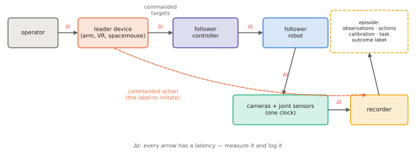

# 9.2 Demonstration Collection and Teleoperation

Behavioural cloning learns whatever the demonstrations contain — their skill, their hesitations, their biases, their gaps ([7.2](../07-decision-making/behavior-cloning.md)). Collecting demonstrations is therefore not a chore before the research but a large part of it. This section covers how demonstrations are produced (teleoperation interfaces, scripted and privileged experts, simulation, human video), what makes them good, and what to record so that they remain usable.

## What is it?

!!! definition "Demonstration"
    A **demonstration** is a recorded episode $\big(\ell,\ (\mathbf{o}_0,\mathbf{a}_0),(\mathbf{o}_1,\mathbf{a}_1),\dots,(\mathbf{o}_T,\mathbf{a}_T),\ \text{outcome}\big)$: the instruction, synchronised observations (all cameras, proprioception) and the actions actually sent to the robot at the control rate, plus metadata — robot and camera configuration, operator, success label, timestamps.

| Source | How actions are produced | Strengths | Weaknesses |
|---|---|---|---|
| **leader–follower teleoperation** (ALOHA, GELLO) | the operator moves a kinematically matched "leader" arm; the robot copies its joints | intuitive, precise, bimanual, cheap | robot-specific hardware |
| **VR / 6-DoF controllers** (DROID, BridgeData) | the operator's hand pose drives the end-effector | general across arms; immersive | no force feedback; latency |
| **SpaceMouse / gamepad** | velocity commands | cheap, simple | slow, unnatural for complex motions |
| **kinesthetic teaching** | the operator physically moves the robot | no interface needed | operator appears in the images |
| **handheld grippers** (UMI) | a hand-held gripper with a camera records in the wild; actions are reconstructed from the camera's motion | no robot needed during collection; diverse scenes | embodiment gap to the real robot |
| **scripted / planner experts** | code or a motion planner with privileged state | unlimited, consistent, free labels for DAgger | only for tasks you can script; unnatural, unimodal |
| **simulation** | any of the above in a simulator ([Appendix A](../../appendix/mujoco.md)) | scale, resets, perfect labels | sim-to-real gap |
| **human video** | none directly; actions inferred (hand poses, latent actions) | enormous volume | no action labels, different embodiment |

## Why does it matter?

Three properties of demonstrations decide what a VLA learns:

1. **Coverage** — the states and situations in the data bound where the policy is competent ([7.3](../07-decision-making/covariate-shift.md)). Vary object poses, distractors, lighting, backgrounds, camera mounting tolerances, starting configurations.
2. **Consistency** — conflicting strategies become multimodality (handle with a generative head) or noise (averaged away). Pauses, hesitations and corrections are learned as behaviour.
3. **Recoveries** — demonstrations that only ever succeed smoothly never show how to get back on track; a few deliberate recoveries (or interventions, [7.4](../07-decision-making/dagger.md)) are worth many more nominal episodes.

The largest open real-robot datasets were collected exactly with this in mind: DROID gathered about 76 k trajectories across 564 scenes with a standardised Franka platform carried to many buildings, because *scene diversity* — not the count of repetitions of one scene — drives generalisation.

## How does it work?

### Recording

- **Timestamps on everything**, from one clock. Cameras, joint encoders and commands arrive asynchronously; align them at write time or at least keep enough information to align them later.
- **Record the commanded action**, not only the measured state. If you record only states, labels must be reconstructed (differences of positions), which mixes in tracking error and latency.
- **Record at the control rate you will run**, or resample consistently ([8.7](../08-vla/closed-loop.md#why-does-it-matter)).
- **Keep calibration**: camera intrinsics/extrinsics, robot model version, gripper type. A dataset without it cannot be reused on a modified setup.
- **Label outcomes**: success/failure per episode (and ideally per subtask). Failed episodes are useful later (for success detectors, RL, filtering) — but exclude them from BC.

### Latency and the action label

Teleoperation has latency between the operator's intent and the robot's motion, and cameras have exposure and transport delays. The pair $(\mathbf{o}_t,\mathbf{a}_t)$ written to disk may therefore show the robot *already responding* to $\mathbf{a}_{t-k}$. A policy trained on misaligned pairs learns to react late. Measure the delays (a visible event, such as the gripper closing, against its command) and shift labels accordingly.

### Experts for drones and teams

For UAVs, good demonstrations are rarely human-piloted at the setpoint level. More common sources: a classical planner or MPC with privileged state (simulation or motion capture) as the expert, autonomous missions logged with their setpoints, and human pilots only for high-level decisions (which area to search, where to look). For multi-robot teams, a centralised planner with full information is a natural privileged teacher whose decisions decentralised policies imitate ([Chapter 14](../14-multi-robot/index.md)).

<figure markdown="span">
  
  <figcaption markdown="span">A demonstration pipeline. The operator drives a leader device; the follower robot executes the commands through its controller; cameras and joint sensors are timestamped on one clock; the recorder writes observations, *commanded* actions, calibration and an outcome label per episode. Each arrow has a latency that should be measured and logged.</figcaption>
</figure>

### How many demonstrations?

There is no general number. Orders of magnitude from published work: tens of demonstrations per task for a narrow ACT/Diffusion Policy specialist; hundreds for post-training a generalist VLA on a new robot and task family; hundreds of thousands to millions of episodes across many robots for generalist pretraining. More informative than the count is *the number of distinct situations* covered.

## Implementation: a minimal episode recorder

```python
import json
import time
from pathlib import Path

import numpy as np

class EpisodeRecorder:
    """Write one episode: per-step arrays (images, state, commanded action, timestamps) + metadata."""

    def __init__(self, root, meta: dict):
        self.dir = Path(root) / f"episode_{int(time.time() * 1e3)}"
        self.dir.mkdir(parents=True)
        self.meta, self.steps = dict(meta), []

    def add(self, images: dict, state, action, t_obs, t_cmd):
        self.steps.append({"images": images, "state": np.asarray(state), "action": np.asarray(action),
                           "t_obs": t_obs, "t_cmd": t_cmd})

    def close(self, success: bool):
        np.savez_compressed(self.dir / "steps.npz",
                            state=np.stack([s["state"] for s in self.steps]),
                            action=np.stack([s["action"] for s in self.steps]),
                            t_obs=np.array([s["t_obs"] for s in self.steps]),
                            t_cmd=np.array([s["t_cmd"] for s in self.steps]),
                            **{f"cam_{k}": np.stack([s["images"][k] for s in self.steps])
                               for k in self.steps[0]["images"]})
        (self.dir / "meta.json").write_text(json.dumps({**self.meta, "success": success,
                                                        "length": len(self.steps)}, indent=2))
```

Production pipelines store images as video (much smaller) and use a standard format ([9.3](datasets.md)), but the content is exactly this.

!!! lab "Lab 13, §1–2; Lab 12"
    Record depot demonstrations — including some from a sloppy operator — with task strings, timestamps and outcome labels, store them in the LeRobot dataset format, and inspect timestamps, statistics and failed episodes. Lab 12 collects the same demonstrations in MuJoCo.

## Limitations

- **Human time is the bottleneck**: a skilled operator collects tens of episodes per hour.
- **Interfaces shape behaviour**: a VR operator without force feedback demonstrates differently from a leader–follower operator; the policy inherits the interface's style.
- **Scripted experts are unimodal and unnatural**, and only exist for tasks you can already solve.
- **Privacy and safety** constraints apply to data collected in homes, workplaces or public spaces — including by drones.

## Why it matters for VLAs and robots

The demonstration budget is the main resource of a VLA project for your own robots. Spend it on diversity and recoveries, record what a future you will need (commanded actions, timestamps, calibration, outcomes), and use experts — scripted, planned, privileged — wherever they can replace human time. For a drone team in a depot, the most valuable dataset may come from a planner flying thousands of simulated missions, with humans demonstrating only the decisions planners cannot make.
