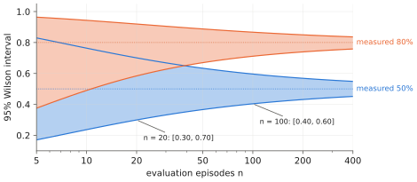

# 9.5 Evaluating VLAs

A VLA is only as good as the evidence that it works, and that evidence is expensive: each data point is a closed-loop episode on a robot or in a simulator, with a binary outcome and a lot of noise. Offline metrics (validation loss, action error) are cheap but weakly predictive ([2.5](../02-transformers/training.md#what-to-monitor), [7.2](../07-decision-making/behavior-cloning.md)). This section covers how to design evaluations that can distinguish one model from another, and how to report them honestly.

## What is it?

!!! definition "Closed-loop success rate"
    For a policy $\pi$, a task distribution $\mathcal{T}$ (instructions, initial scenes, perturbations) and a success criterion, the **success rate** is $p_\pi=\Pr_{\tau\sim\pi,\ \text{task}\sim\mathcal{T}}[\text{success}]$. It is estimated from $n$ episodes by $\hat p=k/n$, where $k$ is the number of successes.

With binary outcomes, $\hat p$ has standard error $\sqrt{p(1-p)/n}$. A **Wilson** 95% interval (better than $\hat p\pm1.96\,\text{SE}$ near 0 and 1) is

$$
\frac{\hat p+\frac{z^2}{2n}\pm z\sqrt{\frac{\hat p(1-\hat p)}{n}+\frac{z^2}{4n^2}}}{1+\frac{z^2}{n}},\qquad z=1.96 .
$$

## Why does it matter?

The numbers are sobering. With $n=20$ episodes per configuration — common in real-robot papers — a measured success of 60% has a 95% interval of roughly 39–78%. Two policies at 60% and 75% on 20 trials each are statistically indistinguishable. Real-robot evaluations are slow (minutes per episode, plus resets), so the temptation is to evaluate little and conclude much.

<figure markdown="span">
  
  <figcaption markdown="span">How many trials an evaluation needs. Wilson 95% intervals for a measured success rate of 50% and 80% as the number of episodes grows. With 20 episodes the interval spans about ±20 percentage points; distinguishing policies that differ by 10 points needs on the order of a hundred episodes each.</figcaption>
</figure>

## How does it work?

### Design the task distribution deliberately

Generalisation claims need held-out *axes*, not just held-out episodes. Evaluate separately along:

| Axis | Held-out examples |
|---|---|
| object poses / initial states | new positions within the training distribution |
| new object instances | an unseen toolbox of a known kind |
| new object categories | a kind never seen in robot data (tests VLM knowledge transfer) |
| distractors and clutter | extra objects, including look-alikes (tests grounding; [4.5](../04-alignment/failure-modes.md)) |
| scene / lighting / background | another room, another time of day |
| instruction paraphrases | "grab the crimson box" for "pick up the red toolbox" |
| camera perturbations | small mounting changes |
| disturbances | the object is moved during execution |

Report per axis. An average over a mixture hides exactly the failures that matter.

### Make comparisons fair and paired

- **Same initial conditions** for all policies (fixed seeds in simulation; the same object placements, photographed or marked, on hardware), so that differences come from the policies, not the scenes.
- **Randomise the order** of policies on hardware (wear, lighting and battery drift over a session).
- **Blind the operator** to which policy runs when the operator judges success or resets the scene.
- **Define success before running** — including partial-success rubrics for long tasks (e.g. "toolbox grasped", "lifted", "placed").

### Use simulation as a filter, hardware as the judge

A sensible pipeline: offline metrics to catch training bugs → simulation (LIBERO, SimplerEnv, your MuJoCo replica — [Appendix A](../../appendix/mujoco.md)) with hundreds of episodes to choose among checkpoints and designs → a smaller hardware evaluation of the finalists with a pre-registered protocol. Check that simulation rankings agree with hardware rankings on a few models before trusting them.

### Beyond success

For deployment, also measure: time to completion, smoothness (jerk), safety interventions or filter activations ([Chapter 12](../12-embodied/index.md)), recovery from disturbances, behaviour on *impossible* instructions (does it refuse or hallucinate a target? [5.4](../05-vlms/spatial.md)), and latency distributions ([8.7](../08-vla/closed-loop.md)).

## Implementation

```python
import math

def wilson(k, n, z=1.96):
    """95% Wilson interval for k successes in n trials."""
    if n == 0:
        return (0.0, 1.0)
    p = k / n
    centre = (p + z * z / (2 * n)) / (1 + z * z / n)
    half = z * math.sqrt(p * (1 - p) / n + z * z / (4 * n * n)) / (1 + z * z / n)
    return centre - half, centre + half

def paired_difference(success_a, success_b):
    """Paired comparison on the same initial conditions: fraction where A succeeds and B fails, and vice versa.
    A McNemar-style test uses only the discordant pairs."""
    a_only = sum(a and not b for a, b in zip(success_a, success_b))
    b_only = sum(b and not a for a, b in zip(success_a, success_b))
    return a_only, b_only

print(wilson(12, 20))      # (0.39, 0.78): 60% measured on 20 trials
```

`vlacourse.depot_env.evaluate` uses fixed seeds per episode index, so two policies evaluated with the same `seed` face identical scenes and instructions — the paired design above.

!!! lab "Lab 11, §3–7, and Lab 13, §4"
    Lab 11 reports every closed-loop number with its Wilson interval, split by ambiguous and specific instructions; Lab 13 compares adaptation methods episode by episode with paired tests.

## Limitations

- **Hardware evaluation does not scale**; it is the bottleneck of the whole field.
- **Simulators are imperfect proxies**: physics, rendering and sensor noise differ from reality.
- **Benchmarks become targets**: once a benchmark is optimised directly, its scores stop measuring generalisation.

## Why it matters for VLAs and robots

Most claims about VLAs — "generalises to new objects", "better than X" — rest on small evaluations. Reading papers critically and designing your own experiments both require the arithmetic of this section. For multi-robot research the problem is harder still: team-level success depends on the joint behaviour of several policies and on communication, multiplying the conditions to test ([Chapter 14](../14-multi-robot/index.md)).
