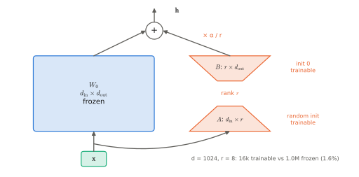

# 9.4 Fine-Tuning and Parameter-Efficient Adaptation

Post-training a VLA on your robot ([9.1](stages.md)) means fine-tuning billions of parameters on hundreds of demonstrations. Full fine-tuning is memory-hungry and easy to overfit; **parameter-efficient fine-tuning (PEFT)** trains a small number of new parameters and leaves the pretrained ones frozen. This section derives LoRA, the PEFT method used for VLAs, puts numbers on the memory of each option, and gives the practical recipe for adapting a generalist to a new robot.

## What is it?

!!! definition "Low-rank adaptation (LoRA; Hu et al., 2022)"
    For a frozen pretrained weight matrix $W_0\in\mathbb{R}^{d_\text{in}\times d_\text{out}}$ (in row-vector convention, $\mathbf{y}=\mathbf{x}W_0$), LoRA learns a low-rank update

    $$
    \mathbf{y}=\mathbf{x}W_0+\frac{\alpha}{r}\,\mathbf{x}AB,\qquad A\in\mathbb{R}^{d_\text{in}\times r},\ B\in\mathbb{R}^{r\times d_\text{out}},\ r\ll\min(d_\text{in},d_\text{out}),
    $$

    with $B$ initialised to **zero** (so training starts exactly at the pretrained model) and $A$ random. Only $A$ and $B$ are trained: $r(d_\text{in}+d_\text{out})$ parameters instead of $d_\text{in}d_\text{out}$. After training, $\Delta W=\tfrac{\alpha}{r}AB$ can be merged into $W_0$, so inference costs nothing extra.

| Symbol | Meaning |
|---|---|
| $r$ | rank of the update (typically 8–64) |
| $\alpha$ | scaling; $\alpha/r$ keeps the update's magnitude comparable across ranks |
| target modules | which matrices get adapters: usually the attention projections ($W_Q,W_K,W_V,W_O$) and the MLP matrices of every layer |

## Why does it exist?

**Memory.** Training with AdamW in mixed precision costs about 16 bytes per *trained* parameter (bf16 weights and gradients, fp32 master weights and two moments; [0.3](../00-foundations/training.md#momentum-and-adam)), plus activations. For a 7 B VLA:

| Method | Trained parameters | Weight memory | Optimiser + gradient memory | Fits on |
|---|---|---|---|---|
| full fine-tuning | 7 B | 14 GB (bf16) | ~98 GB | several 80 GB GPUs |
| LoRA, $r=32$ on all linear layers | ~100 M (≈1.5%) | 14 GB frozen | ~1.6 GB | one 24–48 GB GPU |
| QLoRA (4-bit base + LoRA) | ~100 M | ~4 GB | ~1.6 GB | one consumer GPU |

**Data.** With a few hundred demonstrations, updating billions of parameters overfits quickly; restricting the update to a low-rank subspace is a strong regulariser. Leaving $W_0$ untouched is often said to limit forgetting as well, but a low-rank update can still overwrite behaviour: in Lab 13, LoRA forgot the original task as much as full fine-tuning, and only co-training ([9.1](stages.md)) prevented it. The OpenVLA authors found LoRA fine-tuning matched full fine-tuning on their adaptation tasks at a fraction of the compute.

**Why low rank suffices.** Empirically, the weight change needed to adapt a large pretrained model to a new task has low "intrinsic dimension": most of what is needed is a re-weighting of existing features, not new ones. Lab 13 measures this on the toy VLA: the *smallest* ranks did best on the new task (rank 1: 0.80 success vs rank 32: 0.68, a significant paired difference), because with a few thousand adaptation frames extra rank mostly adds capacity to overfit.

## How does it work?

### The adaptation recipe for a new robot

1. **Re-derive the action space and normalisation.** Compute normalisation statistics on *your* demonstrations; map your robot's actions to the convention the generalist was trained with where possible, or replace the action head's input/output projections ([8.3](../08-vla/action-spaces.md)).
2. **Match the observation pipeline**: image resolution, camera order and names, prompt template, state layout ([8.2](../08-vla/inputs.md)).
3. **Choose what to train**: LoRA on the backbone, full training of the (small) action head or expert, and usually the vision encoder at a lower learning rate or with LoRA as well (VLAs, unlike VLMs, benefit from adapting the encoder; [3.4](../03-vision/encoders-for-vlas.md#frozen-or-fine-tuned)).
4. **Train briefly**: small learning rate ($10^{-5}$–$10^{-4}$ for adapters), warm-up, a few thousand to tens of thousands of steps; consider co-training with a slice of the generalist's data ([9.1](stages.md)).
5. **Select checkpoints by closed-loop success**, not validation loss — the two correlate weakly ([2.5](../02-transformers/training.md#what-to-monitor)); at least evaluate a few rollouts per candidate checkpoint.

### Adapters and the "do nothing at initialisation" principle

LoRA's zero-initialised $B$ is the same idea as zero-initialised FiLM ([1.3](../01-multimodal-intro/combining.md#implementation-sketch-film)), Flamingo's gates ([4.3](../04-alignment/connectors.md#gated-cross-attention-leaving-the-lms-input-alone)) and the residual policies of Lab 10 ([7.6](../07-decision-making/rl-finetuning.md)): **a new pathway added to a pretrained model should start as the identity.** Training then moves away from the pretrained behaviour only as far as the data justifies.

<figure markdown="span">
  
  <figcaption markdown="span">LoRA. The frozen pretrained matrix $W_0$ ($d_\text{in}\times d_\text{out}$) is left untouched; a trainable bypass projects the input down to rank $r$ with $A$ and back up with $B$, scaled by $\alpha/r$. Because $B$ starts at zero, the adapted model starts identical to the pretrained one. After training, $AB$ can be merged into $W_0$.</figcaption>
</figure>

## Implementation

```python
import math
import torch
import torch.nn as nn

class LoRALinear(nn.Module):
    """Wrap a frozen nn.Linear with a trainable low-rank update. y = base(x) + (alpha / r) * x A B."""

    def __init__(self, base: nn.Linear, r: int = 8, alpha: float = 16.0):
        super().__init__()
        self.base = base.requires_grad_(False)
        self.A = nn.Parameter(torch.randn(base.in_features, r) / math.sqrt(base.in_features))
        self.B = nn.Parameter(torch.zeros(r, base.out_features))       # zero: starts as the pretrained layer
        self.scale = alpha / r

    def forward(self, x):
        return self.base(x) + self.scale * (x @ self.A) @ self.B

    @torch.no_grad()
    def merge(self) -> nn.Linear:
        """Fold the update into the base weight (nn.Linear stores W^T, shape (out, in))."""
        self.base.weight += self.scale * (self.A @ self.B).T
        return self.base


def add_lora(model: nn.Module, r=8, alpha=16.0, names=("q_proj", "k_proj", "v_proj", "o_proj", "w1", "w2", "w3")):
    """Replace matching nn.Linear submodules in place; freeze everything else."""
    for p in model.parameters():
        p.requires_grad = False
    for parent in list(model.modules()):
        for name, child in list(parent.named_children()):
            if isinstance(child, nn.Linear) and name in names:
                setattr(parent, name, LoRALinear(child, r, alpha))
    return model
```

The names match `vlacourse`'s attention (`q_proj` …) and SwiGLU (`w1`, `w2`, `w3`) modules; for Hugging Face models the `peft` library does the same with `LoraConfig(target_modules=[...])`.

!!! lab "Lab 13, §3–4"
    Adapt the toy VLA to new object kinds with full fine-tuning and with LoRA at ranks 1–32, with and without co-training; compare closed-loop success, trainable parameters, memory and forgetting of the original task.

## Limitations

- **Low rank can be too low** for large shifts (new embodiment, new action space); the action head usually needs full training.
- **Adapters do not fix data problems**: a small, narrow dataset still yields a narrow policy.
- **Quantised bases (QLoRA)** add quantisation error to the frozen model, which matters for precise control more than for chat.
- **Evaluation cost** dominates hyperparameter search: every candidate needs closed-loop rollouts.

## Why it matters for VLAs and robots

LoRA is what makes VLA research possible on a single GPU: you can adapt a billion-parameter generalist to your robot, your cameras and your tasks overnight. Because adapters are small and separable, a fleet can also keep **one shared backbone and one adapter per robot or per task** — a natural design for heterogeneous multi-robot teams ([Chapter 14](../14-multi-robot/index.md)).
