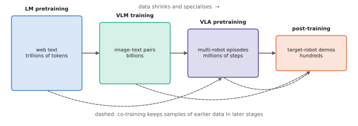

# 9.1 Training Stages and Co-Training

A VLA is not trained once; it is assembled from a sequence of training stages, each on a different kind of data and each starting from the previous stage's weights. This section lays out that pipeline end to end — from web-scale pretraining to the few hundred demonstrations of your own robot — and the one technique that holds it together: **co-training**, mixing data from earlier stages into later ones so that what was learned is not forgotten.

## What is it?

!!! definition "The VLA training pipeline"
    | Stage | Data | Trains | Produces |
    |---|---|---|---|
    | 0. unimodal pretraining | web text; web images or image–text pairs | LM; vision encoder | an LLM, a SigLIP/DINOv2 encoder ([Chapters 2–4](../04-alignment/index.md)) |
    | 1. VLM training | captions, VQA, grounding, documents | connector, LM (and encoder) | a VLM ([Chapter 5](../05-vlms/index.md)) |
    | 2. robot **pretraining** | large, diverse, multi-robot demonstration mixtures (+ web data) | everything, incl. a new action head | a *generalist* VLA |
    | 3. robot **post-training** | demonstrations of the target robot and tasks | everything, or adapters only ([9.4](finetuning.md)) | a *specialist* for your robot |
    | 4. (optional) improvement | rollouts with rewards, interventions | small parts of the policy ([7.6](../07-decision-making/rl-finetuning.md)) | a more reliable policy |

    Each stage minimises a [behavioural-cloning](../07-decision-making/behavior-cloning.md) or language-modelling loss on its data, initialised from the previous stage.

!!! definition "Co-training"
    **Co-training** optimises a mixture of objectives in the same run,

    $$
    \mathcal{L}(\theta)=\sum_{k}w_k\,\mathbb{E}_{(x,y)\sim\mathcal{D}_k}\big[\ell_k(\theta;x,y)\big],\qquad\sum_kw_k=1,
    $$

    where the datasets $\mathcal{D}_k$ are, for example, robot demonstrations (action loss), web VQA (text loss) and other robots' demonstrations, and the weights $w_k$ set how often each appears in a batch.

## Why does it exist?

Each stage exists because the data for the next one is scarce. Robot demonstrations number in the millions of episodes at most; image–text pairs in the billions; web text in the trillions of tokens. The pipeline moves from abundant, general data to scarce, specific data, so that the scarce data only has to teach what nothing else can — how *this* robot moves.

Fine-tuning on narrow data, however, overwrites what the earlier stages taught: **catastrophic forgetting**. A VLA fine-tuned only on pick-and-place demonstrations loses its ability to recognise unseen objects or follow novel phrasings — the very generalisation that motivated using a VLM ([8.1](../08-vla/definition.md#why-does-it-exist)). RT-2 showed the remedy: **co-fine-tune** on robot data *and* the original web VQA data, so that the backbone keeps answering questions while learning to act. π0.5 pushed it further, co-training on heterogeneous data — other robots, high-level subtask prediction in language, web data — and attributed its generalisation to new homes largely to that mixture.

## How does it work?

### Mixture weights

The weights $w_k$ are the most important hyperparameters of a VLA training run and are set empirically. Practical rules from published recipes:

- **Upweight the target**: in post-training, most of the batch is the target robot's data; earlier data is a minority "reminder".
- **Balance by information, not by size**: a huge dataset of near-identical episodes should not dominate a small, diverse one. Open X-Embodiment mixtures down-weight some datasets and up-weight others ([9.3](datasets.md)).
- **Keep the language objective alive**: a few percent of web VQA (RT-2-style) is enough to preserve much of the backbone's semantic ability.
- **Watch for negative transfer**: data from a very different embodiment can hurt; measure, do not assume.

<figure markdown="span">
  
  <figcaption markdown="span">The VLA training pipeline. Data shrinks and specialises from left to right — trillions of text tokens, billions of image–text pairs, millions of multi-robot episodes, hundreds of target-robot demonstrations. Co-training (dashed arrows) carries samples of earlier data into later stages so that general knowledge is not forgotten while robot-specific behaviour is learned.</figcaption>
</figure>

### What changes between pretraining and post-training

| | Robot pretraining | Post-training |
|---|---|---|
| data | many robots, scenes, tasks; quality varies | your robot, your scenes, curated |
| action space | unified (padded, normalised per dataset) | your robot's, normalised with your statistics |
| learning rate, steps | larger, long | smaller, short (hours) |
| parameters | all | all, or LoRA adapters ([9.4](finetuning.md)) |
| goal | breadth: a prior over manipulation | depth: reliability on the target tasks |

A generalist checkpoint is a starting point, not a product: zero-shot deployment on a new robot rarely works, because cameras, action spaces and dynamics differ. Post-training on tens to hundreds of demonstrations of the target setup is the norm ([Chapter 10](../10-case-studies/index.md)).

### Hierarchical outputs inside one model

A recent trend trains the same VLA to output *both* language and actions: a high-level subtask in text ("pick up the toolbox") followed by low-level actions for it. The text outputs are supervised with annotated subtasks or web data; the actions with demonstrations. At run time the model first predicts the next subtask, then the actions conditioned on it — the planner–controller hierarchy of [5.5](../05-vlms/to-action.md) inside one network (π0.5 does this).

## Implementation: a co-training data loader

```python
import random

class MixtureLoader:
    """Sample batches from several datasets with fixed weights; each dataset yields (inputs, targets, loss_kind)."""

    def __init__(self, datasets: dict, weights: dict, batch_size: int, seed: int = 0):
        self.datasets, self.names = datasets, list(datasets)
        self.w = [weights[n] for n in self.names]
        self.bs, self.rng = batch_size, random.Random(seed)

    def __iter__(self):
        while True:
            names = self.rng.choices(self.names, weights=self.w, k=self.bs)   # per-sample dataset choice
            yield [(n, self.datasets[n].sample(self.rng)) for n in names]

# in the training step, route each sample to its loss:
#   robot demonstrations -> action loss (flow matching / action-token cross-entropy)
#   web VQA              -> next-token cross-entropy on the answer
loader = MixtureLoader({"depot_robot": robot_ds, "other_robots": oxe_ds, "web_vqa": vqa_ds},
                       {"depot_robot": 0.7, "other_robots": 0.2, "web_vqa": 0.1}, batch_size=64)
```

!!! lab "Lab 13, §3"
    Fine-tune the toy VLA of Lab 11 on a new task (new object kinds) with and without co-training on the original data, and measure forgetting on the original task.

## Limitations

- **Mixture weights are found by expensive trial and error**, and the best mixture depends on the evaluation tasks.
- **Forgetting is reduced, not eliminated**; capabilities that are not exercised by any training stage still decay.
- **Stages compound bias**: whatever the web data or the large robot datasets over-represent (tabletop scenes, certain robots) shapes everything downstream.

## Why it matters for VLAs and robots

For your own robots, the pipeline tells you where your effort goes. You will almost never run stages 0–2; you will download their result and spend your data budget on post-training. The quality of that small dataset ([9.2](demonstrations.md)), the action normalisation of your robot ([8.3](../08-vla/action-spaces.md)), the choice of full fine-tuning or adapters ([9.4](finetuning.md)) and a little co-training to keep the generalist's knowledge are what decide whether the result works.
