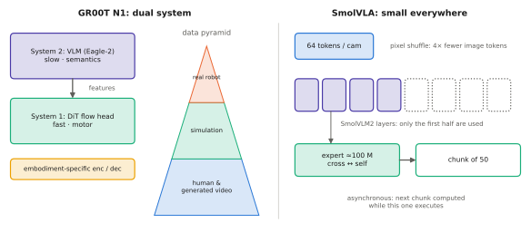

# 10.5 GR00T N1 and SmolVLA

Two 2025 systems take the action-expert design in opposite directions. NVIDIA's **GR00T N1** targets humanoids, with a dual-system design and a data pyramid that includes simulation and human video. Hugging Face's **SmolVLA** targets affordability: a VLA under half a billion parameters, trained on community data, that runs on consumer hardware. SmolVLA is also the model this course can actually run.

## GR00T N1 (NVIDIA, 2025)

| | |
|---|---|
| **Architecture** | **dual system** ([8.5](../08-vla/action-experts.md#dual-system-timing)). System 2: a VLM (Eagle-2, built from a SigLIP-2 vision encoder and a SmolLM2 language model) that processes images and the instruction; its intermediate-layer features are passed on. System 1: a **diffusion transformer** (DiT) action head, trained with **flow matching**, that cross-attends to the VLM features and self-attends over state and noisy action tokens. Flow time enters by adaptive LayerNorm |
| **Embodiments** | humanoids and arms, with **embodiment-specific** state encoders and action decoders around a shared core ([8.3](../08-vla/action-spaces.md#cross-embodiment-action-spaces)) |
| **Outputs** | action chunks for the target embodiment, produced by the fast action head at a much higher rate than the VLM |
| **Data** | a "data pyramid": large volumes of human egocentric video and neural-generated video (with pseudo-actions from latent-action models or inverse dynamics), simulation data, and real-robot teleoperation at the top |
| **Size** | about 2 B parameters |

**What was new.** An open foundation model for humanoids that treats the slow-semantic / fast-motor split as architecture, and that uses action-free and synthetic data at scale by inferring actions for it. The data pyramid is the more transferable idea: real robot data at the top, and much larger but noisier sources below.

**Limitations.** Pseudo-labelled actions from video are approximate; humanoid evaluation remains limited; the compute is high for small labs.

## SmolVLA (Shukor et al., 2025)

| | |
|---|---|
| **Architecture** | backbone from **SmolVLM2-500M** (SigLIP + small LM; [5.3](../05-vlms/small-vlms.md)) with **layer skipping**: only the first half of the LM's layers are used, since middle-layer features were sufficient for control at half the cost. **64 visual tokens** per camera via pixel shuffle. A ≈100 M flow-matching **action expert** whose layers alternate cross-attention to the backbone and self-attention among action tokens |
| **Inputs** | 1–3 cameras, the instruction, the robot state (as a token) |
| **Outputs** | chunks of 50 actions |
| **Objective** | flow matching; backbone partly frozen |
| **Data** | ~10 M frames from several hundred community datasets on the Hugging Face Hub (mostly low-cost SO-100 arms), collected by many users in many places, with cleaned and standardised task annotations |
| **Inference** | **asynchronous**: the next chunk is computed while the current one executes ([6.6](../06-generative/sampling-cost.md#why-does-it-matter-the-control-loop)); runs on a consumer GPU, even on CPU at reduced rate |
| **Size** | ≈450 M parameters |

**What was new.** Showing that a small VLA trained on *community* data (diverse, noisy, cheap) can compete with much larger models on simulation benchmarks and real low-cost arms. The efficiency choices — 64 tokens, half the layers, a small expert, asynchronous execution — are a checklist for deploying VLAs on modest hardware ([Chapter 11](../11-deployment/index.md)).

**Limitations.** Smaller backbone means less world knowledge; data is dominated by one low-cost arm type; precision tasks remain hard.

<figure markdown="span">
  
  <figcaption markdown="span">Two directions for the action-expert design. GR00T N1 splits semantic understanding (System 2 VLM) from fast motor generation (System 1 diffusion transformer) and feeds them a data pyramid from human video to real robots. SmolVLA shrinks every component: 64 image tokens per camera, half of a small VLM's layers, a 100 M expert, asynchronous chunks.</figcaption>
</figure>

## Comparing the action-expert family

| | π0 | GR00T N1 | SmolVLA |
|---|---|---|---|
| backbone | PaliGemma 3 B | Eagle-2 VLM | SmolVLM2-500M (half the layers) |
| expert coupling | shared attention, block mask | cross-attention, DiT with adaLN | interleaved cross- and self-attention |
| image tokens / camera | 256 | (VLM's own) | 64 |
| chunk | 50 | (embodiment-dependent) | 50 |
| total size | ≈3.3 B | ≈2 B | ≈0.45 B |
| distinctive idea | expert + long chunks at 50 Hz | dual system, data pyramid | efficiency, community data, async |

!!! lab "Lab 14"
    Run SmolVLA with the `lerobot` library on a sample from a LeRobot dataset: inspect its inputs, count its tokens, time the backbone and the expert, and compare with the latency model of [6.6](../06-generative/sampling-cost.md).

## Why it matters for VLAs and robots

For research on your own robots and teams, SmolVLA-class models are the realistic starting point: fine-tunable on one GPU ([9.4](../09-training/finetuning.md)), deployable on an edge computer, and open. GR00T N1's dual-system split and data pyramid are the ideas to borrow for robots whose control loops are too fast for any VLM — drones among them ([Chapter 13](../13-uavs/index.md)).
