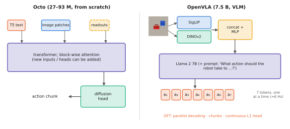

# 10.3 Octo and OpenVLA: The Open Generalists

After RT-2, two open models made generalist robot policies available to everyone, with weights, code and training data from Open X-Embodiment ([9.3](../09-training/datasets.md)). They took opposite architectural bets. **Octo** is a compact transformer trained from scratch on robot data, with a diffusion head and a design built for fine-tuning. **OpenVLA** is a 7 B VLM turned into a token-based policy. Together they bracket the design space; OpenVLA-OFT then showed how far fine-tuning recipes can move a token-based VLA.

## Octo (Octo Model Team, 2024)

| | |
|---|---|
| **Architecture** | a transformer trained **from scratch** (Octo-Small 27 M, Octo-Base 93 M parameters). Observation tokens come from a frozen T5 language encoder and from images through a shallow convolutional stem and patching. Learned **readout tokens** attend to the observation and feed a small **diffusion** action head ([8.5](../08-vla/action-experts.md#3-readout-tokens-octo)) |
| **Inputs** | primary camera (256 px), optional wrist camera (128 px), language instruction *or* goal image, a short observation history |
| **Outputs** | a chunk of a few actions, denoised by the diffusion head |
| **Objective** | diffusion (noise prediction) on action chunks |
| **Data** | ~800 k episodes from 25 OXE datasets, with curated mixture weights |
| **Inference** | fast: a small transformer once per step, and a small denoiser |

**What was new.** A generalist designed for **adaptation**. Its block-wise attention lets new observation tokens (a new sensor) and new readouts or action heads (a new action space) be added at fine-tuning time without retraining from scratch. The paper fine-tuned it to new robots, sensors and action spaces with ~100 demonstrations.

**Limitations.** No web pretraining, so semantic generalisation to unseen concepts is limited. The small model limits capacity.

## OpenVLA (Kim et al., 2024)

| | |
|---|---|
| **Architecture** | the **Prismatic** VLM: **SigLIP-So400m and DINOv2-L** patch features concatenated channel-wise ([3.4](../03-vision/encoders-for-vlas.md#fusing-two-encoders)), a 2-layer MLP projector, and a **Llama 2 7 B** language model |
| **Inputs** | one 224 px image (256 fused tokens) and the instruction in a fixed prompt template; no proprioception |
| **Outputs** | 7 action tokens (end-effector deltas + gripper), 256 bins per dimension between the 1st and 99th percentiles, mapped to the 256 least-used Llama tokens ([8.4](../08-vla/action-tokens.md)) |
| **Objective** | next-token cross-entropy on action tokens only; all parameters trained, *including the vision encoder* |
| **Data** | ~970 k episodes from OXE |
| **Training compute** | 64 A100 GPUs for about two weeks (≈21.5 k A100-hours) |
| **Inference** | ≈6 Hz on a desktop GPU in bf16; 4-bit quantisation fits it in ≈7 GB with similar success ([Chapter 11](../11-deployment/index.md)) |

**What was new.** An open, reproducible token-based VLA that outperformed the closed 55 B RT-2-X on its multi-robot evaluations, with a careful study of design decisions: fusing SigLIP with DINOv2 helped spatial tasks; fine-tuning the vision encoder was important (unlike in VLMs); 224 px sufficed; training ran for many epochs. It also showed LoRA fine-tuning matching full fine-tuning for adaptation ([9.4](../09-training/finetuning.md)).

**Limitations.** One action per call at a few hertz; single camera, no proprioception; discretisation; 7 B parameters to deploy.

## OpenVLA-OFT (Kim, Finn & Liang, 2025)

An **O**ptimised **F**ine-**T**uning recipe for the same model:

1. **parallel decoding**: empty action slots, predicted in one bidirectional pass instead of 7 sequential tokens;
2. **action chunking**: several future actions per pass;
3. **continuous actions** with an L1 regression head instead of bins;
4. extra inputs (multiple cameras, proprioception) and, for real-robot tasks, FiLM conditioning on language to strengthen instruction following.

The result was roughly an order of magnitude or more faster action generation and state-of-the-art success on the LIBERO benchmark. The trade-off ([8.4](../08-vla/action-tokens.md#parallel-decoding)): an L1 head is not multimodal, which works when task demonstrations are consistent.

<figure markdown="span">
  
  <figcaption markdown="span">Two opposite bets. Octo: a small transformer trained only on robot data, readout tokens, a diffusion head, modular inputs and outputs. OpenVLA: a 7 B VLM (two fused vision encoders, Llama 2) that writes actions as tokens. OpenVLA-OFT keeps the backbone and replaces token decoding with parallel, chunked, continuous outputs.</figcaption>
</figure>

| | Octo-Base | OpenVLA | OpenVLA-OFT |
|---|---|---|---|
| parameters | 93 M | 7.5 B | 7.5 B (+ heads) |
| web pretraining | no (T5 text encoder only) | yes (Prismatic VLM) | yes |
| action head | diffusion on readouts | 7 autoregressive tokens | parallel L1 regression, chunked |
| multimodal actions | yes | yes | no |
| speed | fast | ≈6 Hz single actions | much faster, chunked |

!!! lab "Lab 11; Lab 13"
    The toy VLA's three heads correspond to the columns above. Lab 13 applies OpenVLA's adaptation recipe (LoRA, new normalisation statistics) to the toy model.

## Why it matters for VLAs and robots

For a new robot with modest compute, these two papers are the practical starting points. Octo shows how to make a policy *adaptable*, and OpenVLA shows how to make a VLM *act*. Their published design ablations — encoders, resolution, fine-tuning the vision encoder, LoRA — are the closest thing the field has to an engineering handbook.
