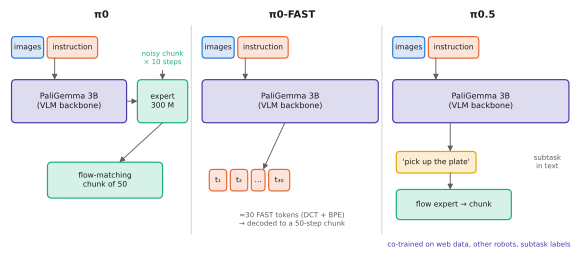

# 10.4 π0, FAST and π0.5

Physical Intelligence's π-series established the action-expert architecture for dexterous, high-frequency control with a VLM backbone. π0 attached a flow-matching expert to PaliGemma. FAST made token-based training competitive at high rates. π0.5 used heterogeneous co-training and hierarchical inference to generalise to entirely new homes. These are the systems whose design Chapter 8 dissected; here they are as whole systems.

## π0 (Black et al., 2024)

| | |
|---|---|
| **Architecture** | **PaliGemma-3B** (SigLIP-So400m + Gemma-2B) as backbone plus a ≈300 M-parameter **action expert**: a second set of transformer weights (narrower) for state and action tokens, in the same sequence, coupled by a **block-wise causal mask** ([8.5](../08-vla/action-experts.md#1-shared-attention-with-a-block-wise-mask-0)); ≈3.3 B parameters in total |
| **Inputs** | up to 3 camera images (224 px each, 256 tokens), the instruction, the robot's state (padded to the largest robot's dimension) |
| **Outputs** | a chunk of $H_a=50$ actions, at up to 50 Hz control |
| **Objective** | **flow matching** on the action chunk ([6.5](../06-generative/flow-matching.md)), with flow time sampled from a shifted Beta distribution emphasising the noisy end |
| **Data** | a large mixture: Physical Intelligence's own dexterous data across 7 robot configurations and 68 tasks, plus OXE; then post-training on high-quality task-specific data |
| **Inference** | backbone (prefix) once with KV caching, then 10 Euler steps of the expert; chunks executed open loop / partially |

**What was new.** The combination of a VLM backbone, a separate flow-matching action expert and long chunks. It made billion-parameter policies run complex, long-horizon dexterous tasks at 50 Hz: folding laundry from a hamper, bussing tables, assembling boxes. The pretraining/post-training split ([9.1](../09-training/stages.md)) was presented explicitly: pretraining for breadth and recovery behaviours, post-training for fluent execution.

## FAST and π0-FAST (Pertsch et al., 2025)

FAST tokenises action chunks with a DCT along time, quantisation and BPE ([8.4](../08-vla/action-tokens.md#fast-compress-the-chunk-before-tokenising)). **π0-FAST** is the π0 backbone trained to output FAST tokens autoregressively, with no flow expert. It matched π0's flow model on many tasks and trained considerably faster. As a token model it decodes sequentially, so it is slower at inference than the flow expert. FAST's broader contribution is to make token-based VLAs viable for high-frequency, long-chunk data, where naive per-step binning failed.

## π0.5 (Physical Intelligence, 2025)

| | |
|---|---|
| **Goal** | generalise to **entirely new environments**, such as cleaning kitchens and bedrooms in homes never seen during training |
| **Architecture** | the π0 design, trained to produce both **text** and **actions**: at run time it first predicts a high-level subtask in language ("pick up the plate"), then the low-level action chunk for it with the flow expert ([9.1](../09-training/stages.md#hierarchical-outputs-inside-one-model)) |
| **Data** | heterogeneous co-training: mobile manipulators in many homes, data from other robots, high-level subtask annotations, verbal instructions, and web data (captioning, VQA, object detection) |
| **Finding** | the breadth of the mixture — in particular other robots' data and web data — was essential for generalisation to new homes; removing parts of it degraded performance in held-out environments |

**What was new.** Open-world generalisation for long, multi-stage mobile-manipulation tasks. It relied on *what* the model was co-trained on rather than on a new architectural component, and on hierarchical inference inside one model.

<figure markdown="span">
  
  <figcaption markdown="span">The π-series as three answers to one question: how should a VLM produce high-rate actions? π0 adds a flow-matching action expert that reads the VLM through a block-wise mask. π0-FAST keeps a single model and compresses the action chunk into a few dozen tokens. π0.5 adds a language step — predict the subtask, then its actions — and broad co-training.</figcaption>
</figure>

## Reading π0 mechanistically

| Question | π0 |
|---|---|
| tokens | 3 × 256 image tokens + ~20 text tokens (prefix, bidirectional); 1 state token; 50 noisy action tokens (expert weights) |
| fusion | in-sequence, every layer, through the block-wise mask |
| where the action comes out | the expert's output at the action positions: a velocity field integrated over 10 steps |
| per-chunk cost | one prefix pass of a 2.6 B backbone (cached) + 10 passes of a 300 M expert over 51 tokens |

!!! lab "Lab 11"
    The toy VLA's flow head reproduces π0's training objective and inference loop in miniature, with cross-attention instead of shared attention.

## Limitations

- **Compute**: a high-end GPU near the robot for 50 Hz control; the full pretraining recipe and data are not public (the π0 and π0-FAST weights were released).
- **Open-loop chunks** limit reactivity ([8.6](../08-vla/chunking.md)); real-time chunking methods were developed to mitigate this.
- **Generalisation is broad but not guaranteed**; evaluation is necessarily on limited sets of homes and tasks ([9.5](../09-training/evaluation.md)).

## Why it matters for VLAs and robots

π0's backbone + expert + chunk pattern is the template for most current VLAs, including the small ones you can run yourself. π0.5's lesson is about data: heterogeneous co-training, not only scale, drove open-world generalisation. That is directly relevant to multi-robot fleets, which naturally produce heterogeneous data ([Chapter 14](../14-multi-robot/index.md)).
