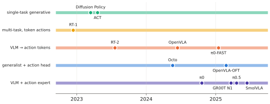

# 10.1 Precursors: ACT and Diffusion Policy

Before VLAs, two single-task policies established the techniques every VLA now uses: **action chunking** (ACT) and **generative action heads** (Diffusion Policy). Neither has a language model or web pretraining; both are trained from scratch on tens to hundreds of demonstrations of one task. They remain the strongest baselines for narrow tasks and the right first thing to try on a new robot.

Each case study in this chapter answers the same questions: architecture, inputs, outputs, training objective, data, inference, compute, strengths, limitations, and what was genuinely new.

## ACT — Action Chunking with Transformers (Zhao et al., 2023)

| | |
|---|---|
| **Architecture** | CVAE ([6.3](../06-generative/vae.md)): a transformer *encoder* compresses (joint state, action chunk) into a 32-D latent $\mathbf{z}$ (training only); the *policy* is a transformer encoder over ResNet-18 features of four cameras, joint positions and $\mathbf{z}$, plus a transformer decoder whose $k$ learned queries output the chunk |
| **Inputs** | 4 RGB cameras at 480×640 (each → a 15×20 feature map → 300 tokens), 14 joint positions of two arms |
| **Outputs** | a chunk of $k=100$ future joint-position targets for both arms (50 Hz → 2 s) |
| **Objective** | L1 reconstruction of the chunk + $\beta\cdot$KL ($\beta=10$) |
| **Data** | ~50 human demonstrations per task, collected with ALOHA leader–follower arms ([9.2](../09-training/demonstrations.md)) |
| **Inference** | $\mathbf{z}=\mathbf{0}$; a chunk every step, **temporal ensembling** of overlapping chunks ([8.6](../08-vla/chunking.md)) |
| **Compute** | ~80 M parameters; trains in hours on one GPU; real-time on a laptop GPU |

**What was new.** Predicting long chunks instead of single actions, and showing that this, plus temporal ensembling, turns a behaviour-cloning policy into one that performs fine bimanual tasks (opening a cup, threading a zip tie) from 50 demonstrations on low-cost hardware. The ablations attribute most of the gain to chunking; the CVAE matters most with human (multimodal) data.

**Limitations.** One task per policy, no language, no pretraining; deterministic at test time; temporal ensembling averages modes if they ever disagree.

## Diffusion Policy (Chi et al., 2023)

| | |
|---|---|
| **Architecture** | a denoiser ([6.4](../06-generative/diffusion.md)) over action chunks conditioned on observation features: either a 1-D temporal **U-Net** with FiLM conditioning or a **transformer** with cross-attention to observation tokens; visual encoder ResNet-18 trained end-to-end, with GroupNorm and spatial-softmax pooling |
| **Inputs** | the last $T_o=2$ observations (images + low-dimensional state) |
| **Outputs** | a chunk of $T_p=16$ actions, of which $T_a=8$ are executed (receding horizon) |
| **Objective** | DDPM noise prediction |
| **Data** | tens to a few hundred demonstrations per task (simulation benchmarks and real tasks) |
| **Inference** | DDPM or DDIM with tens of denoising steps per chunk |
| **Compute** | tens of millions of parameters; real time on a desktop GPU |

**What was new.** Treating action generation as conditional generative modelling of whole chunks. It handled multimodal demonstrations (pushing a T-shaped block from either side) that regression, mixtures and energy-based policies failed on, and it trained stably. It improved substantially over prior methods across a dozen benchmark tasks.

**Limitations.** One task per policy; the sampling cost of diffusion ([6.6](../06-generative/sampling-cost.md)); no language or semantic generalisation.

<figure markdown="span">
  
  <figcaption markdown="span">The lineage of the systems in this chapter. Single-task generative policies (ACT, Diffusion Policy) contributed chunking and generative heads. Large multi-task transformers (RT-1) contributed scale and token actions. VLMs fine-tuned for actions (RT-2, OpenVLA) contributed web knowledge. Action-expert VLAs (π0, GR00T N1, SmolVLA) combine all of them.</figcaption>
</figure>

## What they teach about VLAs

| Idea | Origin | Where it lives in VLAs |
|---|---|---|
| action chunks | ACT | every modern VLA ($H_a$ = 4–50) |
| temporal ensembling / receding horizon | ACT / Diffusion Policy | execution schemes ([8.6](../08-vla/chunking.md)) |
| generative action heads | Diffusion Policy (and ACT's CVAE) | flow and diffusion experts (π0, Octo, GR00T, SmolVLA) |
| low-cost teleoperation hardware | ALOHA | the community datasets SmolVLA trains on |

!!! lab "Labs 09 and 11"
    Lab 09 compares the CVAE and diffusion heads of these two systems on a multimodal toy; Lab 11 runs chunking, receding horizon and temporal ensembling on the toy VLA.

## Why it matters for VLAs and robots

Before reaching for a billion-parameter VLA, ask whether the task is narrow enough for ACT or Diffusion Policy. With fifty good demonstrations of one task in one setup they are often as reliable, far faster, and trainable in an afternoon. VLAs earn their cost when you need many tasks, language instructions, or generalisation to new objects and scenes.
