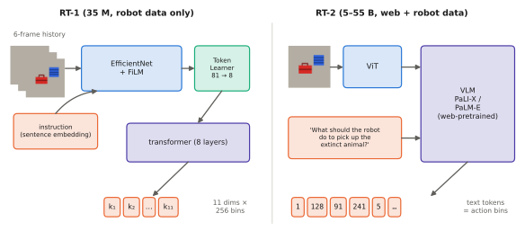

# 10.2 RT-1 and RT-2

Google's Robotics Transformer line made two jumps. RT-1 showed that a single transformer policy trained on a large, diverse real-robot dataset can perform hundreds of tasks. RT-2 showed that if that policy *is* a web-pretrained vision-language model, web knowledge transfers to the robot. RT-2 also coined the term "vision-language-action model".

## RT-1 (Brohan et al., 2022)

| | |
|---|---|
| **Architecture** | an ImageNet-pretrained **EfficientNet-B3** conditioned on the instruction by **FiLM** layers ([1.3](../01-multimodal-intro/combining.md#how-to-fuse-four-mechanisms)), with the instruction embedded by a frozen sentence encoder (Universal Sentence Encoder); **TokenLearner** compresses each image's 81 feature tokens to 8; a decoder-only transformer over the tokens of the last 6 images (48 tokens); ~35 M parameters |
| **Inputs** | 6 frames of a single 300×300 head camera; the instruction |
| **Outputs** | one action per step, 11 dimensions — 7 arm (end-effector position, orientation, gripper), 3 base, 1 mode (arm / base / terminate) — each discretised into **256 bins** and predicted as a categorical |
| **Objective** | cross-entropy on the action bins (behavioural cloning) |
| **Data** | ~130 k teleoperated episodes, 700+ tasks, 13 mobile manipulators, collected over 17 months in office kitchens |
| **Inference** | 3 Hz on the robot |

**What was new.** Scale and diversity of real-robot data with a high-capacity architecture. RT-1 reached high success on seen tasks and generalised better than earlier policies to unseen instructions, distractors and backgrounds. Its ablations showed that data *diversity* mattered more than size ([9.6](../09-training/data-scaling.md)).

## RT-2 (Brohan et al., 2023)

| | |
|---|---|
| **Architecture** | an off-the-shelf **VLM** — PaLI-X (5 B and 55 B) or PaLM-E (12 B) — unchanged except for the output vocabulary |
| **Inputs** | one camera image and the instruction, in a VQA-style prompt |
| **Outputs** | an action as **8 text tokens**: a termination flag, 6 end-effector deltas and the gripper, each of the latter discretised into 256 bins mapped to existing integer tokens (PaLI-X) or to the 256 least-used tokens (PaLM-E) ([8.4](../08-vla/action-tokens.md)) |
| **Objective** | next-token cross-entropy on the action tokens, **co-fine-tuned** with the VLM's original web VQA/captioning data ([9.1](../09-training/stages.md)) |
| **Data** | the RT-1 robot dataset plus web-scale vision-language data |
| **Inference** | in the cloud on TPUs, about 1–3 Hz for the 55 B model and around 5 Hz for the 5 B model |

**What was new.** The demonstration that semantic knowledge transfers from web data into robot behaviour. RT-2 could act on instructions requiring concepts absent from the robot data: "move the banana to the sum of two plus one" (place it on the number 3), "pick up the extinct animal" (a toy dinosaur), "move the object to the Taylor Swift picture". Co-fine-tuning beat robot-only fine-tuning on these generalisation tests, and larger models generalised better.

**Limitations.** No new *skills*: RT-2 recombined the motions in the robot data with new semantics, but did not learn motions it had never seen. Cloud-only inference at a few hertz. Single actions without chunks. Closed weights.

<figure markdown="span">
  
  <figcaption markdown="span">RT-1 versus RT-2. RT-1 is a purpose-built, instruction-conditioned image encoder with token compression and a small transformer. RT-2 is an unmodified vision-language model whose text output *is* the action. The same 256-bin discretisation connects them. What changed is where the knowledge comes from: robot data alone versus web pretraining plus robot data.</figcaption>
</figure>

## Reading them mechanistically

Apply the three questions of [1.3](../01-multimodal-intro/combining.md#why-it-matters-for-vlas-and-robots):

| | RT-1 | RT-2 |
|---|---|---|
| what are the tokens? | 8 TokenLearner tokens per image × 6 frames | ViT patch tokens + text tokens |
| where is fusion? | FiLM inside the image encoder, then self-attention | in-sequence, in a pretrained LLM |
| where does the action come out? | categorical heads per dimension | text tokens, autoregressively |

!!! lab "Lab 11, §6"
    The toy VLA's token head is RT-2's mechanism in miniature: action bins as tokens, decoded by the backbone itself.

## Why it matters for VLAs and robots

RT-1 set the data agenda (diverse, multi-task, real), RT-2 set the architectural agenda (start from a VLM), and both used the token interface whose cost and limits Chapter 8 analysed. Their closed weights and cloud-scale inference made the next steps — open models that run on one GPU — the field's priority.
