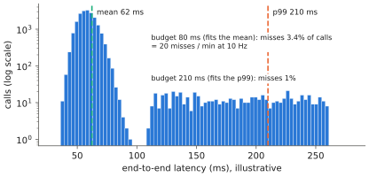

# 11.1 Latency Budgets and Control Rates

[8.7](../08-vla/closed-loop.md) gave the anatomy of a VLA control loop. This section turns it into an engineering procedure: write the budget, measure every stage under realistic load, design for the tail rather than the mean, and decide what to change when the budget does not close. It is the difference between "the model runs at 10 Hz on my desk" and "the robot reliably acts at 10 Hz in the depot".

## What is it?

!!! definition "Latency budget"
    A **latency budget** assigns every stage of the loop — sensing, transport, preprocessing, model, post-processing, hand-off — a time allowance whose sum must stay below the **deadline** set by the control scheme:

    $$
    \underbrace{t_\text{sense}+t_\text{transport}+t_\text{pre}+t_\text{model}+t_\text{post}+t_\text{handoff}}_{t_\text{e2e}}\ \le\ D,\qquad
    D=\begin{cases}H_e\,\Delta t & \text{synchronous chunked execution}\\ \text{staleness the task tolerates} & \text{asynchronous execution}\end{cases}
    $$

    with every term taken at a high percentile (p99 or worst case), not the mean.

## Why does it matter?

Robots fail on the tail. A policy whose mean latency is 60 ms but whose p99 is 250 ms (garbage collection, a thermal throttle, a network hiccup, another process on the GPU) will, a few times per minute, leave the controller without a new chunk. The controller then holds or repeats the last command, or the watchdog stops the robot. For an arm this is a jerk or a pause. For a drone flying with velocity setpoints it is a stretch of flight on stale commands ([Chapter 13](../13-uavs/index.md)).

## How does it work?

### 1. Write the budget before building

| Stage | Typical | What drives it |
|---|---|---|
| camera exposure + readout | 5–30 ms | exposure time, sensor, rolling shutter |
| transport (USB/GigE/ROS 2) | 1–20 ms | bandwidth, serialisation, copies |
| preprocessing | 1–10 ms | resizing, normalisation; in Python on CPU it is often the slowest stage |
| vision encoder | 5–50 ms per camera | resolution → tokens ([3.4](../03-vision/encoders-for-vlas.md)) |
| backbone prefill | 20–300 ms | tokens × parameters; compute-bound ([2.6](../02-transformers/inference.md)) |
| action head | 1 pass to 10s of passes | head family ([6.6](../06-generative/sampling-cost.md)) |
| post-processing + hand-off | 1–5 ms | un-normalisation, safety filter, middleware |

### 2. Measure under deployment conditions

Measure on the target hardware, at its power mode and temperature, with the other robot processes running (localisation, perception, logging), using timestamps carried *with the data* rather than wall-clock deltas inside one function. Report the p50, p90, p99 and maximum over minutes of operation.

<figure markdown="span">
  
  <figcaption markdown="span">Why budgets use the tail. A latency distribution measured over minutes of operation (illustrative) has a long right tail from garbage collection, thermal throttling and contention. A budget that fits the mean misses the deadline several times per minute; a budget that fits the p99 misses it rarely, and a watchdog handles the rest.</figcaption>
</figure>

### 3. Close the budget

If $t_\text{e2e}$ exceeds the deadline, the levers in order of typical payoff:

1. **Fewer tokens**: lower resolution, fewer cameras, token reduction ([3.4](../03-vision/encoders-for-vlas.md#reducing-tokens)).
2. **Fewer bytes per weight**: quantisation; decode is bandwidth-bound ([11.2](memory-quantization.md)).
3. **Fewer sequential passes**: a flow expert instead of action tokens, fewer integration steps, parallel decoding ([8.4](../08-vla/action-tokens.md), [8.5](../08-vla/action-experts.md)).
4. **Longer chunks or asynchronous execution**: more time per inference, at the cost of reactivity or staleness ([8.6](../08-vla/chunking.md)).
5. **Compiled inference**: TensorRT, `torch.compile`, CUDA graphs remove Python and kernel-launch overhead, which dominates small models (Lab 05's observation).
6. **Move preprocessing to the GPU** and avoid host↔device copies.
7. **A smaller model**: the last resort, but sometimes the right one ([10.5](../10-case-studies/groot-smolvla.md)).

### 4. Decide what happens when the deadline is missed

Late is a normal event, not an exception. Decide in advance:

- **arms**: hold position (or continue the current chunk if the remaining actions are still valid), then stop if no chunk arrives within a timeout;
- **drones**: never hold a velocity command indefinitely. A stale setpoint decays to hover, and a timeout triggers PX4's offboard-loss failsafe ([Chapter 13](../13-uavs/index.md));
- **always**: log the miss with its cause.

## Implementation: a latency profiler with percentiles

```python
import time
from collections import defaultdict

import numpy as np

class StageTimer:
    """Collect per-stage latencies; report percentiles. Use time.perf_counter_ns and synchronise the GPU."""

    def __init__(self):
        self.samples = defaultdict(list)

    def measure(self, stage, fn, *args, sync=None, **kw):
        t0 = time.perf_counter_ns()
        out = fn(*args, **kw)
        if sync is not None:
            sync()                                     # e.g. torch.cuda.synchronize
        self.samples[stage].append((time.perf_counter_ns() - t0) / 1e6)
        return out

    def report(self):
        for stage, v in self.samples.items():
            v = np.array(v)
            print(f"{stage:14s} p50 {np.percentile(v, 50):7.2f}  p90 {np.percentile(v, 90):7.2f}  "
                  f"p99 {np.percentile(v, 99):7.2f}  max {v.max():7.2f} ms  (n={len(v)})")
```

!!! lab "Lab 14, §5"
    Profile SmolVLA stage by stage on your machine (preprocessing, vision, backbone, expert), with p50/p99, and compute which chunk execution horizon $H_e$ closes the budget at 10, 30 and 50 Hz.

## Limitations

- **Simulation hides latency**: physics waits for the policy. Inject measured delays into simulated evaluation to see their effect.
- **Percentiles need long measurements**; a p99 from 100 samples is a guess.
- **Budgets interact with behaviour**: a longer $H_e$ that closes the budget may break the task's reactivity requirement.

## Why it matters for VLAs and robots

A VLA that misses its deadlines is not a slow policy; it is a different, untested policy (the one that holds or repeats stale commands). Writing and measuring the latency budget is how you find out which policy you are actually deploying.
