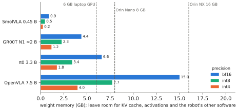

# 11.2 Memory, Quantisation and Edge Hardware

A VLA's first deployment question is not "how accurate?" but "does it fit, and how fast can its weights be read?". [2.6](../02-transformers/inference.md) showed that decoding is memory-bandwidth-bound, so bytes per weight translate directly into milliseconds. This section covers the memory arithmetic, quantisation methods and their effect on control, and the edge computers that robots actually carry.

## What is it?

!!! definition "Weight quantisation"
    **Quantisation** stores each weight with fewer bits. For a group of $g$ weights $\mathbf{w}$ (typically $g=64$–$128$ consecutive values) with $b$ bits, symmetric uniform quantisation stores

    $$
    q_i=\operatorname{round}\Big(\frac{w_i}{s}\Big)\in\{-2^{b-1},\dots,2^{b-1}-1\},\qquad s=\frac{\max_i|w_i|}{2^{b-1}-1},
    $$

    plus one scale $s$ per group; at run time $\hat w_i=s\,q_i$. **Weight-only** quantisation (int8/int4 weights, bf16 activations) cuts memory and bandwidth; quantising **activations** as well (int8/fp8 matmuls) also speeds up compute-bound phases.

| Format | Bytes / weight | 7 B model | 0.45 B model | Notes |
|---|---|---|---|---|
| fp32 | 4 | 28 GB | 1.8 GB | training master weights |
| bf16 / fp16 | 2 | 14 GB | 0.9 GB | default inference |
| int8 | 1 (+ scales) | ~7.5 GB | ~0.5 GB | near-lossless for most layers |
| int4 (NF4, GPTQ, AWQ) | 0.5 (+ scales) | ~4 GB | ~0.25 GB | small accuracy loss; outlier-aware methods matter |

## Why does it matter?

Two constraints. **Capacity**: the weights, KV cache, activations and the rest of the robot software must fit in the device's memory, which on embedded computers is *shared* between CPU and GPU. **Bandwidth**: every decode step and every action-expert step reads the weights involved; halving bytes roughly halves the time of bandwidth-bound phases. OpenVLA reported that 4-bit quantisation brought its memory to about 7 GB with success rates close to bf16, while 8-bit was, in their setup, *slower* than bf16 because of dequantisation overhead — quantisation speed depends on kernels, not only on bits.

## How does it work?

### Methods

- **Round-to-nearest (RTN)** per group: simple; fine at 8 bits; degrades at 4 bits for layers with outliers.
- **NF4** (QLoRA's 4-bit NormalFloat): quantisation levels placed at quantiles of a normal distribution, matching the empirical distribution of weights.
- **GPTQ**: quantises weights column by column, updating the remaining weights to compensate the error measured on calibration data (second-order information).
- **AWQ**: protects the small fraction of weights multiplied by large activations by rescaling channels before quantisation.
- **Mixed precision**: keep sensitive parts — vision encoder, first/last layers, the action head — in bf16 and quantise the bulk of the backbone.

### What quantisation does to control

Language benchmarks tolerate small perturbations of the output distribution; control may not. A slightly different flow-velocity field, or a shifted action-token probability, changes trajectories — usually harmlessly, sometimes at the precision limit of a task (insertion, grasping thin objects). Validate quantised models **in closed loop on the tasks that need precision**, not only by offline action error, and prefer keeping the action expert or head in higher precision.

### Edge hardware

| Device | Memory (shared) | Bandwidth | Fits (bf16 / int4) |
|---|---|---|---|
| Jetson Orin Nano 8 GB | 8 GB | 68 GB/s (≈100 GB/s in "Super" mode) | SmolVLA-class / ~3 B in 4-bit, slowly |
| Jetson Orin NX 16 GB | 16 GB | 102 GB/s | 3 B in bf16 tight; 7 B in 4-bit |
| Jetson AGX Orin 64 GB | 64 GB | 205 GB/s | 7 B in bf16 |
| laptop / desktop GPU | 6–24 GB dedicated | 0.2–1 TB/s | depends on VRAM |

The bandwidth column gives the decode bound directly: $t_\text{step}\gtrsim\text{bytes read}/\text{bandwidth}$ ([2.6](../02-transformers/inference.md#arithmetic-intensity)). Power matters too: a drone's companion computer may have a 10–25 W budget, which caps both compute and clocks. Vendor inference stacks (TensorRT and TensorRT-LLM on Jetson) provide fused, quantised kernels that are usually several times faster than eager PyTorch.

<figure markdown="span">
  
  <figcaption markdown="span">What fits where. Weight memory of VLAs from this book at bf16, int8 and int4 against the shared memory of common edge computers, leaving room for the KV cache, activations and the rest of the robot software. SmolVLA-class models fit anywhere; 7 B models need 4-bit quantisation or a large Orin.</figcaption>
</figure>

## Implementation: group-wise int4 quantisation by hand

```python
import torch

def quantize_int4(w: torch.Tensor, group: int = 64):
    """Symmetric per-group int4 quantisation of a 2-D weight (rows = output channels)."""
    out_f, in_f = w.shape
    wg = w.reshape(out_f, in_f // group, group)
    scale = wg.abs().amax(-1, keepdim=True).clamp(min=1e-8) / 7          # int4 range: -8..7
    q = torch.clamp(torch.round(wg / scale), -8, 7).to(torch.int8)
    return q, scale

def dequantize(q, scale, shape):
    return (q.float() * scale).reshape(shape)

w = torch.randn(1024, 1024) * 0.02
q, s = quantize_int4(w)
err = (dequantize(q, s, w.shape) - w).norm() / w.norm()
print(f"relative weight error {err:.3f}; bits/weight ≈ {4 + 16 / 64:.2f}")   # scales stored in fp16
```

!!! lab "Lab 14, §6"
    Quantise SmolVLA's language model and action expert to int8 and int4 by hand (group-wise, weight-only, simulated by quantise–dequantise), compute the memory each would need, and measure how far the predicted action chunks move from bf16 on dataset frames. Exercise 4 measures real low-bit kernels.

## Limitations

- **Speed-ups depend on kernels**: without fused low-bit kernels, quantisation saves memory but may cost time.
- **Calibration data matters** for GPTQ/AWQ; calibrate on robot observations, not web text.
- **Closed-loop validation is required**; offline error under-predicts control degradation at the precision limit.

## Why it matters for VLAs and robots

Bytes per weight is the most direct lever on both whether a VLA fits on a robot and how fast it runs. For UAVs, whose companion computers are small and power-limited, it often decides between "a VLA on board", "a VLA on a ground station over the radio link", and "no VLA in the loop at all" ([Chapter 13](../13-uavs/index.md)).
