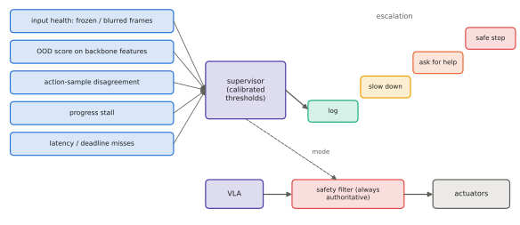

# 11.5 Monitoring, Logging, Failure Modes and Reproducibility

A deployed VLA will fail; the question is whether you will know when, why, and whether you can reproduce it. This section covers what to log, how to monitor a learned policy at run time (including cheap uncertainty and out-of-distribution signals), a catalogue of deployment failure modes, and how to make a deployment reproducible months later.

## What is it?

!!! definition "Runtime monitoring"
    **Runtime monitoring** computes signals during operation that predict or detect failure — latency and deadline misses, input health, distance from the training distribution, policy uncertainty, task progress — and triggers responses: log, alert, slow down, ask for help, or stop.

## Why does it matter?

Offline evaluation measures average behaviour on anticipated conditions ([9.5](../09-training/evaluation.md)); deployment produces the unanticipated ones. Without logs you cannot debug them, without monitors you cannot react to them, and without versioning you cannot tell which model, which normalisation statistics and which prompt produced them. For robots operating near people or flying, this is also an accountability requirement.

## How does it work?

### What to log, always

| Stream | Why |
|---|---|
| raw sensor inputs (images, state) at the policy's rate | replay the exact observation |
| instruction and prompt as sent to the model | language is an input; prompts drift |
| every action chunk with the observation timestamp it was computed from | what the model wanted |
| every command actually sent after the safety filter, and filter interventions | what the robot did, and when safety overrode the model |
| latencies per stage, deadline misses | timing failures |
| model identity: weights hash, normalisation statistics, config, code version | reproducibility |

ROS 2 `rosbag2` (MCAP storage) records topics with timestamps and supports replay ([11.4](ros2.md)). Log compactly but completely: images can be compressed; actions and metadata are tiny.

### Cheap uncertainty and OOD signals for VLAs

- **Sample disagreement** (flow/diffusion heads): draw $K$ action chunks for the same observation and measure their spread. Large spread means multimodality or uncertainty. Sustained spread on a task that was unimodal in training is a warning.
- **Token entropy** (token heads): the entropy of action-token distributions ([0.4](../00-foundations/probability.md#entropy-cross-entropy-and-kl-divergence)).
- **Feature-space distance**: distance of the current backbone features from the training distribution (e.g. Mahalanobis distance or nearest-neighbour distance in a pooled embedding).
- **Progress stall**: no change in task-relevant state for a time window — the policy is stuck or dithering.
- **Input health**: blurred, saturated or frozen images (identical frames), missing joints, clock skew.

None of these is a calibrated probability of failure. Calibrate thresholds on logged deployment data, with the false-alarm and missed-detection costs of your task.

<figure markdown="span">
  
  <figcaption markdown="span">Monitoring around a VLA. Input-health checks, out-of-distribution scores on backbone features, action-sample disagreement, progress tracking and latency checks feed a supervisor. The supervisor escalates — log, slow down, request human help, safe stop — while the safety filter stays authoritative over the actuators regardless.</figcaption>
</figure>

### Failure modes in deployment

| Failure | Typical cause | Detection | Mitigation |
|---|---|---|---|
| silent performance drop after an update | changed normalisation stats, prompt template or camera order | regression tests on logged episodes | version and test the full input/output pipeline |
| dithering between targets | stochastic head, ambiguous scene | sample disagreement, progress stall | chunk commitment, ask for clarification |
| acting on stale data | latency spikes, network | timestamps, deadline misses | staleness checks, watchdog |
| confident wrong target | grounding failure, hallucination ([4.5](../04-alignment/failure-modes.md), [5.4](../05-vlms/spatial.md)) | independent verification (detector, depth) | verify before irreversible actions |
| drift into unseen states | compounding error ([7.3](../07-decision-making/covariate-shift.md)) | OOD score rising | recovery behaviours, human intervention |
| thermal throttling | sustained load on edge hardware | latency trend, device temperature | lower rate, active cooling, smaller model |

### Reproducibility

A deployment is reproducible if, months later, you can reconstruct exactly what produced an action. Pin and record: model weights (hash), normalisation statistics, tokenizer, prompt template, preprocessing code, control rate and chunking parameters, library versions (PyTorch, CUDA, TensorRT), hardware and power mode, and random seeds where sampling is involved. Package them together (a model card plus a lock file), and make the logged episode reference that package. Then **regression-test** every new version against a fixed set of logged and simulated episodes before it reaches a robot.

## Implementation: sample-disagreement monitor for a flow head

```python
import torch

@torch.no_grad()
def action_disagreement(vla, images, instr, state, k=8, steps=10):
    """Spread of k sampled chunks for the same observation: mean over steps/dims of the per-dimension std."""
    rep = lambda t: t.repeat_interleave(k, 0)                         # noqa: E731
    chunks = vla.act(rep(images), rep(instr), rep(state), steps=steps)  # (B*k, H_a, d_a)
    chunks = chunks.view(len(images), k, *chunks.shape[1:])
    return chunks.std(1).mean((-1, -2))                                  # (B,)

# use: trigger a clarification request or a slower, more cautious mode above a calibrated threshold
```

!!! lab "Lab 11, exercise 7, and Lab 14"
    Compute action disagreement for the toy VLA's flow head on ambiguous vs specific instructions; log SmolVLA's inputs, outputs and latencies for a replayable episode.

## Limitations

- **Uncertainty signals are heuristic** and need calibration on deployment data.
- **Logs are large**; deciding what to keep is itself a design decision (privacy, storage).
- **Reproducibility across hardware** is limited by non-deterministic GPU kernels; aim for statistical, not bitwise, reproducibility of behaviour.

## Why it matters for VLAs and robots

Monitoring turns a black-box policy into an inspectable component, and its outputs feed the safety architecture of [Chapter 12](../12-embodied/index.md). For teams of robots, monitoring signals are also communication. A robot that knows it is uncertain can ask a teammate or the operator, a capability central to [Chapter 14](../14-multi-robot/index.md).
