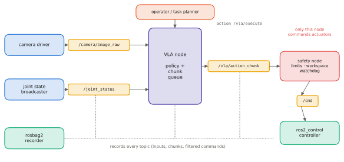

# 11.4 ROS 2 Integration

On a real robot the VLA is one process among many: camera drivers, state estimation, controllers, safety monitors, loggers. **ROS 2** is the middleware that connects them. This section designs a VLA node: what it subscribes to and publishes, how it keeps inference from blocking the control loop, which quality-of-service settings to use, and where the safety layer sits. The code targets ROS 2 Jazzy with `rclpy`. ROS 2 is not part of the course environment, so the snippets are reference implementations; [Appendix B](../../appendix/ros2-px4.md) sets up ROS 2 and PX4 SITL to run them.

## What is it?

!!! definition "ROS 2 vocabulary"
    - **Node**: a process (or component) with a name and parameters.
    - **Topic**: a typed publish/subscribe stream (`sensor_msgs/Image`, `sensor_msgs/JointState`, `geometry_msgs/TwistStamped`).
    - **Service**: a typed request/response call. **Action**: a long-running goal with feedback and cancellation, the natural interface for "execute this instruction".
    - **QoS** (quality of service): reliability (`RELIABLE` / `BEST_EFFORT`), history depth, durability; publishers and subscribers must be compatible.
    - **Executor** and **callback groups**: how callbacks are scheduled on threads.
    - **tf2**: the tree of coordinate frames (base, cameras, end effector) with timestamps.

## Why does it matter?

Integration is where timing and safety assumptions meet reality. A VLA node that runs inference inside a subscription callback blocks every other callback on its thread, including the one that should notice a stale image. A `RELIABLE` image subscription over Wi-Fi queues old frames and makes the policy act on the past. A node that publishes directly to motor controllers bypasses every check. These are the common integration bugs, and all of them are design decisions, not ML problems.

## How does it work? A VLA node design

<figure markdown="span">
  
  <figcaption markdown="span">A VLA in a ROS 2 graph. Camera and state topics feed the VLA node, which accepts instructions as an action goal and publishes action chunks. A separate safety node owns the command stream to the controllers: it filters every action (limits, workspace, collisions), and a watchdog substitutes a safe command when chunks stop arriving. Everything is recorded by rosbag2.</figcaption>
</figure>

### Topics and types

| Direction | Topic | Type | QoS |
|---|---|---|---|
| in | `/camera/head/image_raw` (or `/compressed`) | `sensor_msgs/Image` | sensor data: best effort, depth 1–5 |
| in | `/joint_states` | `sensor_msgs/JointState` | sensor data |
| in | `/vla/execute` | action `ExecuteInstruction` (goal: instruction string; feedback: progress; result: success) | default |
| out | `/vla/action_chunk` | custom `ActionChunk` (header stamp of the observation, $H_a\times d_a$ array, control period) | reliable, depth 1 |
| safety → controller | `/arm_controller/commands` or `/cmd_vel` | `trajectory_msgs/JointTrajectory`, `geometry_msgs/TwistStamped` | reliable |

The chunk carries the **timestamp of the observation** it was computed from, so the executor downstream can align it to time and discard it if it is stale ([11.3](serving.md#asynchronous-execution-over-a-network)).

### Threads: keep inference off the control path

Run inference in its own callback group (or a worker thread) with a `MultiThreadedExecutor`. Subscriptions only store the latest message, the control timer only reads queued actions, and the inference loop takes the latest snapshot, runs the model and publishes. The control loop never waits for the GPU.

### Synchronising inputs

Cameras and joint states arrive at different rates. Use the most recent message of each with a maximum age, rather than exact synchronisation, and record the ages; `message_filters.ApproximateTimeSynchronizer` helps for multi-camera rigs. Use `use_sim_time` in simulation so the same node runs against a simulator's clock.

## Implementation: a VLA node skeleton (rclpy)

```python
import threading
import numpy as np
import rclpy
from rclpy.node import Node
from rclpy.qos import qos_profile_sensor_data
from rclpy.callback_groups import MutuallyExclusiveCallbackGroup
from rclpy.executors import MultiThreadedExecutor
from sensor_msgs.msg import Image, JointState
from std_msgs.msg import Float32MultiArray, String

class VLANode(Node):
    def __init__(self, policy, max_age=0.3, period=0.1):
        super().__init__("vla")
        self.policy, self.max_age = policy, max_age
        self.latest = {"image": None, "state": None, "instruction": None}
        self.lock = threading.Lock()
        self.create_subscription(Image, "/camera/head/image_raw", self.on_image, qos_profile_sensor_data)
        self.create_subscription(JointState, "/joint_states", self.on_state, qos_profile_sensor_data)
        self.create_subscription(String, "/vla/instruction", self.on_instruction, 10)   # an action server in practice
        self.pub = self.create_publisher(Float32MultiArray, "/vla/action_chunk", 1)
        self.create_timer(period, self.infer, callback_group=MutuallyExclusiveCallbackGroup())

    def on_image(self, msg):
        with self.lock:
            self.latest["image"] = msg
    def on_state(self, msg):
        with self.lock:
            self.latest["state"] = msg
    def on_instruction(self, msg):
        with self.lock:
            self.latest["instruction"] = msg.data

    def infer(self):
        with self.lock:
            img, st, ins = self.latest["image"], self.latest["state"], self.latest["instruction"]
        if img is None or st is None or ins is None:
            return
        now = self.get_clock().now()
        age = (now - rclpy.time.Time.from_msg(img.header.stamp)).nanoseconds * 1e-9
        if age > self.max_age:
            self.get_logger().warn(f"stale image ({age:.2f} s): skipping inference")
            return
        frame = np.frombuffer(img.data, np.uint8).reshape(img.height, img.width, -1)
        chunk = self.policy(frame, ins, np.asarray(st.position, np.float32))       # (H_a, d_a)
        msg = Float32MultiArray(data=chunk.astype(np.float32).ravel().tolist())
        self.pub.publish(msg)                     # a safety node consumes this; never the motors directly

def main(policy):
    rclpy.init()
    node = VLANode(policy)
    ex = MultiThreadedExecutor(num_threads=3)
    ex.add_node(node)
    ex.spin()
```

A production version replaces `Float32MultiArray` with a custom message that carries the observation stamp and the shape, uses an action server for instructions, and runs as a lifecycle node, so that it can be configured, activated and deactivated cleanly.

!!! lab "Appendix B"
    Builds the ROS 2 workspace, runs this node against a simulated robot, and adds the safety and watchdog node of [Chapter 12](../12-embodied/index.md).

## Limitations

- **Python nodes have jitter** (GIL, garbage collection); latency-critical paths such as safety and controllers belong in C++ or in `ros2_control`.
- **DDS discovery and QoS mismatches** fail silently: a subscriber with incompatible QoS simply receives nothing. Check with `ros2 topic info -v`.
- **Large images over DDS** are expensive; use compressed transport, shared memory or zero-copy intra-process communication.

## Why it matters for VLAs and robots

ROS 2 is where the VLA meets the rest of the robot. Keep the VLA a *proposer* of time-stamped action chunks, give a separate safety node sole authority over actuator commands, and keep inference off the control path. That makes a learned policy a well-behaved component of a classical stack, which is exactly the architecture [Chapters 12–13](../12-embodied/index.md) argue for.
