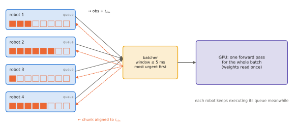

# 11.3 Serving, Batching and Asynchronous Execution

Where does the VLA run — on the robot, on a server next to it, or in the cloud — and how do robot and model talk? This section covers the three placements, the policy-server pattern, batching requests from several robots, and asynchronous execution across a network. For multi-robot systems these choices decide hardware costs and communication load more than any model detail.

## What is it?

!!! definition "Policy server"
    A **policy server** hosts the model and answers *observation → action chunk* requests from one or more **robot clients**. The client owns the control loop. It sends observations (images, state, instruction, timestamps), receives chunks, and feeds actions to the controller at the control rate. The server owns the GPU and may batch requests from several clients.

| Placement | Latency added | Pros | Cons |
|---|---|---|---|
| **on board** | none | no network dependence; privacy | limited memory, compute and power |
| **edge server** (same site, Wi-Fi/Ethernet) | 2–30 ms + jitter | big GPU shared by a fleet; easy updates | network loss and jitter; radio range |
| **cloud** | 30–200 ms + jitter | unlimited compute | unreliable for control; connectivity and privacy |

## Why does it matter?

A fleet of ten robots each carrying a 16 GB Jetson differs in cost, maintenance and capability from ten lightweight robots sharing one workstation GPU. Network placement also changes the failure model: on board, the model fails when the computer fails; served remotely, it also fails when the radio does. For drones beyond a few hundred metres, a remote policy in the loop is fragile by construction.

## How does it work?

### Batching across robots

A GPU decoding at batch 1 is bandwidth-bound and mostly idle; reading the weights once and applying them to $B$ requests costs almost the same as $B=1$ until compute becomes the limit ([2.6](../02-transformers/inference.md#arithmetic-intensity)). A server for $N$ robots can therefore batch their requests:

$$
t_\text{batch}(B)\approx\max\big(t_\text{bandwidth},\ B\cdot t_\text{compute per request}\big),\qquad\text{throughput}=B/t_\text{batch}(B).
$$

The gain depends on the phase. Decode-like steps (action tokens, small expert passes) are bandwidth- or launch-bound and batch almost for free; a prefill over hundreds of image tokens is closer to compute-bound and batches less well. Lab 14 measures SmolVLA with two 512-pixel cameras on a laptop GPU: eight requests take about four times as long as one, not eight times and not the same.

The cost is **queueing delay**: a request may wait for others to fill the batch. Dynamic batching with a short maximum wait (a few milliseconds) is the standard compromise. For robots with deadlines, prefer *deadline-aware* scheduling — serve the robot closest to running out of actions first.

<figure markdown="span">
  
  <figcaption markdown="span">A policy server for a team. Robot clients run their own control loops and send timestamped observations; the server batches requests that arrive within a short window, runs one forward pass for all of them, and returns per-robot action chunks. Each robot executes its current chunk while waiting, so batching delay is hidden as long as it fits the chunk's remaining time.</figcaption>
</figure>

### Asynchronous execution over a network

With asynchronous execution ([6.6](../06-generative/sampling-cost.md#why-does-it-matter-the-control-loop)), the client requests the next chunk when its queue drops below a threshold — before it runs out. Network latency then adds to staleness but not to pauses. Two rules keep this safe:

1. **Timestamp everything** and have the client discard chunks whose observation is older than a threshold.
2. **Align chunks to time, not to arrival**: a chunk computed for observation time $t_o$ starts at $t_o$; when it arrives at $t_o+\delta$, the first $\lceil\delta/\Delta t\rceil$ actions are already in the past and are skipped (or blended).

SmolVLA's asynchronous inference stack ([10.5](../10-case-studies/groot-smolvla.md)) implements this pattern in LeRobot with a client on the robot and a server on a GPU machine.

### Interfaces and serialisation

Images dominate traffic. A 224×224 RGB frame is 150 kB raw; at 10 Hz with two cameras that is 3 MB/s per robot — fine on Ethernet, significant over Wi-Fi for a fleet, prohibitive over long-range drone radios. JPEG compression (10–20×) or on-board encoding to visual tokens or embeddings ([3.4](../03-vision/encoders-for-vlas.md)) reduces it. gRPC or ZeroMQ with protobuf/msgpack are common transport choices; ROS 2 topics work within a site ([11.4](ros2.md)).

## Implementation: a minimal asynchronous client queue

```python
import collections
import time

class ChunkQueue:
    """Client-side action queue for asynchronous execution: request early, align chunks to observation time."""

    def __init__(self, dt, refill_below=4, max_staleness=0.3):
        self.dt, self.refill_below, self.max_staleness = dt, refill_below, max_staleness
        self.queue = collections.deque()

    def needs_refill(self):
        return len(self.queue) < self.refill_below

    def receive(self, chunk, t_obs):
        """chunk: actions for times t_obs, t_obs + dt, ...; drop the ones already in the past."""
        age = time.monotonic() - t_obs
        if age > self.max_staleness:
            return False                                 # too old to trust
        skip = int(age // self.dt)
        self.queue = collections.deque(chunk[skip:])     # replace the tail with fresher predictions
        return True

    def next_action(self, fallback):
        return self.queue.popleft() if self.queue else fallback   # fallback: hold / hover command
```

!!! lab "Lab 14, §7"
    Measure SmolVLA's time per chunk at batch sizes 1–8, then simulate a policy server for 1–8 robots executing 8 actions per chunk at 10 Hz: request-to-chunk latency, missed deadlines and GPU load as functions of team size and batching window.

## Limitations

- **Networks are not deterministic**: jitter and loss must be part of the design, not an afterthought.
- **Batching helps throughput, not single-request latency.**
- **Centralised serving is a single point of failure** for a team; on-board fallbacks are needed.

## Why it matters for VLAs and robots

For a multi-robot team, serving is architecture. One GPU can serve several robots if their requests are batched and their chunks hide the delay, which changes the economics of deploying VLAs on fleets of small robots. The same server is also a natural place for team-level reasoning — the coordinator of [Chapter 14](../14-multi-robot/index.md).
