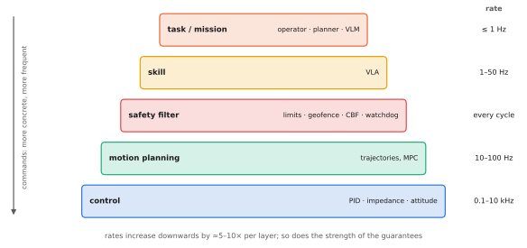

# 12.2 The Planning and Control Hierarchy

Robots have always been organised in layers that run at different rates: a task layer that decides *what*, a motion layer that decides *how to move*, and a control layer that makes the motors follow. Foundation models did not remove this structure. They changed which layers can be learned and how the top layers talk to the bottom ones. This section describes the hierarchy, the rate and guarantee of each layer, and where VLAs and VLMs fit in it.

## What is it?

!!! definition "The control hierarchy"
    A stack of layers $\ell=1,\dots,L$, from abstract to physical. Layer $\ell$ runs at rate $f_\ell$ and turns the command of layer $\ell-1$ into commands for layer $\ell+1$, using feedback at its own rate. Rates increase downwards, $f_1<f_2<\dots<f_L$, and so does the strength of the guarantees each layer can offer.

| Layer | Decides | Rate | Classical method | Learned option |
|---|---|---|---|---|
| mission / task | which tasks, in which order | events, ≤ 1 Hz | planners (PDDL, behaviour trees), operator | LLM/VLM task planner (SayCan, Code as Policies) |
| skill / policy | which motion achieves the current task | 1–50 Hz | scripted skills, motion primitives | **VLA** |
| motion planning | a collision-free trajectory to a goal | 1–20 Hz | sampling planners, trajectory optimisation, MPC | learned costs, diffusion planners |
| control | torques or rotor speeds that track the trajectory | 0.1–10 kHz | PID, impedance control, attitude control | rarely learned (RL for legged locomotion) |
| safety | reject or modify unsafe commands | as fast as the layer it guards | limits, geofences, control barrier functions | (should not be learned alone) |

## Why does it matter?

The hierarchy is how robots get both flexibility and guarantees. Lower layers are fast, local, model-based and verifiable: a joint position controller can be shown to be stable, and a geofence can be checked in microseconds. Upper layers are slow, global and flexible: they handle language, novelty and long horizons, but offer no stability guarantee. When a VLA takes over a layer, it inherits that layer's rate and responsibilities. That is why a VLA that outputs joint deltas at 10 Hz on an arm with a 1 kHz impedance controller below it is an ordinary design, while a VLA that outputs rotor speeds for a quadrotor is not ([Chapter 13](../13-uavs/index.md)).

## How does it work?

<figure markdown="span">
  
  <figcaption markdown="span">The hierarchy as a stack of loops. Each layer closes its own feedback loop at its own rate; the commands flowing down get more concrete and more frequent. VLAs typically occupy the skill layer, between language-level task planning (sometimes a VLM, sometimes π0.5-style subtask prediction inside the VLA) and classical motion planning and control. The safety layer sits below every learned component.</figcaption>
</figure>

### Rate separation

Each loop treats the loops below it as approximately ideal and the loops above it as approximately constant. The rule of thumb is a factor of 5–10 between adjacent rates. A VLA at 10 Hz commanding end-effector targets works because the 1 kHz controller reaches each target well within 100 ms; it breaks if the controller is slow or saturates. A VLA with chunked actions ([8.6](../08-vla/chunking.md)) is a step towards the motion-planning layer: a 50-step chunk is a short trajectory, and executing it open loop is trajectory following.

### Where VLAs sit, and the alternatives

1. **VLA as the skill layer** (RT-2, OpenVLA, π0, SmolVLA): outputs end-effector or joint targets for a low-level controller. The most common design for arms.
2. **VLM as the task layer, classical skills below** (SayCan, Code as Policies, [5.5](../05-vlms/to-action.md)): the model chooses among verified skills or writes code that calls them. Interpretable and safe, limited by the skill library.
3. **Hierarchical VLA** (π0.5, GR00T N1's dual system): one model predicts a subtask in language and then actions, or a slow system conditions a fast one ([10.4](../10-case-studies/pi0.md), [10.5](../10-case-studies/groot-smolvla.md)).
4. **VLA producing goals or waypoints** for a classical planner: the model decides *where*, the planner decides *how*. The natural design when the robot's dynamics are fast or dangerous — UAVs ([13.3](../13-uavs/architectures.md)).

### Interfaces between layers

The command passed between layers determines what each layer can guarantee:

| Interface | Example | What the lower layer can enforce |
|---|---|---|
| symbolic task | "pick(red_toolbox)" | preconditions, skill-level checks |
| goal pose / waypoint | $(x,y,z,\psi)$ | reachability, collision-free path, speed limits |
| trajectory / chunk | 50 timed set-points | dynamic feasibility, smoothing |
| velocity / delta | $(\dot x,\dot y,\dot z,\dot\psi)$ | limits, filtering, barrier functions |
| torque / rotor speed | $\boldsymbol{\tau}$ | almost nothing |

Moving down the table gives the learned layer more authority and the classical layer less to check. [12.4](interfaces.md) develops the interfaces and the safety filters that sit between them.

## Implementation: two-rate simulation of a VLA over a controller

```python
import numpy as np

def two_rate(policy, x0, steps=300, dt=0.002, policy_every=50, kp=40.0, kd=12.0):
    """1-D double integrator. The policy sets a target position at 10 Hz (every 50 steps of 2 ms);
    a PD controller tracks it at 500 Hz. Returns the trajectory."""
    x, v, target, traj = x0, 0.0, x0, []
    for k in range(steps):
        if k % policy_every == 0:
            target = policy(x)                     # slow, learned, no stability guarantee
        u = kp * (target - x) - kd * v             # fast, classical, provably stable for kp, kd > 0
        v += u * dt; x += v * dt
        traj.append(x)
    return np.array(traj)
```

## Limitations

- **The hierarchy constrains what can be learned end to end.** A learned skill limited to targets a controller can reach cannot exploit dynamics (throwing, dynamic manipulation) unless the interface allows it.
- **Rate separation can fail**: a slow controller, saturating actuators, or a policy whose targets jump discontinuously.
- **Layer boundaries are a design choice**, not a law; research systems blur them, and should say how their guarantees change when they do.

## Why it matters for VLAs and robots

A VLA is a new kind of layer in an old architecture. Placing it correctly — choosing its rate, its output interface and what sits beneath it — decides whether its failures are caught by classical guarantees or passed straight to the motors. The next section asks which layers should be learned at all.
