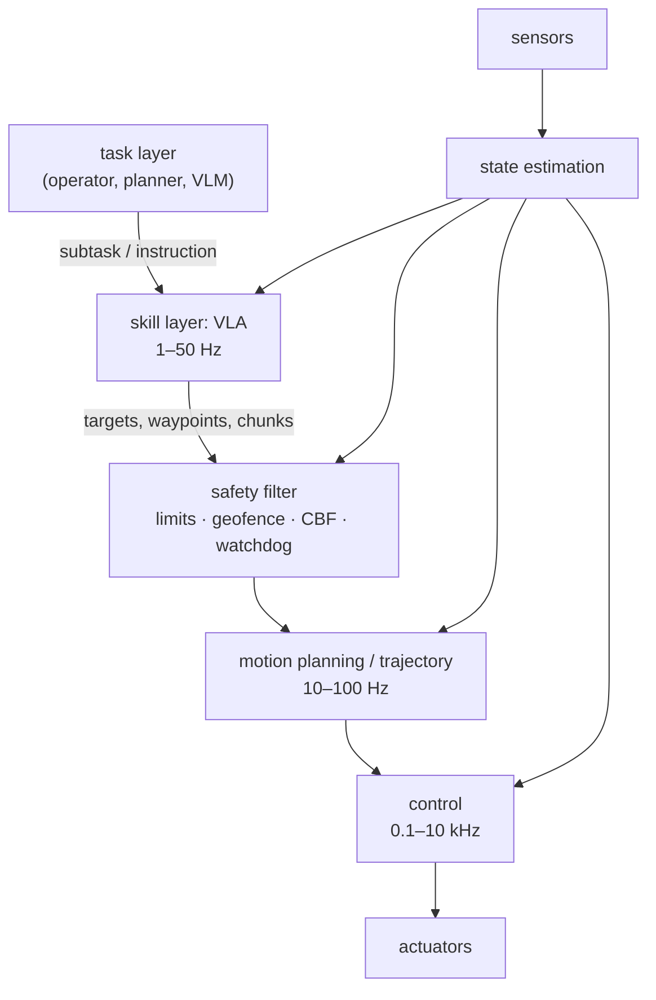

# 12. Robotics and Embodied AI

A VLA is one component of a robot, not the robot. This chapter places it in the robot stack: what the robot senses and which of it the VLA should see, the hierarchy of planning and control loops that runs at different rates beneath and above it, how to decide which components to learn and which to keep classical, and the interfaces and safety filters through which a learned proposal becomes a physical command. It is the bridge from the model-centric Chapters 8–11 to the systems of Chapters 13 (UAVs) and 14 (teams of robots).

## Learning objectives

1. Classify a robot's sensors by what they measure, their rate and errors, and route each to an estimator, a controller or the VLA. ([12.1](state-sensors.md))
2. Describe the task / skill / motion / control / safety hierarchy, its rate separation, and the alternative places a foundation model can sit in it. ([12.2](hierarchy.md))
3. Decide, component by component, whether learning is justified, using model quality, rate, failure cost, data and verification. ([12.3](learn-or-classical.md))
4. Post-process VLA outputs into controller commands and implement safety filters — saturation, geofences, watchdogs and control barrier functions. ([12.4](interfaces.md))

## Sections

| Section | Topic | Lab |
|---|---|---|
| [12.1](state-sensors.md) | State, sensors and proprioception | |
| [12.2](hierarchy.md) | The planning and control hierarchy | |
| [12.3](learn-or-classical.md) | What to learn, what to keep classical | |
| [12.4](interfaces.md) | Interfaces between learned policies and controllers; safety filters | Lab 15 |
| [Review](review.md) | Quiz and reading assignments | |

