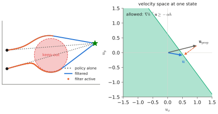

# 12.4 Interfaces Between Learned Policies and Controllers

The interface between a VLA and the layer below it is where a learned proposal becomes a physical command. A good interface makes the VLA's job learnable, the controller's job easy, and unsafe commands detectable before they reach the actuators. This section covers the common interfaces, the post-processing every VLA output needs, and **safety filters** — in particular control barrier functions, which modify a command minimally so that the robot provably stays in a safe set.

## What is it?

!!! definition "Safety filter"
    A **safety filter** maps a proposed action $\mathbf{u}_\text{prop}$ to an applied action $\mathbf{u}$ that satisfies the constraints of a safe set $\mathcal{S}=\{\mathbf{x}: h(\mathbf{x})\ge0\}$, changing it as little as possible:

    $$
    \mathbf{u}^\ast=\arg\min_{\mathbf{u}}\ \lVert\mathbf{u}-\mathbf{u}_\text{prop}\rVert^2\quad\text{s.t.}\quad \nabla h(\mathbf{x})^\top\big(f(\mathbf{x})+g(\mathbf{x})\mathbf{u}\big)\ \ge\ -\alpha\,h(\mathbf{x}),\qquad \mathbf{u}\in\mathcal{U}.
    $$

    $h$ is a **control barrier function** (CBF): if the constraint holds at every instant, $h$ can decrease at most exponentially, $\dot h\ge-\alpha h$, so $h$ never becomes negative and the robot never leaves $\mathcal{S}$. $\mathcal{U}$ encodes actuator limits.

## Why does it matter?

A VLA's output distribution has no hard boundaries. Even a policy that is almost always right will, over enough steps, propose an action that leaves the workspace, exceeds a speed limit, or drives into a person — because its inputs were unusual, because it hallucinated a target, or because a latency spike made it act on stale data ([11.1](../11-deployment/latency.md)). The safety filter makes the guarantee independent of the policy. Whatever the VLA proposes, the applied command satisfies the constraints that can be written down. It also requires no retraining when constraints change: a new no-fly zone is a new $h$, not new data.

## How does it work?

### 1. Post-processing every VLA output

Before any filter, the raw output must be turned into a command in the controller's units and frame:

1. **Un-normalise** with the dataset statistics the policy was trained with ([8.3](../08-vla/action-spaces.md)).
2. **Convert the representation**: delta to absolute target, end-effector to joints (inverse kinematics), body to world frame.
3. **Time-align** the chunk to the observation timestamp, dropping actions already in the past ([11.3](../11-deployment/serving.md)).
4. **Smooth** where the controller needs it: limit jerk between chunks, blend overlapping chunks ([8.6](../08-vla/chunking.md)).

### 2. Simple filters: limits, boxes and watchdogs

- **Saturation**: clip each command to actuator and speed limits, $\mathbf{u}\leftarrow\operatorname{clip}(\mathbf{u},\mathbf{u}_\min,\mathbf{u}_\max)$; for vectors, scale the norm rather than clipping per axis so that the direction is preserved.
- **Workspace / geofence**: reject or project targets outside an allowed box or polygon.
- **Rate limits**: bound the change between consecutive commands.
- **Watchdog**: if no valid command arrives within $T_\text{wd}$, replace the command with a safe default — hold position, zero velocity, hover — and escalate if the silence continues.

### 3. Control barrier functions

For a robot modelled as a single integrator $\dot{\mathbf{x}}=\mathbf{u}$ (a velocity-controlled base or a UAV with a good velocity controller) and a circular keep-out zone of radius $r$ around $\mathbf{c}$:

$$
h(\mathbf{x})=\lVert\mathbf{x}-\mathbf{c}\rVert^2-r^2,\qquad \nabla h=2(\mathbf{x}-\mathbf{c}),\qquad \text{constraint: } 2(\mathbf{x}-\mathbf{c})^\top\mathbf{u}\ \ge\ -\alpha h(\mathbf{x}).
$$

This is one linear inequality $\mathbf{a}^\top\mathbf{u}\ge b$ in $\mathbf{u}$. The minimal change is a projection onto the half-space, with a closed form:

$$
\mathbf{u}^\ast=\mathbf{u}_\text{prop}+\max\!\Big(0,\ \frac{b-\mathbf{a}^\top\mathbf{u}_\text{prop}}{\lVert\mathbf{a}\rVert^2}\Big)\,\mathbf{a}.
$$

Far from the zone, $h$ is large and the constraint is inactive, so the filter does nothing. Close to it, only the velocity component *towards* the zone is reduced: the robot slides along the boundary instead of stopping. With several zones the constraints are stacked into a small quadratic program, solved in microseconds; or, for a few constraints, projected in turn. Geofences are CBFs too, $h(\mathbf{x})=R^2-\lVert\mathbf{x}-\mathbf{c}\rVert^2$ for a circular fence or one half-space per edge for a polygon. In multi-robot systems, inter-robot separation $h_{ij}=\lVert\mathbf{x}_i-\mathbf{x}_j\rVert^2-d^2$ is the same construction ([Chapter 14](../14-multi-robot/index.md)).

<figure markdown="span">
  
  <figcaption markdown="span">A CBF safety filter at work (computed). Left: a policy that heads straight for its goal through a keep-out zone (dashed), and the filtered trajectory that slides around the zone's boundary; the filter is inactive far from the zone. Right: at one state, the half-space of allowed velocities (shaded) and the minimal correction that projects the proposed velocity onto it.</figcaption>
</figure>

**Choosing $\alpha$.** Large $\alpha$ lets the robot approach the boundary quickly and brake late; small $\alpha$ makes it slow down far from the boundary. With actuator limits or a lagging velocity controller, $\alpha$ must be small enough that the required braking is feasible. Higher-order CBFs handle systems controlled through acceleration.

### 4. What a filter cannot do

A filter enforces constraints you can write as functions of the state you know. It cannot know that the VLA picked the wrong object, cannot see an obstacle that is not in its map or sensor feed, and cannot make a task succeed. A policy fighting a filter, constantly pushing into a constraint, also fails the task: that is a monitoring signal ([11.5](../11-deployment/monitoring.md)) in its own right.

## Implementation: a CBF filter for velocity commands

```python
import numpy as np

def cbf_filter(x, u_prop, zones, fence=None, alpha=2.0, u_max=1.0, iters=3):
    """x, u_prop: (2,) position and proposed velocity. zones: list of (centre, radius) keep-out circles;
    fence: (centre, radius) circle the robot must stay inside. Sequential half-space projections + speed limit."""
    cons = [(2 * (x - c), -alpha * (np.sum((x - c) ** 2) - r ** 2)) for c, r in zones]
    if fence is not None:
        c, R = fence
        cons.append((-2 * (x - c), -alpha * (R ** 2 - np.sum((x - c) ** 2))))
    u = np.asarray(u_prop, float).copy()
    for _ in range(iters):                                    # a few passes handle interacting constraints
        for a, b in cons:
            gap = b - a @ u
            if gap > 0:
                u = u + gap / (a @ a) * a
    n = np.linalg.norm(u)
    return u * min(1.0, u_max / n) if n > 0 else u           # preserve direction under the speed limit
```

!!! lab "Lab 15"
    Fly the toy VLA of Lab 11 as a UAV over the depot with keep-out zones, a geofence, actuator lag, wind, latency and link loss, with and without this filter and a watchdog; measure success, violations and minimum clearance.

## Limitations

- **Model-dependent**: a CBF is only as good as the dynamics model and state estimate it uses; margins must cover estimation error and lag.
- **Conflicting constraints** can make the QP infeasible (a robot between two zones); a feasible fallback (stop, hover) is required.
- **Myopic**: CBFs prevent constraint violation, not deadlock. If the proposed velocity points straight at a zone's centre, the projection removes all of it and the robot stops at the boundary; a planner (or a small tangential bias) must route around.

## Why it matters for VLAs and robots

The interface plus filter is the contract that lets a learned policy drive a physical system: the policy proposes, and the filter disposes according to rules written by people and checked every cycle. It is the core of the UAV safety architecture of [Chapter 13](../13-uavs/index.md) and of collision avoidance in robot teams.
