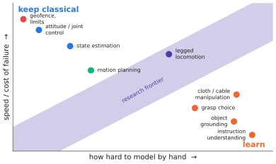

# 12.3 What to Learn, What to Keep Classical

"End to end" is a research direction, not a requirement. Every component of a robot stack can in principle be learned, and every learned component costs data, compute, latency and verifiability. This section gives a decision procedure: for each component, compare what a learned model would gain with what it would cost. It then applies the procedure to typical manipulation, mobile and UAV stacks.

## What is it?

!!! definition "The learn-or-keep decision"
    For a component $c$ with a classical solution, learning it is justified when the expected improvement in task performance outweighs the added costs:

    $$
    \underbrace{\Delta J_c}_{\text{gain: generality, robustness to unmodelled effects}}\ >\ \underbrace{C^\text{data}_c+C^\text{latency}_c+C^\text{verification}_c+C^\text{maintenance}_c}_{\text{what learning it costs}}.
    $$

    The gain is large when the classical solution needs a model nobody can write down (what "tidy" means, how cloth deforms). The costs are large when the component must be fast, provably correct or certified.

## Why does it matter?

Foundation models made learning the *semantic* parts of a robot almost free: recognising objects, interpreting instructions, choosing a grasp on an unfamiliar object. They did not make the *physical* parts free. Stabilising a quadrotor or keeping a joint within limits has decades-old solutions that are faster, need no data, and come with guarantees. Learning them gains little and loses the guarantees. Learning the semantic parts gains a lot and loses nothing that existed.

## How does it work?

### A component-by-component decision table

<figure markdown="span">
  
  <figcaption markdown="span">Where learning pays. Components placed by how hard they are to model by hand (horizontal) and how much a failure costs or how fast they must run (vertical). Semantic, slow, hard-to-model components (lower right) are where VLMs and VLAs bring the most; fast, safety-critical, well-modelled components (upper left) stay classical. The diagonal band is where research is active.</figcaption>
</figure>

| Component | Hard to model by hand? | Rate / criticality | Usual choice |
|---|---|---|---|
| instruction understanding, object recognition | yes | slow, recoverable | **learn** (VLM) |
| choosing what to do next, which object, which grasp | yes | 1–10 Hz, mostly recoverable | **learn** (VLA / VLM) |
| contact-rich manipulation (insertion, cloth, cables) | yes | 10–50 Hz, recoverable | **learn** (VLA with chunks), often with force input |
| collision-free motion in known geometry | no | 10–100 Hz, critical | classical planning; learning for speed only |
| state estimation (pose, velocity) | mostly no | 100 Hz–1 kHz, critical | classical (filters, VIO); learned components inside |
| low-level control (joints, attitude) | no | 1 kHz, critical | classical; RL for legged locomotion is the main exception |
| limits, geofences, emergency stop | no | every cycle, safety-critical | **classical, always** |

The exception for legged locomotion is instructive. RL policies trained in simulation now outperform hand-designed controllers on rough terrain, because contact dynamics are hard to model; they are deployed with classical safety layers and extensive simulation testing. The decision follows the inequality, not a doctrine.

### Questions to ask for each component

1. **Is there a model?** If a physics or geometry model predicts the outcome well, use it.
2. **What is the rate?** A component above the VLA's achievable rate ([11.1](../11-deployment/latency.md)) cannot be the VLA.
3. **What happens when it fails?** Recoverable failures (a missed grasp) tolerate learning; unrecoverable ones (a crash) need a classical guard even if the component itself is learned.
4. **Where does the data come from?** Learning needs demonstrations or a simulator for that component, on your robot.
5. **How will it be verified?** Classical components can be tested against specifications; learned ones only statistically ([9.5](../09-training/evaluation.md)).

### The usual answer

For most robots today: learn the semantic and dexterous decisions (VLM/VLA), keep estimation, low-level control and safety classical, and make the interface between them explicit and checkable ([12.4](interfaces.md)). For UAVs the learned part moves *up* the hierarchy, to goals and waypoints, because the vehicle's dynamics are fast and failures are not recoverable ([Chapter 13](../13-uavs/index.md)).

## Implementation: making the decision explicit

```python
from dataclasses import dataclass

@dataclass
class Component:
    name: str
    model_quality: float      # 0 = no usable model, 1 = accurate model exists
    rate_hz: float
    failure_cost: float       # 0 = recoverable, 1 = catastrophic
    data_available: bool

def recommend(c: Component, policy_rate_hz=10.0):
    if c.failure_cost > 0.7:
        return "classical (or learned *with* a classical guard)"
    if c.rate_hz > 2 * policy_rate_hz:
        return "classical: faster than the learned policy can run"
    if c.model_quality > 0.7:
        return "classical: a good model exists"
    return "learn" if c.data_available else "learn, after collecting data or building a simulator"

for c in [Component("object grounding", 0.1, 2, 0.2, True), Component("attitude control", 0.9, 500, 1.0, False),
          Component("cloth folding", 0.1, 20, 0.1, True), Component("geofence", 1.0, 50, 1.0, False)]:
    print(f"{c.name:18s} -> {recommend(c)}")
```

## Limitations

- **The boundary moves.** As data and models improve, components cross from classical to learned (perception did; locomotion is doing so).
- **Hybrid components are common**: a classical planner with a learned cost, a Kalman filter with a learned measurement model.
- **Costs are hard to quantify**, especially verification and maintenance; the inequality is a thinking tool, not a formula to compute.

## Why it matters for VLAs and robots

The most capable VLA-based systems are not the most end-to-end ones. They put foundation models where hand modelling fails and keep classical components where models and guarantees exist. For research on teams of robots and UAVs, this division also defines the interfaces through which robots coordinate ([Chapter 14](../14-multi-robot/index.md)).
