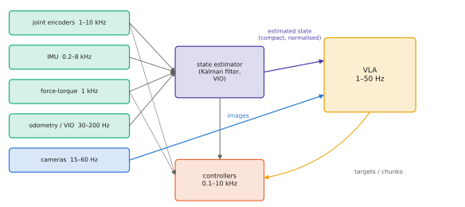

# 12.1 State, Sensors and Proprioception

A VLA sees the world through a few camera images and a short state vector. A robot knows far more: joint encoders at kilohertz, an IMU, force-torque sensors, odometry, a map, a localisation estimate with its covariance. This section surveys what a robot measures, at what rate and with what errors, and asks which of it should reach the VLA, which should stay with classical estimators and controllers, and why the difference matters.

## What is it?

!!! definition "State, observation, proprioception, exteroception"
    The robot's **state** $\mathbf{s}_t$ is whatever makes the future independent of the past given actions: poses, velocities, contacts, object states. It is never observed directly. **Proprioception** measures the robot's own body: joint positions and velocities, motor currents, gripper width, IMU accelerations and angular rates. **Exteroception** measures the world: cameras, depth, lidar, force/touch, GNSS. A **state estimator** fuses them into an estimate $\hat{\mathbf{s}}_t$ with uncertainty, e.g. a Kalman filter

    $$
    \hat{\mathbf{s}}_{t\mid t}=\hat{\mathbf{s}}_{t\mid t-1}+K_t\big(\mathbf{z}_t-h(\hat{\mathbf{s}}_{t\mid t-1})\big),\qquad K_t=P_{t\mid t-1}H_t^\top\big(H_tP_{t\mid t-1}H_t^\top+R_t\big)^{-1},
    $$

    where $\mathbf{z}_t$ is a measurement with model $h$ and noise covariance $R_t$, and $P$ is the state covariance.

## Why does it matter?

The VLA's observation $\mathbf{o}_t$ ([7.1](../07-decision-making/mdp.md)) is a design choice. Every sensor you add costs tokens or input dimensions ([8.2](../08-vla/inputs.md)), must exist identically on every robot the policy is trained on, and must be calibrated consistently. Every sensor you leave out must be handled by something else. Two failure patterns recur:

- **Missing information.** The policy is asked to do something its inputs cannot support: insert a peg without force sensing, or track an object that leaves the camera's view without memory.
- **Misplaced responsibility.** The policy is asked to do something classical estimation does better and more reliably: estimate its own velocity from images, stabilise a drone's attitude, or keep a joint within limits.

## How does it work?

### The sensor table

| Sensor | Measures | Typical rate | Typical errors | Usually goes to |
|---|---|---|---|---|
| joint encoders | joint angles | 0.5–10 kHz | quantisation, backlash | controller; VLA as state $\mathbf{q}_t$ |
| motor current / torque | effort | 1 kHz | noise, friction | controller, collision detection |
| IMU | acceleration, angular rate | 0.2–8 kHz | bias drift, vibration | state estimator (attitude) |
| wrist force-torque | contact wrench | 0.5–1 kHz | temperature drift | impedance controller; some VLAs |
| RGB camera | appearance | 15–60 Hz | exposure, motion blur, rolling shutter | **VLA** (main input), detectors |
| depth / stereo | geometry | 15–90 Hz | holes on dark or shiny surfaces | mapping, grasp planning, deprojection |
| lidar | geometry | 10–20 Hz | sparse at range | localisation, obstacle avoidance |
| GNSS (UAVs, outdoor) | position | 5–10 Hz | metres, multipath | state estimator |
| odometry / VIO | ego-motion | 30–200 Hz | drift | state estimator |

Two observations from the table. The VLA consumes the *slowest* sensors (cameras), so it cannot be responsible for anything that must react faster than a camera frame plus inference. And the fast sensors already feed well-understood estimators and controllers whose outputs (a pose, a velocity, a contact flag) can be handed to the VLA as compact state tokens.

### What the VLA should receive

<figure markdown="span">
  
  <figcaption markdown="span">Where each sensor's information goes. Fast proprioceptive streams feed the state estimator and the controllers at hundreds of hertz; the VLA receives camera images and a compact, estimated state at its own slower rate. The estimator's outputs are the interface: the VLA never integrates IMU data itself.</figcaption>
</figure>

A practical recipe:

1. **Images** from cameras that look at the task, at the resolution the backbone expects ([3.4](../03-vision/encoders-for-vlas.md)). A wrist camera for manipulation; a downward or forward camera for UAVs.
2. **Estimated state**, not raw sensors: joint positions and gripper width for arms; position (in a task frame), velocity and yaw for mobile robots and UAVs. Normalise with dataset statistics ([8.3](../08-vla/action-spaces.md)).
3. **Context the cameras cannot see**: the task phase, a goal location from a map, battery level when it changes behaviour. Language is a convenient carrier for slow, symbolic context ([8.2](../08-vla/inputs.md)).
4. **Not** high-rate signals the policy cannot use at its own rate (raw IMU, motor currents), unless the policy runs fast enough and the data contains them.

### Frames, calibration and time

State is only meaningful in a **frame**. A VLA trained with end-effector positions in the robot base frame fails silently if deployed with positions in a world frame. Keep a calibrated transform tree (tf2 in ROS 2, [11.4](../11-deployment/ros2.md)) and record which frame every logged quantity is in. Calibrate cameras (intrinsics as in [Appendix A](../../appendix/mujoco.md#5-cameras-rendering-and-intrinsics), extrinsics relative to the base) and time-synchronise sensors. A 50 ms offset between image and state means the policy learns from inconsistent pairs.

## Implementation: a 1-D Kalman filter fusing a slow camera and a fast IMU

```python
import numpy as np

def kalman_cv(z_cam, acc, dt=0.005, cam_every=20, q=0.5, r=0.02 ** 2):
    """Constant-velocity filter: IMU acceleration drives the prediction at 200 Hz, camera positions correct it at 10 Hz."""
    x, P = np.zeros(2), np.eye(2)                        # state [position, velocity]
    F = np.array([[1, dt], [0, 1]]); B = np.array([0.5 * dt ** 2, dt]); H = np.array([[1.0, 0.0]])
    Q = q * np.array([[dt ** 4 / 4, dt ** 3 / 2], [dt ** 3 / 2, dt ** 2]])
    out = []
    for k, a in enumerate(acc):
        x = F @ x + B * a; P = F @ P @ F.T + Q            # predict with the IMU
        if k % cam_every == 0:                            # a camera measurement arrives
            S = H @ P @ H.T + r; K = P @ H.T / S
            x = x + (K * (z_cam[k // cam_every] - H @ x)).ravel(); P = (np.eye(2) - K @ H) @ P
        out.append(x.copy())
    return np.array(out)
```

## Limitations

- **Estimators assume models.** Kalman filters need noise models; learned policies can absorb unmodelled effects but cannot report their uncertainty.
- **More inputs mean more data.** Each sensor added to a VLA requires demonstrations that contain it, on every robot.
- **Calibration drifts.** Cameras get bumped and clocks drift; monitoring must catch this ([11.5](../11-deployment/monitoring.md)).

## Why it matters for VLAs and robots

Deciding what the VLA sees is half of deciding what it is responsible for. Give it the information it needs for the decisions only it can make — what to do, where, with what object — and leave fast physical state to estimators that are faster, cheaper and verifiable. That division is the subject of the rest of this chapter.
