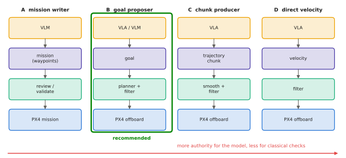

# 13.3 VLA → Planner → Trajectory → Controller → PX4

Given the UAV stack, where should a vision-language-action model sit? This section compares four architectures, from a VLM that only writes missions to a VLA that streams velocity commands. It recommends the hierarchical pattern for most research platforms: the model chooses goals or waypoints, a classical planner turns them into safe trajectories, PX4 tracks them. It also gives the latency and failure analysis behind the recommendation.

## What is it?

!!! definition "Hierarchical VLA architecture for UAVs"
    The learned model produces **goals** $\mathbf{g}_k$ — a waypoint, a region, an object to approach, or a short path — at a low rate $f_\text{VLA}$. A **planner** turns the latest goal into a dynamically feasible, collision-free **trajectory** $\mathbf{x}^\text{ref}(t)$ at $f_\text{plan}$. A **safety filter** checks every setpoint sampled from it ([13.5](safety.md)), and PX4 tracks the setpoints in offboard mode at $f_\text{ctrl}$:

    $$
    \underbrace{\mathbf{g}_k=\pi_\theta(\mathbf{o}_{t_k},\ell)}_{0.5\text{–}5\text{ Hz}}\ \longrightarrow\ \underbrace{\mathbf{x}^\text{ref}=\operatorname{plan}(\hat{\mathbf{x}},\mathbf{g}_k,\text{map})}_{5\text{–}20\text{ Hz}}\ \longrightarrow\ \underbrace{\mathbf{u}=\operatorname{filter}(\mathbf{x}^\text{ref}(t))}_{20\text{–}50\text{ Hz}}\ \longrightarrow\ \text{PX4}.
    $$

## Why does it matter?

UAV tasks that benefit from vision-language models are mostly *semantic*: "inspect the crack on the left pylon", "follow the red truck", "find the person in the orange jacket", "land on the marked pad". The difficult part is deciding *where*, which a VLM/VLA does well. The *how* — smooth, dynamically feasible, collision-free flight — has mature classical solutions. Splitting at the goal level lets each part do what it is good at, and puts every learned output through checks before it moves the vehicle.

## How does it work?

### Four architectures

<figure markdown="span">
  
  <figcaption markdown="span">Four placements of a vision-language model in a UAV stack, from least to most authority. (A) A VLM writes or edits a mission of waypoints and actions, checked before upload. (B) A VLA or VLM proposes goals or waypoints that a planner turns into trajectories (recommended). (C) A VLA outputs short trajectories or action chunks, smoothed and filtered before streaming. (D) A VLA streams velocity commands directly. Each step down gives the model more authority and the classical layers less to check.</figcaption>
</figure>

| | Output of the model | Rate | What classical layers can still check | Main risk |
|---|---|---|---|---|
| **A** mission writer | waypoint list, actions | per mission | everything, before take-off | wrong plan, but visible and reviewable |
| **B** goal / waypoint | next goal, region, object | 0.5–5 Hz | reachability, path safety, speed, geofence | wrong goal; planner keeps flight safe |
| **C** trajectory / chunk | 1–5 s of positions or velocities | 1–10 Hz | feasibility, filter on each point | stale chunks under latency ([8.6](../08-vla/chunking.md)) |
| **D** direct velocity | $\dot{\mathbf{x}}$ (and yaw rate) | 5–20 Hz | only per-command limits and CBFs | latency, oscillation, link loss ([13.4](direct-action.md)) |

### The recommended pattern (B) in detail

1. **Perception and grounding.** The VLA or VLM receives the onboard image, the instruction and the vehicle state, and outputs a goal in a well-defined frame. For a camera-based goal: a pixel or box in the image, deprojected with depth or the ground plane ([Appendix A](../../appendix/mujoco.md#5-cameras-rendering-and-intrinsics)) and transformed to the local frame with the vehicle's pose.
2. **Goal validation.** Is the goal inside the geofence, outside no-fly zones, at a safe altitude, within range of the battery? Reject or project it, and tell the model or operator.
3. **Planning.** A planner (straight-line with avoidance, A*/RRT on a map, or minimum-snap polynomial trajectories) produces a reference with velocity and acceleration limits.
4. **Tracking.** The companion samples the reference and streams position-plus-velocity setpoints; PX4 tracks them.
5. **Re-planning.** New goals replace the old one; the planner blends rather than jumps.

Because the VLA's output is a goal, its latency only delays *decisions*, not stabilisation. A 500 ms inference on a ground server is acceptable. A goal that arrives late is still valid, and the vehicle keeps flying the last plan or holds position meanwhile.

### Latency analysis

For (D), the command applied at time $t$ is based on an observation from $t-\delta$, where $\delta$ is the end-to-end latency. A velocity controller following a moving target with delayed feedback behaves like a loop with dead time. For gain $k$ (commanded speed per metre of error), the loop is stable only while roughly $k\,\delta<\pi/2$. That is a speed limit that shrinks as latency grows — the opposite of what an agile drone needs. For (B), latency affects how quickly a new goal is adopted, not the stability of flight.

## Implementation: goal → straight-line plan with limits

```python
import numpy as np

def plan_to_goal(p, goal, v_max=2.0, a_max=1.5, dt=0.05, horizon=3.0):
    """Trapezoidal velocity profile along the straight line to the goal; returns (positions, velocities)
    for the next `horizon` seconds. A planner would add obstacle avoidance; the safety filter checks each point."""
    d = goal - p
    dist = float(np.linalg.norm(d))
    if dist < 1e-6:
        return np.repeat(p[None], int(horizon / dt), 0), np.zeros((int(horizon / dt), len(p)))
    e, s, v, P, V = d / dist, 0.0, 0.0, [], []
    for _ in range(int(horizon / dt)):
        v_brake = np.sqrt(max(0.0, 2 * a_max * (dist - s)))           # speed from which we can still stop
        v = min(v + a_max * dt, v_max, v_brake)
        s = min(s + v * dt, dist)
        P.append(p + s * e); V.append(v * e)
    return np.array(P), np.array(V)
```

!!! lab "Lab 15"
    Fly the toy VLA of Lab 11 over the depot in architecture (D), streaming its velocity actions, and in a goal-level variant of (B), where its predicted chunk is turned into a waypoint that a planner and controller fly. Inject latency, wind and link loss, and compare success, smoothness and safety violations.

## Limitations

- **Goal-level VLAs need goal-level data**: demonstrations labelled with goals, or a way to extract them (e.g. from the end of each chunk, as in Lab 15).
- **Planners need maps** or onboard obstacle perception; in unknown cluttered spaces, (B) depends on mapping quality.
- **Agile, reactive tasks** (racing, catching) favour (C)/(D) with very fast models; research systems there use small specialised policies, not VLAs.

## Why it matters for VLAs and robots

For UAV research with foundation models, architecture (B) is the default that keeps experiments flyable and safe. The VLA contributes semantics, while a decades-old stack contributes stability. It also generalises to teams: goals are compact enough to share among robots and to allocate ([Chapter 14](../14-multi-robot/index.md)).
