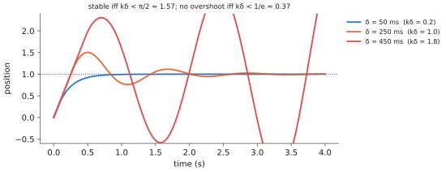

# 13.4 Direct Action Prediction and Why It Is Risky

Manipulation VLAs output low-level actions — end-effector deltas, joint targets — and succeed. Why not do the same for drones and stream velocity or attitude commands from the model? This section makes the risks concrete: latency acting as dead time in a feedback loop, the distribution shift between training data and flight, the lack of recoverable failure, and the fragility of a learned policy's output under link loss. It closes with when direct action can still be justified.

## What is it?

!!! definition "Direct action prediction"
    The model's output is applied as a low-level command with no planning in between: velocity setpoints (architecture D of [13.3](architectures.md)), attitude/thrust setpoints, or body rates. The applied command at time $t$ is $\mathbf{u}(t)=\pi_\theta(\mathbf{o}_{t-\delta(t)},\ell)$ with a time-varying latency $\delta(t)$.

## Why does it matter?

Direct action is tempting: it is the simplest pipeline, it matches how manipulation VLAs are trained, and it can in principle express any behaviour. It is also the configuration in which a model's rare failures become crashes. Understanding *why* is what lets you decide how much authority to give a model and which protections must accompany it.

## How does it work? Four sources of risk

### 1. Latency is dead time

With an error-correcting policy (as most learned policies effectively are, near their goal), delay turns a stable loop into an oscillating one. For a one-dimensional vehicle with velocity control $\dot x(t)=k\,(x^\ast-x(t-\delta))$, the characteristic equation $s+k e^{-s\delta}=0$ has roots in the right half-plane when $k\delta>\pi/2$. A gain that is stable at 50 ms latency oscillates at 300 ms. Latency tails ([11.1](../11-deployment/latency.md)) make this intermittent and hard to reproduce.

<figure markdown="span">
  
  <figcaption markdown="span">Dead time destabilises direct control (computed). A vehicle moving to a target under the delayed proportional law $\dot x=k\,(x^\ast-x(t-\delta))$, $k=4\ \mathrm{s^{-1}}$. With $\delta=50$ ms it converges; at 250 ms it overshoots and rings; at 450 ms ($k\delta>\pi/2$) the oscillation grows. A goal-level architecture keeps the fast loop on the flight controller, where $\delta$ is milliseconds.</figcaption>
</figure>

### 2. Distribution shift has physical consequences

Behavioural cloning drifts into states the demonstrations never covered ([7.3](../07-decision-making/covariate-shift.md)). For an arm, an unusual state usually means a failed grasp. For a drone, unusual states include high speed near obstacles, unusual attitudes and low altitude. Recovery from these is rarely in the data, because demonstrators avoid them.

### 3. Failures are not recoverable

A manipulation policy that fails can retry. A drone that hits a wall, a person or the ground cannot. Evaluation statistics that are acceptable for manipulation — 90% success over 50 trials ([9.5](../09-training/evaluation.md)) — are meaningless as a safety argument for flight, where the relevant number is the probability of a *dangerous* failure per flight hour.

### 4. Link loss and silence

If the model runs on the ground, a radio dropout means no commands. If it runs on board, a crash of the inference process does the same. With direct control, the last command may be "full speed forward". The PX4 offboard-loss failsafe ([13.2](px4-offboard.md)) eventually takes over, but only after its timeout, during which the vehicle keeps flying the stale command.

### When direct action can be justified

- In **simulation** and **tethered** tests, to study what the model learned ([13.6](testing.md)).
- With **small, fast, specialised** policies (milliseconds of latency, onboard) trained with RL and extensive randomisation — the approach of agile-flight research — rather than billion-parameter VLAs.
- Inside a **safety envelope**: CBF filtering, speed limits that shrink with latency, a watchdog that hovers within a fraction of a second, a geofence, and a pilot with an RC override ([13.5](safety.md)).

## Implementation: simulating dead time

```python
import numpy as np

def delayed_tracking(delay_s, k=4.0, dt=0.005, T=4.0, target=1.0):
    """x' = k (target - x(t - delay)): a velocity-controlled vehicle acting on stale observations."""
    n_delay = int(round(delay_s / dt))
    x = np.zeros(int(T / dt))
    for i in range(1, len(x)):
        seen = x[max(0, i - 1 - n_delay)]
        x[i] = x[i - 1] + dt * k * (target - seen)
    return x

for d in (0.05, 0.25, 0.45):
    x = delayed_tracking(d)
    print(f"delay {d * 1000:3.0f} ms: max overshoot {x.max() - 1:+.2f}, final error {abs(x[-1] - 1):.3f}")
```

!!! lab "Lab 15"
    Measures these effects on the toy VLA flown as a drone: success and violations as latency grows, with and without the safety envelope.

## Limitations

- **The analysis is linear**; real policies are nonlinear and their behaviour under delay is harder to predict. Measure it in simulation with the measured latency distribution.
- **Direct action is an active research area**; the risks above are reasons for protections and careful testing, not proof that it can never work.

## Why it matters for VLAs and robots

The same model can be safe or unsafe depending on its interface. Giving a VLA direct control of a drone combines its slowest property (latency) with the vehicle's least forgiving one (fast, unrecoverable dynamics). Choosing a goal-level interface, or surrounding a direct one with the envelope of the next section, is the engineering response.
