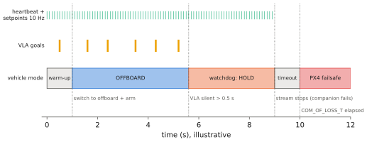

# 13.2 PX4, Offboard Control and uXRCE-DDS

PX4 is the open-source autopilot most used in research. Its **offboard mode** lets a companion computer stream setpoints that the flight controller tracks with its own controllers, while keeping its estimator, limits and failsafes in charge. This section explains how offboard control works, how PX4 talks to ROS 2 through uXRCE-DDS, the conventions that cause most first-flight bugs, and the failsafe behaviour a VLA-driven system must be designed around. [Appendix B](../../appendix/ros2-px4.md) contains the setup and a complete node for simulation.

## What is it?

!!! definition "Offboard mode"
    In **offboard mode**, PX4 tracks setpoints received from an external source: positions, velocities, accelerations, attitudes, or body rates. The source must keep a heartbeat stream (`OffboardControlMode`, at least 2 Hz) that declares which kind of setpoint it is sending, and send the setpoints themselves (`TrajectorySetpoint` for position/velocity/acceleration). If the stream stops for longer than a timeout, PX4 leaves offboard mode and executes a configured **failsafe** (hold, return, land).

## Why does it matter?

Offboard mode is the standard interface between learned or experimental autonomy and a real vehicle. It is also where the guarantees of [Chapter 12](../12-embodied/index.md) become concrete. The FC still runs its own estimator and controllers, still enforces its geofence and limits, and takes over if the companion falls silent. Choosing *which* setpoint type the VLA side sends decides how much authority it has ([13.3](architectures.md), [13.4](direct-action.md)).

## How does it work?

### uXRCE-DDS: PX4 topics as ROS 2 topics

PX4's internal message bus is uORB. A uXRCE-DDS client on the FC and a Micro XRCE-DDS **Agent** on the companion bridge selected uORB topics to the ROS 2 graph, using message definitions from the `px4_msgs` package:

| Direction | Topic (typical) | Message | Content |
|---|---|---|---|
| to PX4 | `/fmu/in/offboard_control_mode` | `OffboardControlMode` | heartbeat: which setpoint fields are used |
| to PX4 | `/fmu/in/trajectory_setpoint` | `TrajectorySetpoint` | position / velocity / acceleration, yaw (NED) |
| to PX4 | `/fmu/in/vehicle_command` | `VehicleCommand` | arm, disarm, mode changes, land, return |
| from PX4 | `/fmu/out/vehicle_local_position` | `VehicleLocalPosition` | estimated position and velocity (NED) |
| from PX4 | `/fmu/out/vehicle_status` | `VehicleStatus` | arming state, navigation mode, failsafe flags |

Recent PX4 releases version some message types, and topic names can carry a version suffix; check with `ros2 topic list` against your PX4 and `px4_msgs` versions. PX4 publishes with **best-effort** QoS, so subscribers must use a compatible profile ([11.4](../11-deployment/ros2.md)).

### The offboard protocol

1. Start streaming `OffboardControlMode` (e.g. `velocity=True`) and setpoints at ≥ 2 Hz, typically 10–50 Hz.
2. After about one second of streaming, send `VehicleCommand` to switch to offboard mode, and arm.
3. Keep streaming. Change setpoints as the plan changes; the FC tracks them with its position/velocity controllers.
4. To end, command a mode change (hold, land, return) rather than simply stopping the stream.

### Conventions that cause first-flight bugs

- **Frames**: PX4 uses **NED** (north-east-down) for local positions and velocities, and FRD for the body; ROS uses **ENU** (east-north-up) and FLU. Converting means swapping $x,y$ and negating $z$ (and adjusting yaw). A VLA trained in ENU and deployed in NED flies mirrored and climbs when it should descend.
- **Units and NaN**: unused setpoint fields are set to NaN, not zero. A zero position setpoint means "fly to the origin".
- **Timestamps**: messages carry microsecond timestamps; use the PX4 time base when the companion and FC clocks differ.

### Failsafes the design must assume

PX4 has independent failsafes for loss of the offboard stream, RC loss, data-link loss, low battery and geofence breach. The relevant parameters include the offboard-loss timeout (`COM_OF_LOSS_T`) and action, and the geofence limits (`GF_MAX_HOR_DIST`, `GF_MAX_VER_DIST`, `GF_ACTION`). A VLA-driven companion should never rely on the FC's failsafe as its normal stop: its own watchdog ([12.4](../12-embodied/interfaces.md)) commands a hover or hold *before* the stream would lapse, so the FC's failsafe remains a last line of defence.

<figure markdown="span">
  
  <figcaption markdown="span">The offboard protocol over time. The companion streams the heartbeat and setpoints, switches to offboard and arms. VLA decisions arrive slowly and update the setpoints in between. When decisions stop, the companion's own watchdog switches to hover within a fraction of a second; only if the whole stream dies does PX4's offboard-loss failsafe take over.</figcaption>
</figure>

## Implementation: the core of an offboard velocity node (rclpy, px4_msgs)

```python
import numpy as np
import rclpy
from rclpy.node import Node
from rclpy.qos import QoSProfile, ReliabilityPolicy, HistoryPolicy, DurabilityPolicy
from px4_msgs.msg import OffboardControlMode, TrajectorySetpoint, VehicleCommand

QOS = QoSProfile(reliability=ReliabilityPolicy.BEST_EFFORT, durability=DurabilityPolicy.TRANSIENT_LOCAL,
                 history=HistoryPolicy.KEEP_LAST, depth=1)

def enu_to_ned(v):
    return np.array([v[1], v[0], -v[2]])

class Offboard(Node):
    def __init__(self):
        super().__init__("offboard")
        self.mode_pub = self.create_publisher(OffboardControlMode, "/fmu/in/offboard_control_mode", QOS)
        self.sp_pub = self.create_publisher(TrajectorySetpoint, "/fmu/in/trajectory_setpoint", QOS)
        self.cmd_pub = self.create_publisher(VehicleCommand, "/fmu/in/vehicle_command", QOS)
        self.v_enu = np.zeros(3)                      # set by the (filtered) planner / VLA side
        self.ticks = 0
        self.create_timer(0.05, self.tick)            # 20 Hz stream

    def now_us(self):
        return self.get_clock().now().nanoseconds // 1000

    def tick(self):
        self.mode_pub.publish(OffboardControlMode(timestamp=self.now_us(), velocity=True))
        sp = TrajectorySetpoint(timestamp=self.now_us())
        sp.position = [float("nan")] * 3              # unused fields are NaN, not zero
        sp.velocity = enu_to_ned(self.v_enu).astype(np.float32).tolist()
        sp.yaw = float("nan")
        self.sp_pub.publish(sp)
        if self.ticks == 20:                          # after 1 s of streaming: offboard, then arm
            self.command(VehicleCommand.VEHICLE_CMD_DO_SET_MODE, 1.0, 6.0)
            self.command(VehicleCommand.VEHICLE_CMD_COMPONENT_ARM_DISARM, 1.0)
        self.ticks += 1

    def command(self, cmd, p1=0.0, p2=0.0):
        self.cmd_pub.publish(VehicleCommand(timestamp=self.now_us(), command=cmd, param1=p1, param2=p2,
                                            target_system=1, target_component=1, source_system=1,
                                            source_component=1, from_external=True))
```

!!! lab "Appendix B"
    Runs this node against PX4 SITL with Gazebo, adds the watchdog and geofence checks of [13.5](safety.md), and connects it to a stand-in planner.

## Limitations

- **Version drift**: `px4_msgs` must match the PX4 firmware; message fields and topic names change between releases.
- **Offboard is not a safety system**: it delegates tracking, not judgement. Bad setpoints are tracked faithfully.
- **Real links are lossy**: the Agent connection, Wi-Fi to the ground, and RC links all fail; each needs a defined behaviour.

## Why it matters for VLAs and robots

Offboard mode turns a VLA's decisions into setpoints that a certified, fast controller tracks, under failsafes that do not depend on the VLA. Every UAV architecture in the next section is a choice of which setpoint type to stream, and how much reasoning sits between the VLA and that stream.
