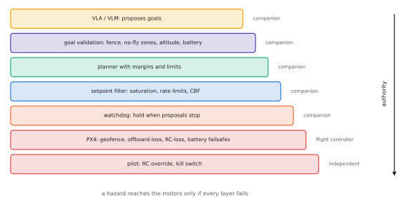

# 13.5 Safety Architecture

A UAV driven by a foundation model needs a safety architecture that does not depend on the model being right. This section specifies one: who has authority over the vehicle in each situation, the independent layers of protection (goal validation, geofences and no-fly zones, kinematic limits, barrier-function filtering, watchdogs, flight-controller failsafes, human override), and how they are arranged so that no single failure — of the model, the companion computer or a link — leads to an unsafe flight.

## What is it?

!!! definition "Defence in depth"
    A safety architecture is a set of independent **protection layers**, each able to stop a hazard on its own, arranged so that a hazard reaches the vehicle only if *all* of them fail. If layer $i$ fails to stop a given unsafe command with probability $p_i$, and failures are independent, the probability that the command passes is

    $$
    P(\text{unsafe command reaches vehicle})=\prod_i p_i .
    $$

    Independence is the hard part: layers that share a computer, a power supply, a state estimate or an assumption fail together.

## Why does it matter?

A VLA's failure modes — hallucinated targets ([5.4](../05-vlms/spatial.md)), misgrounded instructions, out-of-distribution behaviour, latency spikes — are neither rare enough nor predictable enough to be argued away. Aviation practice, and drone regulations in most countries, demand that the vehicle remain controllable and contained regardless. The architecture makes that true by construction, and makes the model's role explicit: a **proposer** with bounded authority.

## How does it work?

<figure markdown="span">
  
  <figcaption markdown="span">Defence in depth for a VLA-driven UAV. Each layer can stop a hazard independently. The model only proposes goals; validation and planning keep them reachable and inside the geofence; the CBF filter and limits shape every setpoint; the companion's watchdog holds when proposals stop; the flight controller's own geofence and failsafes act if the companion fails; the pilot's RC override and kill switch act if everything else fails. Authority increases downwards.</figcaption>
</figure>

### Authority

Write down, for every situation, who commands the vehicle:

| Situation | In authority | Mechanism |
|---|---|---|
| normal operation | planner (from VLA goals) via offboard | setpoints, filtered |
| VLA silent or stale | companion watchdog | hover / hold position |
| companion silent | PX4 | offboard-loss failsafe: hold, return or land |
| geofence breach, low battery | PX4 | configured failsafe action |
| anything unexpected | pilot | RC mode switch to manual / position mode, kill switch |

The pilot's override must not depend on the companion computer or on any software the VLA side can affect.

### The layers

1. **Goal validation** (companion): reject goals outside the operational volume, inside no-fly zones, below a minimum altitude, beyond battery range. Require confirmation for goals near people or structures.
2. **Planning with margins** (companion): trajectories keep a clearance from known obstacles and boundaries, with speed and acceleration limits.
3. **Setpoint filter** (companion): every streamed setpoint passes saturation, rate limits and a **CBF filter** ([12.4](../12-embodied/interfaces.md)) for no-fly zones and the geofence, with margins for tracking error and estimation uncertainty. Shrink speed limits when latency grows ([13.4](direct-action.md)).
4. **Watchdog** (companion): if no valid goal or setpoint arrives within $T_\text{wd}$ (e.g. 0.3 s for direct control, a few seconds for goal-level control), hold position; escalate to return or land after a longer silence.
5. **Flight-controller protections** (PX4): its own geofence, altitude limit, offboard-loss, RC-loss, data-link-loss and battery failsafes — configured independently of the companion.
6. **Human override**: an RC transmitter with a mode switch that takes the vehicle out of offboard mode, and a kill switch, tested before every flight.
7. **Operational limits**: line of sight, weather, segregated airspace, a safety pilot and an observer, as required by regulation and by your institution.

### Monitoring as a safety input

Runtime monitors ([11.5](../11-deployment/monitoring.md)) — action disagreement, OOD scores, filter intervention rate, deadline misses — feed the companion's supervisor. High uncertainty can lower speed limits, demand confirmation, or trigger a hold. They make the system *more cautious*; they never grant authority.

### What the architecture cannot fix

It cannot make a wrong goal right: a drone that flies safely to the wrong building has still failed the task. It cannot protect against hazards that are in no map and no sensor. And it cannot compensate for layers that are not independent: one state estimate feeding both the CBF filter and the PX4 geofence is a shared point of failure, so treat estimator health as a monitored signal.

## Implementation: a minimal safety supervisor on the companion

```python
import numpy as np
from vlacourse.safety import Watchdog, cbf_filter

class SafetySupervisor:
    """Goal validation + CBF setpoint filter + watchdog. Positions/velocities in a local ENU frame (metres)."""

    def __init__(self, fence_low, fence_high, no_fly, z_min=2.0, v_max=3.0, timeout=0.5, escalate=5.0):
        self.low, self.high = np.asarray(fence_low, float), np.asarray(fence_high, float)
        self.no_fly, self.z_min, self.v_max = no_fly, z_min, v_max
        self.wd = Watchdog(timeout, escalate, safe=np.zeros(3))
        self.interventions = 0

    def on_proposal(self, t):
        self.wd.feed(t)                                              # call when a fresh VLA proposal arrives

    def validate_goal(self, g):
        g = np.asarray(g, float)
        if (g < self.low).any() or (g > self.high).any() or g[2] < self.z_min:
            return None, "outside the operational volume"
        if any(np.linalg.norm(g[:2] - np.asarray(c)) < r for c, r in self.no_fly):
            return None, "inside a no-fly zone"
        return g, "ok"

    def filter(self, t, p, v_prop, latency_s=0.0):
        v_lim = self.v_max / (1.0 + 4.0 * latency_s)                # slower when decisions are stale
        v_xy, active = cbf_filter(p[:2], v_prop[:2], self.no_fly, (self.low[:2], self.high[:2]), u_max=v_lim)
        v = np.array([*v_xy, np.clip(v_prop[2], -1.0, 1.0)])
        self.interventions += active
        return self.wd(t, v)                                         # (command, watchdog_active)
```

!!! lab "Lab 15"
    Builds this envelope around the toy VLA in the depot: keep-out zones, a geofence, a latency-dependent speed limit and a watchdog. It measures violations and minimum clearance with and without each layer, under latency spikes and link loss.

## Limitations

- **Independence is approximate**: shared estimators, power and software reduce the product formula's benefit.
- **Margins cost performance**: conservative limits make missions slower and some tasks impossible.
- **A safety case needs more than an architecture**: hazard analysis, testing evidence ([13.6](testing.md)) and operational procedures.

## Why it matters for VLAs and robots

This architecture lets you put an imperfect foundation model on a flying vehicle and still run responsible experiments. It also answers a research question in its own right. The model's job becomes producing proposals the envelope rarely needs to modify, a measurable quantity that connects safety engineering to training.
