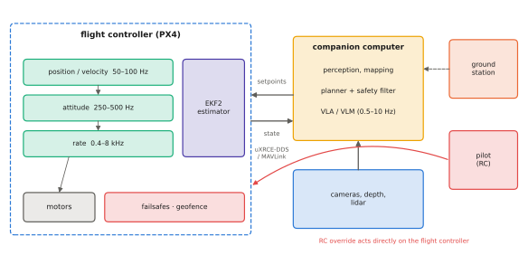

# 13.1 The UAV Stack

A multirotor drone is a robot whose lowest control layer must run hundreds of times per second, whose failures are rarely recoverable, and whose computers are limited by weight and power. Before deciding where a VLA could fit, this section lays out the stack it would join: sensors, the flight controller, the companion computer, the links to the ground, and the rates and responsibilities of each.

## What is it?

!!! definition "Flight controller and companion computer"
    The **flight controller** (FC) is a microcontroller board (e.g. a Pixhawk running PX4) that owns the vehicle: it reads the IMU, barometer, magnetometer and GNSS, estimates attitude, velocity and position, and runs the cascaded attitude, rate and position controllers that compute motor commands. The **companion computer** (e.g. a Jetson or Raspberry Pi class board) runs perception, planning and — if anywhere on board — learned models. It talks to the FC through a serial or Ethernet link and can only *request* behaviour: setpoints, mode changes, missions.

## Why does it matter?

The FC's inner loops are what keep a multirotor in the air: a few hundred milliseconds without correct rate control is a crash. No VLA, at 1–10 Hz with a variable latency tail ([11.1](../11-deployment/latency.md)), can take that role. What the companion computer can do — and therefore what a VLA can do — is decide *where to go and what to look at*. It hands those decisions to the FC in a form the FC can check, track and refuse.

## How does it work?

<figure markdown="span">
  
  <figcaption markdown="span">The UAV stack. The flight controller runs the estimator and the cascaded controllers (position → velocity → attitude → rate → motors) at increasing rates, and it owns the failsafes. The companion computer runs perception, planning and any learned model, and requests setpoints through uXRCE-DDS (ROS 2) or MAVLink. The RC link and the ground station can take over at any time.</figcaption>
</figure>

### Rates and responsibilities

| Component | Runs on | Rate | Responsibility |
|---|---|---|---|
| IMU sampling, rate controller | FC | 0.4–8 kHz | keep angular rates on target |
| attitude controller | FC | 250–500 Hz | keep orientation on target |
| velocity / position controller | FC | 50–100 Hz | track position or velocity setpoints |
| state estimator (EKF2 in PX4) | FC | 100–250 Hz | fuse IMU, GNSS, baro, mag, optical flow, vision |
| failsafes, geofence | FC | every cycle | the last word on safety |
| perception, mapping, planning | companion | 1–30 Hz | obstacles, goals, trajectories |
| VLM / VLA | companion or ground | 0.5–10 Hz | semantic decisions |
| operator (RC, ground station) | ground | human | override, mission changes |

### Links

- **FC ↔ companion**: serial or Ethernet. With PX4, **uXRCE-DDS** exposes FC topics directly as ROS 2 topics ([13.2](px4-offboard.md)); **MAVLink** is the older, widely supported alternative.
- **Vehicle ↔ ground**: a telemetry radio (MAVLink) and the RC link for manual override, plus often a Wi-Fi or cellular link for video and high-bandwidth data. Ground links have range-dependent latency and loss. A VLA served from the ground ([11.3](../11-deployment/serving.md)) inherits all of it.

### Compute and power on board

A 1–2 kg quadrotor typically flies for 15–30 minutes. Every 100 g of payload and every 10 W of computation shorten that. Companion computers for learned models range from 5–15 W boards that run SmolVLA-class models slowly at low precision ([11.2](../11-deployment/memory-quantization.md)) to 25–60 W boards that fit larger models but cost flight time. This is a design variable: a ground-hosted model saves weight but adds link latency and loss.

## Implementation: a back-of-the-envelope flight-time budget

```python
def hover_minutes(mass_kg, battery_wh, compute_w, hover_w_per_kg=170.0, usable=0.8):
    """Rough multirotor endurance: hover power grows with mass (≈150–200 W/kg for small quadrotors),
    compute adds its own draw. Returns minutes of hover."""
    return 60 * usable * battery_wh / (hover_w_per_kg * mass_kg + compute_w)

for name, extra_kg, watts in [("no companion", 0.0, 0), ("Raspberry Pi class", 0.05, 6), ("Jetson Orin NX", 0.15, 20),
                              ("Orin AGX", 0.7, 50)]:
    print(f"{name:20s} {hover_minutes(1.4 + extra_kg, 75, watts):5.1f} min")
```

## Limitations

- **Numbers vary widely** across airframes; the budget above is only an order-of-magnitude tool.
- **Different autopilots** (PX4, ArduPilot, proprietary) expose different interfaces, but the division of labour is the same.
- **Fixed-wing and VTOL** vehicles add constraints (minimum airspeed, transitions) that rule out "hover and wait" fallbacks.

## Why it matters for VLAs and robots

On a UAV the VLA can only ever be a requester of setpoints, never the owner of the vehicle. Everything in the rest of this chapter follows from that: which setpoints to request ([13.3](architectures.md)), why requesting low-level ones is risky ([13.4](direct-action.md)), and the safety architecture that makes requests safe to grant ([13.5](safety.md)).
