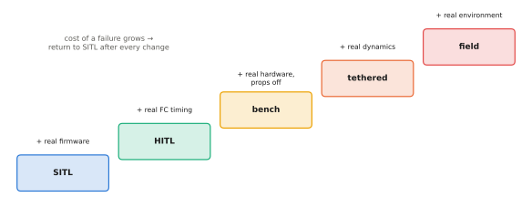

# 13.6 From Simulation to Flight: SITL, HITL, Tethered and Field Testing

A learned UAV system should reach the open sky only after a staged sequence of tests, each of which adds one source of reality and removes one excuse. This section describes the ladder — software-in-the-loop, hardware-in-the-loop, bench and tethered tests, constrained field tests — what each stage can and cannot reveal, the exit criteria for moving up, and what to log at every stage.

## What is it?

!!! definition "The test ladder"
    - **SITL** (software in the loop): the real autopilot firmware (PX4) runs on a desktop against a simulator (Gazebo); the companion software runs unchanged against it.
    - **HITL** (hardware in the loop): the real flight-controller board runs the firmware, with simulated sensors fed to it; tests timing on the real hardware.
    - **Bench**: real vehicle, props off; checks wiring, links, modes, failsafes and the companion's real compute.
    - **Tethered / caged**: real flight with a physical constraint; tests dynamics and the full stack with bounded consequences.
    - **Field**: real flight in a controlled area with a safety pilot, in increasing steps of speed, altitude and autonomy.

## Why does it matter?

Each stage catches failures the previous one cannot. SITL catches logic errors, frame mistakes ([13.2](px4-offboard.md)) and most integration bugs at no risk. HITL catches timing and serialisation issues. The bench catches wiring and failsafe misconfigurations. Tethered flight catches the gap between simulated and real dynamics and perception. Skipping a stage moves its failures to a more dangerous one.

## How does it work?

<figure markdown="span">
  
  <figcaption markdown="span">The test ladder. Each stage adds a source of reality (real firmware, real flight-controller timing, real vehicle, real dynamics, real environment) and raises the cost of a failure. Advance only when the exit criteria of the current stage are met, and return to an earlier stage after every change to the model, the safety envelope or the vehicle.</figcaption>
</figure>

| Stage | Adds | Typical tests | Exit criteria (examples) |
|---|---|---|---|
| SITL | real PX4 logic | offboard protocol, frames, every failsafe triggered on purpose, VLA in the loop with injected latency and dropouts | 100% of scripted failure injections end safely; no geofence violation in N simulated missions |
| HITL | real FC timing | stream rates under load, uXRCE-DDS link stability | setpoint stream jitter within budget for long runs |
| Bench | real hardware, props off | RC override, kill switch, mode switches, companion power and thermal behaviour | every override works from every mode |
| Tethered | real dynamics | hover, small moves, watchdog-triggered holds, VLA goals limited to a small box | stable tracking; watchdog holds within spec |
| Field | real environment | missions with growing range and autonomy, observer and safety pilot | pre-agreed metrics; incident-free hours |

### Failure injection

Testing nominal behaviour is not enough. In SITL (and later, carefully, in the field) deliberately inject the failures the architecture claims to handle: kill the VLA process, delay its outputs, send a goal inside a no-fly zone, drop the offboard stream, disconnect the ground link, return hallucinated detections. For each, the expected outcome — which layer acts, and what the vehicle does — should be written down before the test.

### Closing the perception gap

Simulators render images unlike real cameras; a VLA's perception is the component most likely to differ between SITL and flight. Bridge it with recorded flight imagery replayed through the model offline, with photorealistic simulation, and with field tests in which the VLA's outputs are *logged but not executed* (shadow mode) before it is given authority.

### What to log at every stage

Everything in [11.5](../11-deployment/monitoring.md), plus PX4's own flight logs (ULog), the safety supervisor's decisions and interventions, RC inputs, and the versions of firmware, parameters, model and envelope configuration. A test whose configuration cannot be reconstructed did not happen.

## Implementation: a failure-injection matrix as data

```python
FAILURES = [
    # (name, how to inject, expected protecting layer, expected vehicle behaviour)
    ("VLA process killed", "kill -9 the inference process", "companion watchdog", "hold within 0.5 s"),
    ("VLA latency spike", "sleep 1.5 s in the policy", "watchdog + latency speed limit", "slow down, then hold"),
    ("goal in no-fly zone", "inject goal at zone centre", "goal validation", "goal rejected, keep plan"),
    ("setpoint into zone", "bypass planner, stream velocity at zone", "CBF filter", "slides along boundary"),
    ("offboard stream lost", "stop the offboard node", "PX4 offboard-loss failsafe", "hold, then return"),
    ("geofence breach", "disable companion fence, fly out", "PX4 geofence", "configured action"),
    ("everything", "RC mode switch", "pilot", "manual/position mode immediately"),
]
for name, how, layer, expect in FAILURES:
    print(f"{name:22s} | {layer:30s} | expect: {expect}")
```

## Limitations

- **Simulation fidelity** limits SITL, particularly for perception and aerodynamics near structures.
- **Field testing is regulated**: rules on airspace, pilot certification and operations differ by country and change over time; consult your institution and aviation authority.
- **Statistical evidence accumulates slowly**: rare failures need many test hours to observe.

## Why it matters for VLAs and robots

The test ladder is how a VLA-on-a-drone experiment becomes a result you can trust and publish. It is also where most of the engineering effort goes. Plan SITL infrastructure, failure injection and logging from the start of a project, not after the model works.
