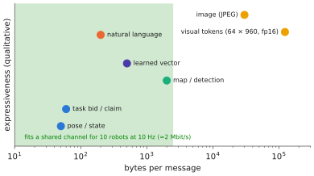

# 14.2 Communication and Shared Representations

Robots in a team coordinate through what they tell each other. Classical systems exchange designed messages: poses, task bids, map updates. Learned systems can exchange learned vectors. Foundation models add natural language, and the token embeddings inside a VLA, as candidate message formats. This section compares message types by what they cost and what they convey, describes how messages can enter a VLA, and treats the realities of wireless channels: bandwidth, latency, loss and range.

## What is it?

!!! definition "Communication in a team"
    At each step robot $i$ may send a message $\mathbf{m}_{i\to j}=\mu_i(\mathbf{h}_i)$ to robots $j$ in its communication neighbourhood $\mathcal{N}_i(t)$ (which changes with distance and obstacles), and conditions its policy on what it receives:

    $$
    \mathbf{a}_i\sim\pi_i\big(\cdot\mid\mathbf{o}_i,\ \{\mathbf{m}_{j\to i}:\ j\in\mathcal{N}_i(t),\ \text{delivered}\}\big).
    $$

    The **message function** $\mu_i$ can be designed (send my pose), learned (send a vector trained end to end), or generated (send a sentence).

## Why does it matter?

Communication is the only thing that turns $N$ local policies into a team ([14.1](dec-pomdp.md)). It is also a hard physical constraint. Wi-Fi in a warehouse, mesh radios in a field, and long-range links for UAV swarms differ by orders of magnitude in bandwidth and reliability. Every message format trades **expressiveness** against **size**, **interpretability** and **robustness**, and VLAs make those trade-offs acute. A single camera image is about 150 kB raw, a VLA's visual tokens about 64 × 960 numbers, a sentence a few dozen bytes.

## How does it work?

### Message types

| Message | Size per message | Expressive? | Interpretable? | Typical use |
|---|---|---|---|---|
| state (pose, velocity, battery) | 10–100 B | low | yes | collision avoidance, formation, allocation |
| task message (bid, claim, done) | 10–100 B | task-level | yes | allocation, auctions ([14.4](task-allocation.md)) |
| map / detection update | 0.1–10 kB | spatial | yes | shared maps, object sightings |
| learned vector (CommNet-style) | 0.1–1 kB | high, task-specific | no | MARL teams trained together |
| natural language | 10–500 B | high, open | yes | VLM/LLM teams, humans in the loop ([14.3](language-coordination.md)) |
| image / visual tokens | 10–200 kB | very high | partly | shared perception, remote inference |

<figure markdown="span">
  
  <figcaption markdown="span">What a message costs and what it can say. Message types placed by size per message (log scale) and expressiveness. Natural language is unusual: nearly as compact as designed task messages, nearly as expressive as raw perception, and readable by people. That is why it has become a coordination medium for foundation-model teams. The shaded band marks what a typical shared wireless channel can carry for a team of ten robots at 10 Hz.</figcaption>
</figure>

### Channel realities

- **Bandwidth is shared.** With $N$ robots broadcasting messages of $b$ bytes at $f$ Hz, the channel carries $N b f$ bytes/s; at ten robots, 10 Hz and 50 kB images that is 5 MB/s before overhead. Plan for state and task messages at control rates, and rich messages on events only.
- **Latency and jitter** make received information stale; time-stamp everything ([11.3](../11-deployment/serving.md)).
- **Loss** is bursty and depends on distance and obstacles. Protocols need acknowledgements or must tolerate missing messages; decentralised algorithms are judged by how they degrade.
- **Range** limits the neighbourhood $\mathcal{N}_i(t)$; teams can split into disconnected groups, and coordination must survive reconnection (consistent task claims, map merging).

### How messages can enter a VLA

1. **As text in the instruction**: "robot 2 is taking the red crate; take the blue one." Requires no architectural change and works with any instruction-following model, but the model must have been trained (or prompted) to use such context.
2. **As extra tokens**: encode received states or messages into token embeddings and append them to the observation tokens ([8.2](../08-vla/inputs.md)), like the proprioception token. Requires training with team data.
3. **Through a task layer**: messages are consumed by an allocator or planner, which gives each robot's VLA a single-robot instruction ([14.4](task-allocation.md)). The VLA stays unchanged, which is the most practical option today.

### Shared representations

Teams benefit from shared *coordinates*, not only shared messages: a common map frame (or transforms between robot frames), consistent object identities ("the red crate" means the same object for every robot), and synchronised clocks. Foundation models can help build them: open-vocabulary detections and embeddings are a shared vocabulary for objects across robots with different sensors ([4.2](../04-alignment/clip-siglip.md)).

## Implementation: a lossy broadcast channel

```python
import numpy as np

class LossyChannel:
    """Broadcast with distance-dependent loss and fixed latency (in steps). Messages are (sender, payload)."""

    def __init__(self, n, p_loss=0.1, range_=0.6, latency=1, seed=0):
        self.n, self.p_loss, self.range, self.latency = n, p_loss, range_, latency
        self.queue, self.rng, self.sent, self.delivered = [], np.random.default_rng(seed), 0, 0

    def send(self, t, sender, payload, positions):
        for j in range(self.n):
            if j == sender:
                continue
            self.sent += 1
            in_range = np.linalg.norm(positions[sender] - positions[j]) <= self.range
            if in_range and self.rng.random() > self.p_loss:
                self.queue.append((t + self.latency, j, sender, payload))

    def receive(self, t, j):
        got = [(s, p) for (td, r, s, p) in self.queue if r == j and td <= t]
        self.queue = [q for q in self.queue if not (q[1] == j and q[0] <= t)]
        self.delivered += len(got)
        return got
```

!!! lab "Lab 16, §5"
    Uses this channel for a decentralised auction among copies of the toy VLA and measures how coordination degrades with loss.

## Limitations

- **Learned messages are opaque** and tied to the team they were trained with; adding a new robot type can break them.
- **Language messages can be ambiguous or wrong**, and a model may not use them reliably unless trained to ([14.3](language-coordination.md)).
- **Security**: messages are an attack surface; a spoofed "I have the red crate" can paralyse a team.

## Why it matters for VLAs and robots

Choosing what robots say to each other — and how it enters their policies — is one of the central open design questions for multi-robot VLAs. Compact, interpretable messages at the task level, consumed by a planner above per-robot VLAs, are the robust choice today. Learning *what* to communicate with foundation models, under real channel constraints, is a research frontier ([Chapter 15](../15-research/index.md)).
