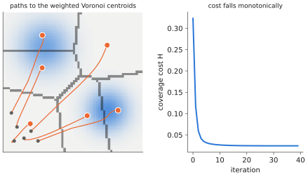

# 14.5 Coverage, Scalability and Emergent Behaviour

Some team tasks are not a list of jobs to allocate but a continuous objective: watch an area, search for a person, map a building. Their classical solutions are distributed control laws in which each robot reacts only to its neighbours, and good team behaviour *emerges*. This section presents coverage control as the canonical example, analyses how computation and communication scale with team size, and discusses emergent behaviour in learned teams — including what changes when each robot carries a foundation model.

## What is it?

!!! definition "Coverage control"
    $N$ robots at positions $\mathbf{p}_i$ cover a region $Q$ with importance density $\phi(\mathbf{q})$ (e.g. where a target is likely, or a VLM's relevance map for "find the red toolbox"). Each point is served by its nearest robot, so robot $i$ is responsible for its **Voronoi cell** $V_i=\{\mathbf{q}:\lVert\mathbf{q}-\mathbf{p}_i\rVert\le\lVert\mathbf{q}-\mathbf{p}_j\rVert\ \forall j\}$. The team minimises the coverage cost

    $$
    H(\mathbf{p}_1,\dots,\mathbf{p}_N)=\sum_i\int_{V_i}\lVert\mathbf{q}-\mathbf{p}_i\rVert^2\phi(\mathbf{q})\,d\mathbf{q},
    $$

    whose gradient with respect to $\mathbf{p}_i$ is $2M_i(\mathbf{p}_i-\mathbf{c}_i)$, with $M_i$ the mass and $\mathbf{c}_i$ the $\phi$-weighted centroid of $V_i$. The **Lloyd / Cortés control law** $\dot{\mathbf{p}}_i=-k(\mathbf{p}_i-\mathbf{c}_i)$ moves each robot towards the centroid of its own cell.

## Why does it matter?

The control law uses only information about Voronoi neighbours, yet provably decreases the team cost and converges to a locally optimal configuration. It is a template for scalable teams: local rules, local communication, a global guarantee. It also shows where foundation models can contribute without breaking the structure. A VLM can supply the importance density $\phi$ from images and language ("damage is more likely near the windows"); the distributed controller stays unchanged.

## How does it work?

<figure markdown="span">
  
  <figcaption markdown="span">Coverage control (computed). Six robots start clustered in one corner of the depot; each repeatedly moves towards the centroid of its Voronoi cell, weighted by an importance map (darker = more important, here two regions an instruction singled out). The team spreads out and concentrates where importance is high, and the coverage cost falls monotonically, using only neighbour information.</figcaption>
</figure>

### Scalability

| Quantity | Centralised | Decentralised (neighbours only) |
|---|---|---|
| computation per step | grows with $N$ at the centre (often $O(N^2)$–$O(N^3)$) | constant per robot (number of neighbours) |
| communication | $O(N)$ messages per step through one link | $O(\text{neighbours})$ per robot |
| robustness to one failure | the centre is a single point of failure | neighbours absorb the change |
| optimality | global optimum possible | local optima; consensus takes time to propagate ($\propto$ network diameter) |

For VLA-equipped teams, the per-robot cost includes inference. Running one VLA per robot scales compute linearly with team size and keeps each robot independent. A shared server ([11.3](../11-deployment/serving.md)) amortises compute but concentrates the communication and failure risk.

### Emergent behaviour

**Emergent** behaviour is team-level structure that no single rule specifies: spreading out, forming lanes in corridors, dividing labour. In designed systems it is engineered through local rules with proofs, as above. In learned teams (multi-agent RL), behaviours such as role specialisation, implicit signalling and turn-taking arise from training on a shared reward. They can be effective, but are hard to predict and can be brittle when teammates or conditions change.

Teams of foundation-model agents add a third kind. Agents conversing in language can produce coordination conventions that nobody designed — and failure modes nobody anticipated, such as repeated deference ("you go first"), agreeing on plans none of them can execute, or copying a teammate's error. Treat such behaviour as an empirical phenomenon: measure it, stress-test it with perturbations (lost messages, a faulty teammate), and keep the verifiable layers of [14.3](language-coordination.md) between it and the motors.

## Implementation: one Lloyd step on a grid

```python
import numpy as np

def lloyd_step(p, phi, k=0.5):
    """p: (N, 2) robot positions in [0,1]^2; phi: (G, G) importance on a grid. Moves each robot towards the
    phi-weighted centroid of its Voronoi cell (cells computed on the grid by nearest robot)."""
    G = phi.shape[0]
    xs = (np.arange(G) + 0.5) / G
    q = np.stack(np.meshgrid(xs, xs, indexing="xy"), -1).reshape(-1, 2)        # grid points (x, y)
    owner = np.argmin(((q[:, None, :] - p[None]) ** 2).sum(-1), axis=1)       # Voronoi cell of each point
    w = phi.reshape(-1)
    new = p.copy()
    for i in range(len(p)):
        m = owner == i
        if w[m].sum() > 0:
            c = (q[m] * w[m, None]).sum(0) / w[m].sum()                         # weighted centroid
            new[i] = p[i] + k * (c - p[i])
    cost = (((q - p[owner]) ** 2).sum(-1) * w).sum() / w.sum()
    return new, cost
```

## Limitations

- **Local optima**: Lloyd's algorithm converges to centroidal configurations that need not be globally optimal.
- **Assumptions**: free space, accurate positions, and communication with Voronoi neighbours; obstacles and limited range require extensions.
- **Emergent learned behaviours are hard to certify**; evaluation must include perturbations, not only nominal runs.

## Why it matters for VLAs and robots

Scalable teams need local rules with global guarantees. Foundation models fit best as providers of *what matters* (importance maps, task lists, semantic labels) to such rules, and as per-robot executors, rather than as a central brain that must see and command everyone. Understanding emergence, both designed and learned, is necessary to evaluate teams of foundation-model agents honestly.
