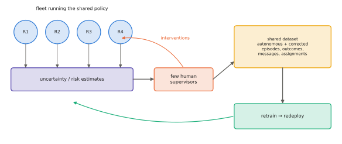

# 14.6 Multi-Robot Data Collection

VLAs are only as good as their data ([Chapter 9](../09-training/index.md)). Teams of robots are both an opportunity and a challenge for data. A fleet produces experience many times faster than one robot, and in more places. But team behaviour needs team data, which single-robot datasets do not contain, and supervising a fleet's mistakes needs people whose attention does not scale. This section covers fleet learning, the special requirements of team datasets, and how to record them so that they can train coordination as well as individual skills.

## What is it?

!!! definition "Fleet learning"
    **Fleet learning** pools the experience of many robots — demonstrations, autonomous rollouts, interventions by human supervisors — into shared datasets that train shared (or partly shared) policies, which are then redeployed to the fleet. **Team data** additionally records the *joint* state of a team during a coordinated task: every robot's observations and actions on a common clock, the messages exchanged, and the task-level decisions (assignments, roles).

## Why does it matter?

Fleet data is how the largest robot datasets were built: RT-1's 130 k episodes came from a fleet of 13 robots over 17 months ([10.2](../10-case-studies/rt.md)), and Open X-Embodiment pooled many labs' fleets ([9.3](../09-training/datasets.md)). Heterogeneous co-training on data from many robots and places drove π0.5's generalisation ([10.4](../10-case-studies/pi0.md)). Yet nearly all of this data is single-robot: each episode is one robot doing one task. Training a VLA that coordinates with teammates needs episodes in which coordination happened and was recorded.

## How does it work?

### Interactive fleet learning

When a fleet runs autonomously, a few human supervisors can watch many robots and intervene when a robot is uncertain or failing. The interventions become corrective data, as in DAgger ([7.4](../07-decision-making/dagger.md)). **Fleet-DAgger** (Hoque et al., 2022) formalised this setting and studied *allocation of human attention*: which robots should ask for help, when, given limited supervisors. The robots' uncertainty and risk estimates ([11.5](../11-deployment/monitoring.md)) decide who gets help.

<figure markdown="span">
  
  <figcaption markdown="span">Interactive fleet learning. Robots run a shared policy autonomously and report uncertainty; a few human supervisors are allocated to the robots most likely to need help; interventions and autonomous episodes, with outcome labels, flow into a shared dataset; the policy is retrained and redeployed. For team data, the recorder logs every robot on one clock, plus the messages and task assignments between them.</figcaption>
</figure>

### What a team dataset must record

| Stream | Why it matters for team learning |
|---|---|
| every robot's observations and actions, **synchronised** | joint behaviour is only learnable if it is aligned in time |
| robot identities and **embodiments** | heterogeneous teams need per-robot action spaces ([8.3](../08-vla/action-spaces.md)) |
| **messages** sent and received, with loss | policies that use messages must see realistic channels |
| **task-level decisions** (allocation, roles, plans) | supervision for allocators and language planners |
| a **global** reference (shared map frame, global state if available) | privileged information for centralised training ([14.1](dec-pomdp.md)) |
| team-level outcomes (task completed, duplicates, collisions) | evaluation and reward signals |

The LeRobot format ([9.3](../09-training/datasets.md)) can store one robot per dataset or several robots as features of one dataset (cameras and states per robot, one clock). Either way, a common `timestamp` and a `team_episode_index` linking robots' episodes are essential.

### Where team data comes from

1. **Teleoperating several robots at once** is hard and scales poorly; useful for small teams and specific tasks.
2. **Scripted or planner-generated team behaviour in simulation**, then (optionally) filtered and transferred — the analogue of scripted experts in this book's labs.
3. **Hierarchical decomposition**: record allocation decisions centrally and single-robot execution locally; each part trains its own component, and existing single-robot data remains usable.
4. **Autonomous fleet operation with interventions**, as above, adding team-level failures (two robots blocking each other) as a category supervisors label.

## Implementation: a team episode record

```python
from dataclasses import dataclass, field

@dataclass
class TeamEpisode:
    team_episode_index: int
    robots: list[str]                                  # e.g. ["ugv0", "ugv1", "uav0"]
    embodiments: dict[str, str]                        # robot -> embodiment / action space
    instruction: str                                   # the team-level instruction
    assignments: list[tuple[float, str, str]] = field(default_factory=list)   # (t, robot, task / sub-instruction)
    messages: list[tuple[float, str, str, str, bool]] = field(default_factory=list)  # (t, from, to, payload, delivered)
    outcome: dict = field(default_factory=dict)        # {"success": .., "duplicates": .., "collisions": .., "makespan_s": ..}
    # per-robot frames live in a LeRobot dataset with columns observation.*.<robot>, action.<robot>, timestamp
```

## Limitations

- **Coordinated demonstrations are expensive**, and scripted team behaviour may not resemble what good teams do.
- **Privacy and logistics**: fleets operating in homes, warehouses or public spaces record people; consent and data governance matter.
- **Distribution shift between team compositions**: data from teams of three may not cover teams of ten.

## Why it matters for VLAs and robots

The bottleneck for multi-robot VLAs is less the architecture than the data: there is little recorded team behaviour to learn from. Designing fleets, simulators and recording pipelines that produce team data is, by itself, a contribution, and a prerequisite for the research directions in [Chapter 15](../15-research/index.md).
