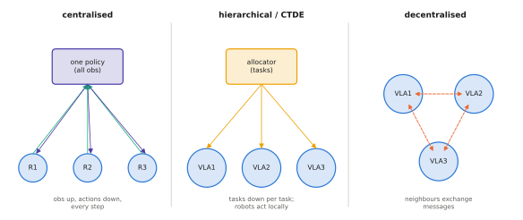

# 14.1 Centralised vs Decentralised Policies; Dec-POMDPs

One VLA controls one robot. A team of robots raises a question that single-robot learning never faces: who decides what for whom, with what information? This section gives the formal model — the decentralised POMDP — and maps the design space from one central policy controlling everyone to fully independent robots, with the information, communication and computation that each point requires.

## What is it?

!!! definition "Dec-POMDP"
    A **decentralised partially observable MDP** for $N$ robots is a tuple $\langle\mathcal{S},\{\mathcal{A}_i\},P,R,\{\mathcal{O}_i\},O,\gamma\rangle$. The state $\mathbf{s}\in\mathcal{S}$ is shared, each robot $i$ chooses $\mathbf{a}_i\in\mathcal{A}_i$, the joint action $\mathbf{a}=(\mathbf{a}_1,\dots,\mathbf{a}_N)$ drives $P(\mathbf{s}'\mid\mathbf{s},\mathbf{a})$, all robots share one reward $R(\mathbf{s},\mathbf{a})$, and robot $i$ receives only its own observation $\mathbf{o}_i\sim O_i(\cdot\mid\mathbf{s})$. A solution is a set of **local policies** $\pi_i(\mathbf{a}_i\mid\mathbf{h}_i)$, each depending only on robot $i$'s own history $\mathbf{h}_i$ (its observations, actions and received messages), maximising

    $$
    J(\pi_1,\dots,\pi_N)=\mathbb{E}\Big[\sum_t\gamma^t R(\mathbf{s}_t,\mathbf{a}_{1,t},\dots,\mathbf{a}_{N,t})\Big].
    $$

The single-robot POMDP of [7.1](../07-decision-making/mdp.md) is the case $N=1$. With a single policy that sees all observations, $\pi(\mathbf{a}\mid\mathbf{o}_1,\dots,\mathbf{o}_N)$, the team is a **centralised** POMDP — one big robot.

## Why does it matter?

The difference between these two models is not a detail. Optimal planning in finite-horizon Dec-POMDPs is NEXP-complete, far harder than in POMDPs, because each robot must reason about what the others know. In practice the information structure decides:

- **what each robot's policy can condition on** (its own camera, or the team's);
- **how much communication** the team needs, and what happens when it fails;
- **how computation scales** with the number of robots;
- **how data is collected and shared** for learning ([14.6](data.md)).

A VLA trained on single-robot demonstrations is, by construction, a local policy with no model of its teammates. Putting several of them in one workspace does not make a team.

## How does it work?

### The design space

<figure markdown="span">
  
  <figcaption markdown="span">Three information structures for a team. Centralised: one policy (or planner) sees every observation and commands every robot; optimal coordination, a single point of failure, communication and computation that grow with the team. Hierarchical / CTDE: a central layer allocates tasks or trains the policies, and each robot executes locally. Decentralised: each robot decides from its own observations and messages from neighbours; robust and scalable, but coordination must emerge from communication.</figcaption>
</figure>

| | Centralised | Hierarchical (allocate centrally, act locally) | Decentralised |
|---|---|---|---|
| policy input | all observations | own observation + assigned task | own observation + messages |
| communication | every robot ↔ centre, every step | centre → robots per task; robots → centre status | neighbour ↔ neighbour |
| failure of centre or link | team stops | robots finish current tasks | graceful |
| compute | grows with $N$ at the centre | allocation at centre, policies local | per robot, constant |
| coordination quality | best possible | good at task level, none within tasks | depends on messages |
| typical VLA role | one VLM planner for the team | VLM allocator + per-robot VLAs | per-robot VLA with message tokens |

### Centralised training, decentralised execution (CTDE)

The most successful learning recipe for teams separates the two phases. During **training**, a learner may use the global state, all observations and all actions — in simulation or from pooled logs. During **execution**, each robot runs its own policy on local information. Multi-agent RL methods built this way include value factorisation (QMIX) and centralised critics with decentralised actors (MAPPO). For VLAs, the analogue is training each robot's policy on team data in which demonstrations were coordinated, possibly with privileged information available only in training ([14.6](data.md)).

### Joint action spaces grow exponentially

A centralised policy over $N$ robots with $|\mathcal{A}|$ actions each has $|\mathcal{A}|^N$ joint actions. Token-based outputs ([8.4](../08-vla/action-tokens.md)) would need $N$ times as many action tokens per step, and flow-based outputs a chunk of dimension $N\times d_a$. Beyond a few robots, factorisation is needed: per-robot heads, attention across robot tokens, or a task-level allocation that decouples robots ([14.4](task-allocation.md)).

## Implementation: the cost of ignoring teammates

Two robots receive the same ambiguous instruction ("go to the crate") in a scene with two crates. Independent policies that each pick a crate at random collide on the same crate half the time; a team that coordinates never does.

```python
import numpy as np

def independent(n_robots, n_targets, trials=100_000, rng=np.random.default_rng(0)):
    """Probability that all robots pick distinct targets when each picks uniformly at random."""
    picks = rng.integers(0, n_targets, size=(trials, n_robots))
    return np.mean([len(set(p)) == n_robots for p in picks])

for n in (2, 3, 4):
    print(f"{n} robots, {n} identical targets: independent success {independent(n, n):.3f}, coordinated 1.000")
# 2 -> 0.5, 3 -> 0.22, 4 -> 0.094: the chance that uncoordinated robots split the work vanishes as n!/n^n
```

!!! lab "Lab 16"
    Runs several copies of the toy VLA in one depot: first independently, then with centralised allocation, then with a decentralised auction over a lossy channel, measuring duplicated targets, makespan, messages and robustness.

## Limitations

- **Dec-POMDP solutions are intractable in general**; practical systems use structure (allocation, factorised policies, communication protocols) rather than solving the full problem.
- **Shared reward** is an idealisation: real teams have individual constraints (battery, capability) and sometimes conflicting objectives.
- **Partial observability is the norm**: robots see different parts of the world, and their estimates of each other are stale.

## Why it matters for VLAs and robots

Multi-robot VLA research starts with choosing the information structure. Most current VLA systems are single-robot local policies. The research opportunities this chapter develops lie in giving them the right teammates: an allocator above them ([14.4](task-allocation.md)), messages beside them ([14.2](communication.md)), language as a coordination medium ([14.3](language-coordination.md)), and team data to learn from ([14.6](data.md)).
