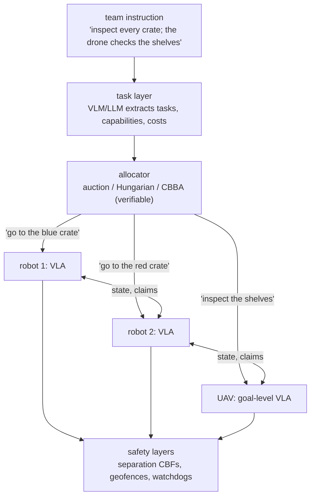

# 14. VLAs for Multi-Robot Systems

This is the book's central research chapter. Everything so far concerned one robot and one policy. A team of robots raises new questions: who decides what for whom, with what information? What do robots say to each other, and over which channel? Can language models coordinate a team, and should they? How do teams scale, and where does team data come from? This chapter gives the formal model (Dec-POMDPs), the classical tools that work (task allocation, auctions, coverage control, barrier functions), the foundation-model approaches that are emerging (language-mediated planning and negotiation), and the evidence for each — so that you can design multi-robot VLA systems and identify research problems in them.

## Learning objectives

1. Formalise a team as a Dec-POMDP; place centralised, hierarchical/CTDE and decentralised designs by information, communication, robustness and scalability. ([14.1](dec-pomdp.md))
2. Compare message types by size, expressiveness and interpretability; account for bandwidth, latency, loss and range; design how messages enter a VLA. ([14.2](communication.md))
3. Describe language-mediated coordination — planner, negotiator, communicator — with its evidence and failure modes, and make it verifiable. ([14.3](language-coordination.md))
4. Solve and analyse multi-robot task allocation: Hungarian, auction, greedy, CBBA, heterogeneity, and where VLMs supply the problem. ([14.4](task-allocation.md))
5. Explain coverage control and scalability of local rules, and assess emergent behaviour in designed, learned and foundation-model teams. ([14.5](coverage-scalability.md))
6. Design fleet-learning and team-data pipelines. ([14.6](data.md))

## Sections

| Section | Topic | Lab |
|---|---|---|
| [14.1](dec-pomdp.md) | Centralised vs decentralised policies; Dec-POMDPs | Lab 16 |
| [14.2](communication.md) | Communication and shared representations | Lab 16 |
| [14.3](language-coordination.md) | Language-mediated coordination | |
| [14.4](task-allocation.md) | Task allocation with heterogeneous robots | Lab 16 |
| [14.5](coverage-scalability.md) | Coverage, scalability and emergent behaviour | |
| [14.6](data.md) | Multi-robot data collection | |
| [Review](review.md) | Quiz and reading assignments | |

## Labs

- **Lab 16 — A team of VLAs** (`labs/16_multi_robot/`): three copies of the toy VLA receive one team instruction. Independent execution duplicates work; centralised allocation (greedy vs auction) fixes it; a decentralised auction over a lossy channel trades messages for conflicts; CBF separation prevents pile-ups but not duplicated work.
