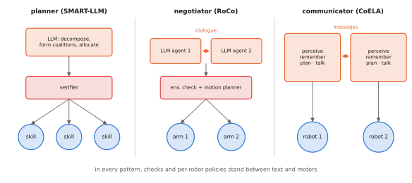

# 14.3 Language-Mediated Coordination

Large language and vision-language models can read a team's situation described in text, reason about who should do what, and write plans, task assignments or messages. Several research systems use them as the team's planner, as a negotiator between robots, or as each robot's "mind" that converses with the others. This section describes these patterns and what they have shown. It also covers their failure modes, and how to combine them with the verifiable allocation and safety layers of the rest of the book.

## What is it?

!!! definition "Language-mediated coordination"
    A team coordinates **through language** when the information that determines who does what is represented, at least in part, as natural-language text produced or consumed by a language model: a task decomposition, an assignment, a message to a teammate, a summary of a robot's state. The language model acts as a **planner** (one model plans for all), a **negotiator** (models argue and agree), or a **communicator** (each robot's model decides what to say and how to act on what it hears).

## Why does it matter?

Multi-robot coordination has always required designers to anticipate tasks and encode them: task types, capabilities, cost functions, message formats. Instructions like "clear the loading bay, but the drone should check the shelves first" do not fit a fixed schema. Language models can turn them into structured plans, explain those plans to people, and adapt to new task types without new code. They also bring the well-known failure modes of LLMs — hallucination, inconsistency, poor arithmetic and spatial reasoning ([5.4](../05-vlms/spatial.md)) — into a setting where errors become collisions or deadlocks.

## How does it work?

### Three patterns

<figure markdown="span">
  
  <figcaption markdown="span">Three ways language models coordinate a team. Planner: one model receives the instruction and a text description of all robots and writes a plan or assignment (SMART-LLM). Negotiator: one model per robot proposes and critiques plans in dialogue until they agree, with an environment check before execution (RoCo). Communicator: each robot's model chooses messages to send and actions to take from its own observations and the messages it receives (CoELA). In every pattern, a verifier and per-robot policies sit between the text and the motors.</figcaption>
</figure>

- **Central planner.** SMART-LLM (Kannan et al., 2023) uses few-shot, programmatic prompts to have an LLM decompose an instruction into subtasks, form coalitions according to robot skills, and allocate subtasks, producing a multi-robot plan over a library of skills. The language model replaces hand-written allocation logic; the skills stay classical.
- **Dialogue and negotiation.** RoCo (Mandi, Jain & Song, 2023) gives each robot arm an LLM agent that discusses a plan with the others, proposes sub-task plans and waypoints, and receives feedback from environment checks (collisions, invalid moves) before execution. A motion planner turns the agreed waypoints into trajectories.
- **Decentralised communicators.** CoELA (Zhang et al., 2023) builds cooperative embodied agents from modules — perception, memory, communication, planning, execution — with an LLM deciding what to communicate and what to do. Co-NavGPT (Yu et al., 2023) uses a VLM to assign exploration frontiers to multiple robots from a merged semantic map.
- **Centralised or decentralised?** Chen et al. (2023) compared centralised, decentralised and two hybrid communication frameworks for LLM-based multi-robot planning. A hybrid framework achieved better success rates on all their tasks and scaled better to more robots; token efficiency, the other axis they measured, also depended on the structure.

### Making language coordination reliable

1. **Ground the text in state.** Generate the team description from the world model (positions, capabilities, task status), not from memory of previous turns.
2. **Constrain the output format** (JSON assignments, calls to a skill API) and **verify** it: every robot assigned at most one task, every task feasible for the robot's capabilities, no duplicated claims, plans that respect the map. Re-prompt or fall back to a classical allocator on failure.
3. **Keep the optimisation classical where it matters.** Use the language model to produce the *problem* — tasks, costs, constraints — and an exact allocator ([14.4](task-allocation.md)) to *solve* it.
4. **Bound authority.** Language-level decisions become per-robot instructions for VLAs or skills, which pass through the safety layers of Chapters 12–13.

### What language buys, and what it costs

| | Gains | Costs |
|---|---|---|
| expressiveness | new task types, constraints and preferences without code | ambiguity; plans that sound right and are wrong |
| interpretability | people can read and correct plans and messages | messages may not reflect what the model will actually do |
| generalisation | world knowledge about objects and tasks | weak numerical and spatial reasoning |
| integration | instructions for per-robot VLAs are already text | token cost and latency grow with team size and dialogue length |

## Implementation: LLM proposes, verifier disposes

```python
import json

def verify_assignment(text, robots, tasks, can_do):
    """Parse an LLM's JSON assignment {robot: task}; return (assignment, errors). The LLM never acts directly."""
    try:
        a = json.loads(text)
    except json.JSONDecodeError as e:
        return None, [f"not JSON: {e}"]
    errors = []
    for r, t in a.items():
        if r not in robots:
            errors.append(f"unknown robot {r}")
        elif t not in tasks:
            errors.append(f"unknown task {t} for {r}")
        elif not can_do(r, t):
            errors.append(f"{r} cannot do {t}")
    claimed = [t for t in a.values() if t in tasks]
    errors += [f"task {t} assigned twice" for t in set(claimed) if claimed.count(t) > 1]
    return (a if not errors else None), errors

# use: errors go back to the model as feedback ("robot uav1 cannot do pick_crate"), or the classical allocator takes over
```

## Limitations

- **Evaluations are mostly in simulation** and with few robots; evidence for reliability at scale and under real communication constraints is limited.
- **Latency and cost**: dialogue-based coordination can take many model calls per decision, which is too slow for dynamic tasks.
- **Consistency**: the same situation can yield different plans; verification and fallback logic are mandatory.

## Why it matters for VLAs and robots

Language is the natural interface between team-level reasoning and per-robot VLAs: the plan that a language model writes for the team can be decomposed into the instructions each robot's VLA was trained to follow. The research questions — how to make that loop reliable, efficient and grounded in real perception and communication — are among the most open in multi-robot systems ([Chapter 15](../15-research/index.md)).
