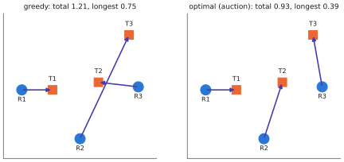

# 14.4 Task Allocation with Heterogeneous Robots

Most practical multi-robot systems coordinate at the task level: decide which robot does which task, then let each robot do its task alone. This section formalises multi-robot task allocation (MRTA), solves the basic case exactly with the Hungarian method and the auction algorithm, extends it to heterogeneous robots and decentralised execution, and shows where vision-language models fit. They supply the *problem* — which tasks exist, what they require, how much they cost for whom — while classical algorithms supply the *solution*.

## What is it?

!!! definition "Multi-robot task allocation"
    Given robots $i=1..N$, tasks $j=1..M$ and a cost $c_{ij}$ for robot $i$ doing task $j$ (travel time, energy, or $+\infty$ if robot $i$ lacks the capability), the single-task, single-robot, instantaneous assignment problem is the integer program

    $$
    \min_{x_{ij}\in\{0,1\}}\ \sum_{i,j}c_{ij}x_{ij}\quad\text{s.t.}\quad\sum_j x_{ij}\le1\ \ \forall i,\qquad\sum_i x_{ij}=1\ \ \forall j\ \ (\text{if }M\le N).
    $$

    Gerkey and Matarić's taxonomy classifies MRTA problems by **single-task (ST) vs multi-task (MT) robots**, **single-robot (SR) vs multi-robot (MR) tasks** and **instantaneous (IA) vs time-extended (TA) assignment**. The problem above is ST-SR-IA, the one case solvable exactly in polynomial time.

## Why does it matter?

Allocation is how a team avoids the duplicated and missed work of independent robots ([14.1](dec-pomdp.md)). It also decouples learning from coordination: once robot $i$ knows its task, a single-robot VLA can execute it with an ordinary instruction ("go to the blue crate"), without being trained on team data. For heterogeneous teams — arms and mobile bases, ground robots and drones — capability constraints in $c_{ij}$ route each task to robots that can do it.

## How does it work?

### Exact and approximate centralised allocation

- **Hungarian method** (Kuhn, 1955): exact, $O(n^3)$, the standard centralised solver.
- **Auction algorithm** (Bertsekas, 1988): robots bid for tasks at current prices. Each unassigned robot $i$ finds its best task $j^\ast=\arg\max_j(-c_{ij}-p_j)$ and raises its price by the margin over its second-best option plus $\varepsilon$:

    $$
    p_{j^\ast}\leftarrow p_{j^\ast}+\big(v_{ij^\ast}-v_{ij^{(2)}}\big)+\varepsilon,\qquad v_{ij}=-c_{ij}-p_j .
    $$

    The previous owner of $j^\ast$ is outbid and bids again. The result is within $N\varepsilon$ of optimal. Its appeal for robots: bids are small messages, and the computation is naturally distributed.
- **Greedy** (assign the cheapest remaining pair repeatedly): fast and simple, but can be arbitrarily worse than optimal on adversarial instances, and typically a few percent worse on random ones.

<figure markdown="span">
  
  <figcaption markdown="span">Allocation in the depot (computed). Left: greedy assignment takes the single cheapest pair first and leaves another robot a long trip. Right: the optimal assignment (auction algorithm, identical to brute force here) minimises total travel. With a makespan objective (minimise the longest trip) the optimum can differ again, so the objective is a design choice.</figcaption>
</figure>

### Objectives

Minimising the **sum** of costs saves total energy; minimising the **makespan** (the largest cost) finishes the mission soonest. The latter is a bottleneck assignment problem, also solvable exactly. Time-extended problems (each robot does a sequence of tasks) become multi-robot routing, which is NP-hard. In practice they are solved with heuristics, sequential auctions or optimisation solvers.

### Decentralised allocation

Without a central computer, robots must agree on the assignment by communicating. **Consensus-Based Bundle Algorithm** (CBBA, Choi, Brunet & How, 2009) alternates two phases: each robot greedily builds a bundle of tasks it bids on, then robots exchange bids with neighbours and resolve conflicts by consensus on the highest bids. It converges to a conflict-free assignment with a guaranteed fraction of the optimal score, and is robust to inconsistent information among robots and to changes in network topology. Simpler variants run the auction algorithm with prices shared by broadcast. Under message loss, conflicts — two robots believing they own the same task — must be detected and resolved when messages get through. Lab 16 measures how often this happens.

### Heterogeneous robots and capabilities

Represent capabilities as sets (e.g. {fly, camera}, {drive, gripper}) and task requirements likewise; set $c_{ij}=\infty$ when requirements are not a subset of capabilities. Tasks needing several robots at once (MR tasks, e.g. carrying a large object) require coalition formation. Language models have been used to decompose instructions and form such coalitions ([14.3](language-coordination.md)).

### Where vision-language models fit

1. **Task extraction**: turn an instruction and images into a task list ("three crates to inspect, one blocked aisle").
2. **Capability matching**: decide which robot types can do which task, from task descriptions.
3. **Cost estimation**: predict travel or effort from images and maps when no metric model exists.
4. **Per-robot execution**: each robot's VLA receives its assigned task as an instruction.

Steps 1–3 produce $c_{ij}$; a classical allocator solves the problem; step 4 executes. Each boundary is checkable.

## Implementation: the auction algorithm

```python
import numpy as np

def auction(cost, eps=1e-3):
    """Min-cost assignment of n robots to m >= n tasks; within n*eps of optimal."""
    benefit = -np.asarray(cost, float)
    n, m = benefit.shape
    price, owner, task = np.zeros(m), -np.ones(m, int), -np.ones(n, int)
    while (task < 0).any():
        i = int(np.flatnonzero(task < 0)[0])          # an unassigned robot bids
        v = benefit[i] - price
        j = int(np.argmax(v))
        second = np.partition(v, -2)[-2]
        price[j] += v[j] - second + eps               # outbid by the margin over the second-best option
        if owner[j] >= 0:
            task[owner[j]] = -1                       # the previous owner must bid again
        owner[j], task[i] = i, j
    return task
```

The course implementation, with greedy and brute-force baselines, is `vlacourse.teams`.

!!! lab "Lab 16"
    Allocates depot tasks among several copies of the toy VLA with greedy, auction and decentralised auction over a lossy channel; compares duplicated targets, total travel, makespan and messages with independent robots.

## Limitations

- **Static costs**: real costs change as robots move and tasks appear; re-allocation must balance responsiveness with stability (robots should not swap tasks constantly).
- **Uncertain execution**: an allocated task may fail; allocation should use success probabilities or re-allocate on failure.
- **Interactions inside tasks** (shared corridors, collisions) are not captured by $c_{ij}$; they need separation constraints ([12.4](../12-embodied/interfaces.md)) or joint planning.

## Why it matters for VLAs and robots

Task allocation is the most reliable bridge between team-level decisions and single-robot VLAs. It lets today's VLAs, trained on single-robot data, work as members of a team. Making allocation *perception-aware*, with costs and tasks from vision-language models, and robust to communication failures, is an active research direction ([Chapter 15](../15-research/index.md)).
