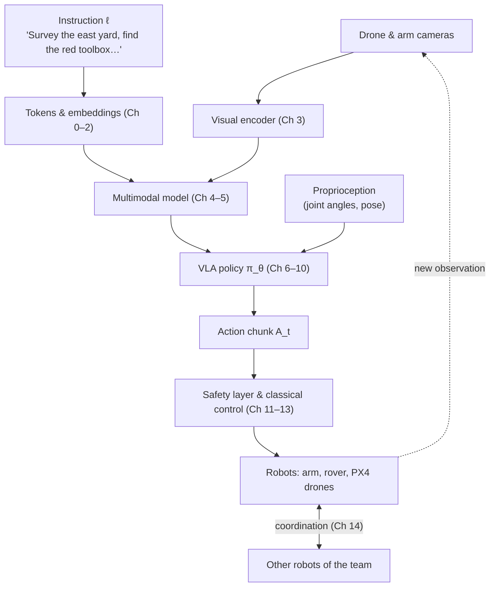

# Vision-Language-Action Models

### From first principles to multi-robot systems and UAVs

This book teaches **Vision-Language-Action (VLA) models** — neural networks that take camera images and a natural-language instruction and output robot actions — starting from the definition of a tensor and ending at open research problems in multi-robot systems and aerial robotics.

It is not a tutorial on calling an API. The objective is that, after finishing it, you can open a new VLA paper, understand every block in its architecture figure, explain *why* each design decision was made, re-implement the system, find its weak points, and design an experiment that improves on it — in particular for **UAVs** and **multi-robot systems (MRS)**.

!!! abstract "What a VLA is, in one equation"
    A VLA is a conditional generative model of robot actions,

    $$
    \mathbf{A}_t \sim \pi_\theta\!\left(\,\cdot \mid \mathbf{o}_t,\ \ell\,\right),
    $$

    where $\mathbf{o}_t$ is what the robot observes at time $t$ (images, joint angles, …), $\ell$ is the language instruction, $\theta$ are the network parameters and $\mathbf{A}_t$ is a short sequence of future actions. Everything in this book exists to explain how $\pi_\theta$ is built, how $\theta$ is learned, how $\mathbf{A}_t$ is produced fast enough to control a robot, and what must stand between $\mathbf{A}_t$ and the actuators. The full definition is in [Chapter 8](chapters/08-vla/index.md).

## The running example: the depot

Every chapter returns to the same system so that concepts accumulate instead of appearing in isolation. A logistics depot has an outdoor yard, a loading bay, storage racks and an inspection station. A **heterogeneous robot team** works there: a mobile manipulator (a wheeled base with a 7-DoF arm) and two quadrotors running PX4. An operator types:

> *"Survey the east yard, find the red toolbox, and bring it to the inspection station."*

The instruction is tokenized in [Chapter 0](chapters/00-foundations/tokens.md), its words attend to each other in [Chapter 2](chapters/02-transformers/attention.md), the drone image is cut into patches in Chapter 3, "red toolbox" is grounded in the image in Chapter 4, a VLM answers *where is it?* in Chapter 5, the arm's grasp is produced as an action chunk in Chapter 8, the latency of all this on a companion computer is budgeted in Chapter 11, the drones' part of the job is mapped onto PX4 in Chapter 13, and the whole team's division of labour is the subject of Chapter 14.

## How the book is organised

| Part | Chapters | What you will be able to do |
|---|---|---|
| **I — Foundations** | [0](chapters/00-foundations/index.md), [1](chapters/01-multimodal-intro/index.md), [2](chapters/02-transformers/index.md) | Derive and implement a transformer language model from scratch; reason about its memory, compute and latency. |
| **II — Seeing and reading** | [3](chapters/03-vision/index.md), [4](chapters/04-alignment/index.md), [5](chapters/05-vlms/index.md) | Build image encoders, align images and text, and assemble a vision-language model. |
| **III — Acting** | [6](chapters/06-generative/index.md), [7](chapters/07-decision-making/index.md), [8](chapters/08-vla/index.md), [9](chapters/09-training/index.md), [10](chapters/10-case-studies/index.md) | Model multimodal action distributions, learn policies from demonstrations, and dissect real VLAs (RT-2, OpenVLA, π0, …). |
| **IV — Deploying** | [11](chapters/11-deployment/index.md), [12](chapters/12-embodied/index.md), [13](chapters/13-uavs/index.md) | Run a VLA inside a real robot stack with a safety architecture, including PX4 UAVs. |
| **V — Research** | [14](chapters/14-multi-robot/index.md), [15](chapters/15-research/index.md) | Formulate and attack open problems in multi-robot VLAs. |
| Appendices | [MuJoCo](appendix/mujoco.md), [ROS 2 + PX4 SITL](appendix/ros2-px4.md), [Notation](appendix/notation.md), [Glossary](glossary.md), [Papers](papers.md) | Reference material. |

Two chapters were inserted before the VLA material because VLAs cannot be understood without them: [Chapter 6](chapters/06-generative/index.md) (generative models — diffusion and flow matching are how most modern VLAs produce continuous actions) and [Chapter 7](chapters/07-decision-making/index.md) (imitation and reinforcement learning — the theory of learning a policy from data).

### Spiral structure

Chapter 0 gives a first, deliberately incomplete pass over every core idea (tokens, embeddings, attention, transformers, vision and multimodal models). Later chapters return to each idea in depth. When a concept is used before its deep-dive, it links to the place where it is first defined; when it is re-used later, it links back. Follow the links freely — the book is meant to be read as a graph as much as a sequence.

### Every section answers the same questions

1. **What is it?** — a precise definition.
2. **Why does it exist?** — the problem it solves and what came before.
3. **How does it work?** — intuition first.
4. **What is the mathematics?** — every symbol, tensor and dimension defined.
5. **How is it implemented?** — shape-annotated PyTorch.
6. **What are its limitations?**
7. **Why does it matter for VLAs and robots?**

### Reading conventions

!!! definition "Definition boxes"
    Formal definitions live in boxes like this one. Other pages link to them.

!!! robot "Robotics boxes"
    Connect the current idea to the depot scenario, to UAVs or to multi-robot systems.

!!! lab "Lab boxes"
    Point to the Jupyter notebook in `labs/` where you implement the idea and inspect its internals.

Tensor shapes are written in parentheses next to code, e.g. `# (B, T, d)`; the symbols are fixed throughout the book and listed in the [notation appendix](appendix/notation.md). Each chapter ends with an interactive quiz (click an option to get feedback) and a short list of **reading assignments** drawn from the curated [paper list](papers.md).

## Labs

The labs are Jupyter notebooks in `labs/`. They build every mechanism by hand before using a library, and they print the intermediate tensors so you can see what the model is doing. See the repository `README.md` for setup (`uv sync`, then `uv run jupyter lab`). Each lab states its runtime and hardware requirements; all labs in Parts I–III run on a laptop CPU in minutes, and those that download pretrained models state their memory requirements.
